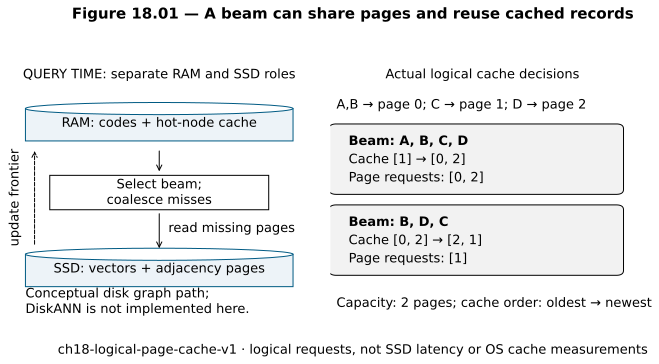
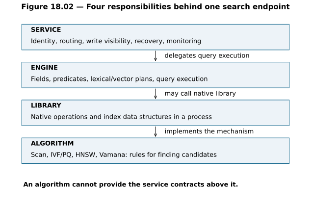
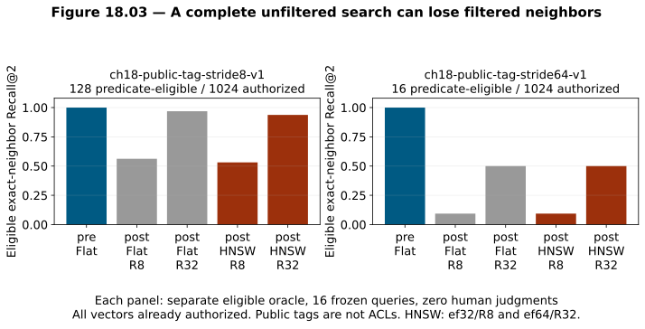
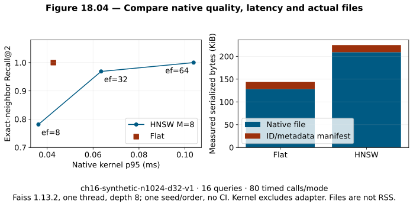

# Chapter 18 — Disk ANN, benchmarks, and vector databases [ADVANCED / PRODUCTION]

Chapter 17 found useful paths through a proximity graph, and also found reasons to keep the exact route. Its best tested large synthetic graph still missed one exact-neighbor membership; on twelve judged support vectors, geometric parity did not improve relevance recall. We now have enough mechanism knowledge to ask a different question: **what must surround an index before it becomes a reliable way to access knowledge?**

Two limitations motivate this chapter. First, the full vectors and graph might exceed the available RAM even when a graph walk is efficient. Second, an index can answer a numerical query correctly while its application serves stale sources, searches the wrong tenant, loses acknowledged writes, or reports a misleading benchmark. Disk-oriented search addresses the first limitation. Explicit library, engine and service boundaries address the second.

Read Chapters [15](chapter-15-exact-knn-to-trees-and-hashing.md), [16](chapter-16-ivf-quantization-and-compressed-vectors.md), [17](chapter-17-proximity-graphs-nsw-and-hnsw.md), and Chapter [3's data/measurement vocabulary](chapter-03-data-algorithms-and-measurements-needed-for-search.md) first. The running project continues from the remediated [V4](../projects/V4/README.md), common [sample envelope](../observability/SAMPLE_ENVELOPE.md) and content-bound judgments. This chapter closes **Part IV**. Its cumulative assessment is required, separately from the chapter lab.

The [native adapter](../projects/V4/native_ch18.py) compares exact and approximate indexes using installed **Faiss 1.13.2 and NumPy 2.4.2**. It does not implement DiskANN, install a vector database, or run generation. Before inspecting the page/cache reference, independently construct [lab A0](../labs/chapter-18/LAB.md#a0-construct-page-coalescing-and-cache-state). The final [solutions](../solutions/chapter-18-solutions.md) remain separate.

**Workload identities:** native comparisons reuse `ch16-synthetic-n1024-d32-v1` and `ch13-stress-probes-v1`. Public-tag experiments introduce `ch18-public-tag-stride8-v1` and `ch18-public-tag-stride64-v1`; the bounded cache example is `ch18-logical-page-cache-v1`. All are in the [registry](../evaluation/WORKLOAD_REGISTRY.md). Different predicates define different exact-oracle populations. Historical results and their measurement boundaries remain intact.

## 1. Start with a capacity and responsibility budget

An index selection begins with a workload, not a product list. Describe the number of searchable items, vector dimensions, metric, query distribution, required candidate depth, permission boundaries, metadata predicates, update/delete frequency and freshness requirement. Add available RAM, storage, build time and request latency. The same index can be suitable for one of these combinations and unsuitable for another.

Consider a hypothetical ten-million-item corpus with 768 float32 coordinates per item. Coordinate payload alone is

`10,000,000 · 768 · 4 = 30,720,000,000 bytes`, or **30.72 decimal GB**.

Suppose its graph has an average of 32 directed adjacency entries per item across all layers, each stored as a four-byte internal ID. That adds `1.28 GB`, before offsets, levels, external IDs, scopes, allocators or query buffers. This example assumes a measured average degree; it does not assert that every HNSW vertex has degree 32. Three complete replicas of the vector-plus-edge payload already need `96 GB` across replicas. Original documents, a query encoder, caches and operating-system memory are additional.

Saving this 32 GB payload into a file does not make it searchable within an 8 GB RAM budget. A loader might immediately reconstruct the whole index in memory. A memory-mapped file lets the operating system load pages on demand, but random graph visits can then cause page faults and storage reads. A practical design must control which data is resident and how dependent reads occur. Chapter 16's compression, smaller eligible partitions, a disk-oriented index, or an explicitly measured exact scan are alternative responses.

A second budget is responsibility. A numerical nearest-neighbor routine does not automatically supply stable source IDs, metadata planning, authenticated access, durable updates, backups, consistency or an incident trace. Name the owner of each responsibility. A local prototype often concentrates them in one process; concentrating ownership does not make the responsibilities disappear.

## 2. Exact search also has an implementation, not just a formula

The exact oracle remains the first performance comparator. Our earlier Python scorer made every multiplication and heap operation visible. A native implementation can put float32 vectors in contiguous storage, use SIMD instructions to operate on several coordinates at once, exploit caches, and compute many query–document comparisons in a matrix-oriented call. It remains exhaustive under its metric. These changes can make exact search competitive long after an unoptimized loop has become slow.

**SIMD** means one instruction performs the same operation over multiple numeric lanes. **Memory bandwidth** is the rate at which bytes can be supplied to computation. A sequential scan can use bandwidth efficiently; a graph can perform fewer distances yet incur irregular memory access, heap work and pointer/ID lookup. Neither counting distance operations nor naming an index predicts elapsed time by itself.

The distinction also matters for precision. An exact float32 implementation is exhaustive over stored float32 coordinates, but it need not produce bit-identical scores to float64 arithmetic. Equal or nearly equal scores may follow a different tie order. Record dtype, metric, normalization, accumulation and tie policies alongside the model revision. An encoder/model mismatch is more serious than rounding, but both can invalidate a poorly specified oracle comparison.

In this chapter we cast query and indexed coordinates to float32, call the native index for a bounded pool, then accumulate original-coordinate squared L2 in float64 within that returned pool and break ties by source ID. This is a canonicalization/refinement boundary, not a newly trained reranker. It cannot recover an item outside the native pool. Every frozen Flat top two agrees with an independent exhaustive oracle and the preceding chapter's observed oracle IDs. That empirical agreement does not prove global tie completeness for an arbitrary pool boundary.

## 3. A disk graph must reduce dependent I/O

An SSD stores and retrieves blocks rather than doing an in-memory pointer dereference. A **page** or block is a unit transferred into memory. A node record can include its vector and outgoing adjacency; several small records can share a page. A **random read** accesses a block chosen by its address rather than continuing a sequential stream. Read latency, storage bandwidth, queue depth and cache residency now enter the search budget.

Imagine 100 required reads with an assumed latency of `.15 ms` each. If they must occur serially, their latency contribution is `15 ms`. If all addresses are already known and eight reads can proceed together, thirteen batches have an idealized latency near `1.95 ms`. This is a **hypothetical scheduling calculation**, not a measured SSD result. A graph discovers many addresses only after earlier reads complete, so that ideal batching assumption often fails. Queueing and contention can also increase latency. Reducing dependent rounds matters separately from reducing total read count.

The original [DiskANN paper](https://proceedings.neurips.cc/paper/2019/hash/09853c7fb1d3f8ee67a61b6bf4a7f8e6-Abstract.html) combines a navigable graph, compressed vectors in RAM, full vectors and graph records on SSD, and caching/batched reads. Its construction algorithm, Vamana, seeks useful navigation links. The durable lesson is to coordinate **navigation, representation and storage layout**; the paper's billion-vector measurements are a separate hardware/dataset workload, not estimates for our computer.

### A search path with two representations

At index time, build a navigation graph, create compressed representations and lay out full records. At query time, approximate scores over RAM-resident codes help prioritize promising vertices. Select a small **beam** of pending vertices, satisfy cached records from RAM and request missing pages. Full records supply outgoing neighbors and more accurate distances. Update the frontier and repeat until the declared stopping rule or budget applies. Return candidates after the applicable original-vector scoring/refinement boundary.

Here a beam is a set of expansions whose records can be requested together; it is not the same parameter as HNSW's retained `efSearch` pool. Wider beams can expose parallelism while increasing reads and work. A better code score cannot create a missing path. A full-vector refinement cannot recover an item that navigation never reached. These are the same kinds of first-loss boundaries we learned in Chapters 16–17, now with I/O between stages.

### Vamana's pruning intuition

As a representative construction rule, select a nearby candidate `s` for new center `x`, then prune another candidate `c` when

`α · distance(s,c) ≤ distance(x,c)`.

The distances here are ordinary Euclidean distances. With `x=0`, `s=1`, `c=3` on a line, `α=1` prunes c because `2≤3`; `α=2` retains it because `4>3`. A larger α can preserve links that are removed by more aggressive pruning, subject to the degree cap and candidate pool. This can shorten useful routes, but does not certify every query's path. If implementing the comparison with squared distances, square α as well: `α²d²(s,c)≤d²(x,c)`. Multiplying squared distance by unsquared α changes the rule.

The full Vamana build includes graph search, candidate-set updates, reciprocal connection handling and construction passes. This chapter explains the mechanism; the bounded learner exercise builds page/cache planning, not an incomplete implementation labeled “DiskANN.” Different disk-search families and current implementations have additional policies. Read the original algorithms only after the graph and pruning prerequisites.

### Cache state is part of the workload

Cache hot node records or pages to avoid some reads. A warm application cache, warm operating-system cache, cold application cache and cold device experiment are different states. Restarting a Python object does not necessarily clear the OS page cache. Record what was reset and what was not. Do not describe a warm deserialize time as a cold disk-search latency.

Our bounded example has A,B on page 0, C on page 1 and D on page 2. The two-page cache initially contains `[1]`, in oldest-to-newest order. A beam `[A,B,C,D]` sees two nodes missing the same page, one cached page and one other missing page. Request pages `[0,2]` once each. After touching hits and completing requests in encounter order, evict page 1 and keep `[0,2]`. The next beam `[B,D,C]` requests only `[1]`, then keeps `[2,1]`. An actual asynchronous system could complete reads in a different order; this example fixes the completion order for reproducibility.

**Figure 18.01 — A beam can share pages and reuse cached records.** The left side separates conceptual RAM and SSD roles; the right side is computed from `ch18-logical-page-cache-v1` and the actual bounded cache code. Page requests are logical counts. No SSD access, OS-cache reset or DiskANN query is timed. [Editable source](../visuals/chapter-18/plot-18-01-02-boundaries-and-pages.py); [logical record](../projects/V4/chapter-18-experiment.json).

*Alt text:* RAM and SSD serve different search roles; coalescing two nodes on one missing page produces one request, and cached records can avoid later requests.

Now attempt [lab A0](../labs/chapter-18/LAB.md#a0-construct-page-coalescing-and-cache-state) before reading [the reference](../projects/V4/storage_ch18.py). Construct residency classification, unique page requests and LRU updates on a fresh fixture. A cache hit is not a relevant-evidence hit, and a page request count is not retrieval recall.

## 4. Partition, quantize and rescore: another portfolio

Some indexes navigate by graph edges; others prune partitions and score compact codes. The [ScaNN algorithm guide](https://github.com/google-research/google-research/blob/master/scann/docs/algorithms.md) describes optional partitioning, scoring and optional rescoring. Match those stages to Chapter 16: choose regions, score an approximate representation, then recompute a bounded pool more accurately. Partition count, regions searched and rescoring depth control different losses and costs.

**Anisotropic quantization** makes some reconstruction-error directions more expensive than others, according to the scoring objective. A simple example shows why this can matter. Let document `x=(1,0)` and query `q=(1,0)`. Reconstructions `(1,.2)` and `(.8,0)` both have squared reconstruction error `.04`. Their query inner products are `1` and `.8`. Equal Euclidean reconstruction error has produced unequal query-score error. In general, if `e=x−x̂`, the inner-product error is `q·e`, which depends on error direction as well as magnitude. This example is unnormalized arithmetic, not a promise that reconstructed vectors remain unit length.

[Guo and colleagues' research](https://arxiv.org/abs/1908.10396) motivates scoring-aware quantization. It does not eliminate partition or shortlist misses and does not improve a model's evidence representation automatically. This chapter runs neither ScaNN training nor a ScaNN benchmark; its family is included so a learner can recognize the mechanism and ask which stage was measured.

| Family | Main shortcut | Extra state/cost | Necessary diagnostic |
|---|---|---|---|
| Full-vector scan | Efficient exhaustive computation | Original vectors, bandwidth | Declared precision/ties and exact rank |
| IVF-Flat | Probe a subset of coarse lists | Centroids, assignments, training | Oracle-list coverage; all-probe parity |
| IVF-PQ / partitioned codes | Restrict lists and approximate distances | Codebooks/codes, optional originals | Separate region, code-rank and refinement-pool loss |
| HNSW | Follow a bounded graph frontier | Levels, adjacency, build work | Discovery/retention loss and outgoing reachability |
| Disk-oriented graph | Coordinate navigation with RAM/SSD | Codes, page layout, caches, I/O scheduling | Read count, dependent rounds, residency and quality |
| Partition/quantize/rescore | Combine several staged shortcuts | Partition/scoring models and bounded rescoring | Each actual pool and its compatible exact oracle |

This is a portfolio of trade-offs. An optimized scan can beat a poorly configured ANN index. A compressed or disk-oriented index can make a larger corpus feasible while adding latency or losing neighbors. Choose against declared quality, memory, update and service constraints.

## 5. Algorithm, library, engine and service are different responsibilities

An **algorithm** defines operations and invariants: scan all eligible vectors, probe lists, evaluate compressed codes, or traverse a bounded graph. A **library** implements those operations inside a program. An **engine** plans and executes searches over organized fields/indexes. A **database or search service** owns additional data and operational contracts: IDs, writes, visibility, metadata, routing, recovery, access control and monitoring. Real products combine these layers in different ways; the layers are not mutually exclusive product boxes.

**Figure 18.02 — Four responsibilities behind one search endpoint.** The arrows indicate delegation/implementation relationships, not a new running data pipeline. A service may call an engine or directly use a library. No lower layer automatically supplies all the responsibilities above it. [Editable source](../visuals/chapter-18/plot-18-01-02-boundaries-and-pages.py).

*Alt text:* A search endpoint combines several responsibility layers; an index algorithm alone does not provide authenticated durable serving.

The [Faiss index map](https://github.com/facebookresearch/faiss/wiki/Faiss-indexes) illustrates a library portfolio: Flat L2/IP, IVF-Flat, IVF-PQ and HNSW variants. `IndexHNSWFlat` means HNSW navigation backed by full-vector storage; the word Flat in this class name does not make the graph search exhaustive. `IndexPQ` can scan every compressed code yet still have approximate original-vector distances. Specify both candidate enumeration and representation.

The following examples locate responsibilities; they are not recommendations or a current feature-ranking chart. Primary documentation was checked on **2026-10-12**. Deployment mode and version still matter.

| Category or combination | Examples and primary documentation | First question to ask |
|---|---|---|
| In-process index library | [Faiss](https://github.com/facebookresearch/faiss), [ScaNN](https://github.com/google-research/google-research/tree/master/scann) | Who owns IDs, metadata, updates, eligibility and recovery around the numerical index? |
| Vector capability within a relational database | [pgvector in PostgreSQL](https://github.com/pgvector/pgvector) | Which physical plan executes predicates and ANN, and what database visibility/durability contract applies? |
| Search/serving engines with vector retrieval | [Elasticsearch](https://www.elastic.co/docs/solutions/search/vector/knn), [OpenSearch](https://docs.opensearch.org/latest/vector-search/), [Vespa](https://docs.vespa.ai/en/querying/nearest-neighbor-search-guide.html) | How do fielded/lexical/vector plans, filters and serving topology interact? |
| Systems centered on vector/data search | [Qdrant](https://github.com/qdrant/qdrant), [Milvus](https://github.com/milvus-io/milvus), [Weaviate](https://docs.weaviate.io/weaviate), [Pinecone](https://docs.pinecone.io/guides/get-started/overview) | What does the selected deployment promise about query visibility, isolation, recovery and observability? |
| Local/embedded options, also with other deployment modes | [Chroma](https://github.com/chroma-core/chroma), [LanceDB](https://github.com/lancedb/lancedb) | What persists locally, what remains an application duty, and what changes in server/cloud mode? |

Installing a client SDK does not tell you whether the database is embedded or remote. A collection or namespace name organizes data; it is not, by itself, authorization. A database's filter API may remove unwanted results without proving that restricted vectors were never scored or traversed. Under this book's stronger eligibility boundary, examine the actual execution/routing contract or use a trusted eligible partition. The public-tag experiment below is deliberately separate from this security requirement.

## 6. Persistence is one contract; search visibility is another

Distinguish at least four moments for a write: the application accepts it; a durable record exists; an index makes it searchable; required replicas can serve it. Their relationship depends on the system. An acknowledgment must state which moment it represents. **Durability** means an acknowledged state survives a specified failure. **Visibility** means a specified read/search can observe the change. **Consistency** describes relationships between observations across reads/replicas and writes. Replication alone does not prove immediate visibility or durable acknowledgment.

For an asynchronous vector build, “accepted” can precede “searchable.” Measure ingestion throughput as accepted writes/s and newly searchable items/s separately, with a visibility-lag distribution. Deletes need the analogous source/policy-change-to-exclusion measurement. A new source version also needs compatible vector and locator identity before context fetch; otherwise an old vector can retrieve new text under an old judgment.

A snapshot must bind vector bytes to external IDs, source/model/metric, normalization, permissions and index configuration. The [native adapter](../projects/V4/native_ch18.py) saves native bytes plus an ID/version manifest. Reload verifies a caller-provided trusted manifest digest, current source/vector/eligible roster, model, dtype-derived vector digest, payload checksum and software version **before native deserialization**. Updating a file and its own checksum is not independent verification. Faiss's [I/O documentation](https://github.com/facebookresearch/faiss/wiki/Index-IO,-cloning-and-hyper-parameter-tuning) warns that native loading does not itself establish trusted/correct input. Use trusted artifacts; a checksum is not a substitute for an authenticated provenance path.

Our snapshot is a reproducible local index artifact. It is not a write-ahead log, transaction, live backup service or tested crash-recovery system. A useful restore test must restore the ID/model/scope map and representative query results, not merely open a file. In production, restore source/deletion/policy state together with compatible indexes and invalidate stale caches.

Vectors, adjacency, caches, backups and exports retain the privacy, licensing and retention duties of their source data. A portable format does not grant redistribution rights. Deletion policy must account for older snapshots and cached candidate/context records as well as the current index. The checked bundles here contain the fictional corpus or registered synthetic vectors; model weights are not committed.

An **insert** adds an item, an **upsert** inserts or replaces a stable logical ID, and a **delete** excludes it under a defined lifecycle. Different index classes support different physical operations. Faiss's current index guide documents removal for Flat, which changes ordinal numbering, and no removal operation for its HNSW index; our pinned HNSW deletion test confirms that limitation. A database can expose a delete API using tombstones, rebuilds or other structures around an index. Its application-level operation is not proof of immediate physical erasure or preserved graph connectivity.

This adapter treats its sorted ID map and vector matrix as a frozen build. It does not silently mutate them after native insertion/deletion. A changed build gets a new trusted identity. Durable updates and deletion propagation are developed later, after ingestion and metadata; here the goal is to know which guarantee has been demonstrated.

## 7. Filtering changes the oracle, not just the result count

Let `A` be the authenticated authorized roster and `P` the items matching a task predicate. The correct filtered geometric oracle is `TopK(A ∩ P)`. It is generally different from `filter_P(TopR(A))`. A nearer item in A can consume a shortlist slot even though it cannot answer this constrained task. Returning fewer than k items is **underfill**; returning k items does not prove that the best eligible k were found.

Three conceptual plans are:

1. Establish an eligible/predicate roster first, then run exact or ANN over that population.
2. Integrate predicate decisions into traversal/enumeration while preserving the required eligibility boundary.
3. Search an already authorized population for a fixed depth R, then apply a **nonsecurity** task predicate.

The third plan is our diagnostic foil. It can reveal shortlist loss without violating authorization because every indexed synthetic vector is public and authorized. It would not satisfy an ACL constraint that prohibits scoring restricted vectors. No permission grant is inferred from the predicate or from a successful benchmark.

If each candidate independently matched a predicate with probability s, expected survivors would be `R·s`. With `s=1/8` and `R=8`, that expectation is one survivor, short of k=2. Choosing `R≈k/s` only targets an expectation under that independence model; similarity neighborhoods and metadata are often correlated. It does not guarantee adequate results or eligible-oracle recall. Measure both underfill and quality at the actual predicate distribution.

SQL expresses a logical need but does not fix its physical plan. For example, `WHERE category_id=7 ORDER BY distance LIMIT 2` can be served by a selective metadata plan plus exact distance computation or by an approximate index with later filtering. Inspect the plan and measure it. The [pgvector filtering guidance](https://github.com/pgvector/pgvector#filtering) discusses selective metadata indexes, partial indexes/partitions and bounded iterative scans. Iterating until enough results appear can reduce underfill while adding work; it does not make the approximate candidate set universally exact or establish before-scoring tenant isolation.

### Controlled public-tag experiment

Assign a public tag to synthetic item `sNNNNN` when its ordinal is divisible by a stride. On **`ch18-public-tag-stride8-v1`**, 128 of 1,024 authorized vectors match; on **`ch18-public-tag-stride64-v1`**, sixteen match. Each workload has the same sixteen query vectors but its own filtered top-two oracle and 32 geometric memberships. Neither has human relevance judgments.

Build a static predicate-specific Flat index as the oracle comparator. Compare it with unfiltered native Flat or HNSW shortlists followed by the public predicate and bounded refinement. The recorded stages contain actual native returns, predicate survivors, original-coordinate refinement pool and final results. The next table reports quality and underfill **within each separately named workload**.

| Route | Stride8 workload: Recall@2 / underfill | Stride64 workload: Recall@2 / underfill |
|---|---:|---:|
| Static predicate-specific Flat | 1.000 / 0% | 1.000 / 0% |
| Flat then predicate, R=8 | .5625 / 75% | .09375 / 100% |
| Flat then predicate, R=32 | .96875 / 6.25% | .500 / 68.75% |
| HNSW e=32 then predicate, R=8 | .53125 / 75% | .09375 / 100% |
| HNSW e=64 then predicate, R=32 | .9375 / 6.25% | .500 / 68.75% |

The Flat postfilter losses are possible even though Flat scored the entire unfiltered roster. Its bounded return pool discarded required constrained neighbors before the predicate. Larger R repairs many losses but still fails some. A static predicate index has additional build/storage/maintenance implications for many changing predicates; it is a controlled baseline, not a recommendation to create one index per arbitrary user query.

**Figure 18.03 — A complete unfiltered search can lose filtered neighbors.** Each panel names its own `ch18-public-tag-stride8-v1` or `ch18-public-tag-stride64-v1` workload and eligible oracle. Bars are mean geometric Recall@2 over sixteen fixed queries. All vectors were already authorized; no ACL enforcement or human relevance is measured. [Editable plot](../visuals/chapter-18/plot-18-03-04-native-and-filters.py); [data](../projects/V4/chapter-18-experiment.json).

*Alt text:* Separate panels show different predicate universes; post-shortlist filtering loses neighbors even for exhaustive unfiltered Flat search.

## 8. Build a benchmark card before interpreting a curve

An ANN benchmark needs frozen database vectors, query vectors and a compatible exact-neighbor oracle. State N, dimension, model/input, dtype, metric, normalization, tie policy, k, eligible roster, predicate slices, duplicate policy and query distribution. Geometric labels are not qrels. A RAG benchmark additionally needs content/version-bound relevance and, when generation runs, separate answer/evidence judgments.

The [ANN-Benchmarks project](https://github.com/erikbern/ann-benchmarks) and its [research paper](https://arxiv.org/abs/1807.05614) make performance/recall trade-offs reproducible under declared implementations and datasets. Its documented single-query and batch modes are different execution settings. A curve measured on precomputed vectors tests an index, not embedding quality, source freshness or answer faithfulness. Read vector datasets such as SIFT, GloVe or learned embedding collections as distributions with dimensions, metrics, queries and geometric ground truth; they do not automatically resemble a permissioned document corpus.

Do not tune repeatedly on the same inspected queries and rename the result “test performance.” Separate parameter selection from an untouched evaluation if making a generalization claim. Keep construction seed/order and training sample separate from query split semantics. Our existing diagnostic questions have already been inspected, and this chapter performs no train/dev/test selection or unseen-family/language evaluation.

Record at least these measurement boundaries:

| Boundary | What it includes | What it cannot establish alone |
|---|---|---|
| Native search call | Library binding plus native computation returning a declared depth | Full application or endpoint latency |
| Candidate adapter | Query conversion/validation, native call, predicate/refinement, actual stage capture | Encoding, context/generation, service queue or network |
| Query-to-candidate request | Encoding plus candidate work and applicable queue/I/O | Answer usefulness or complete end-to-end response |
| Matrix-call throughput | A declared batch of queries processed by one library call | Per-request p95 under independent arrivals |
| Service load test | Requests under a declared arrival/load/failure distribution | Representative relevance unless judged slices are also measured |

Our “native kernel” timing is wall time around the Python binding's search call, not a count of pure C++ CPU cycles. Adapter timing includes its surrounding work and in-operation stage allocation; context and final envelope/file serialization are outside it. A service load test is not run here.

For n completed queries in elapsed T seconds, throughput is `n/T queries/s`. The p95 latency uses the declared nearest-rank order statistic `ceil(.95n)`. Do not estimate service throughput as `1/p95`, add unrelated stage percentiles to obtain end-to-end p95, or divide batch time into per-query latency samples. A saturated throughput test and a low-load latency test can describe different operating points. At higher arrival rates, queueing can consume the budget even when the native computation is unchanged.

Specify warmup, randomized execution order, thread count, batch size, hardware/compile options, background load, timeout/failed populations, samples and excluded setup. Tiny timing samples are sensitive to scheduling and instrumentation. Repeated measurements of sixteen queries are not sixteen new workloads. Confidence intervals and production experiment design deepen in Chapter 48; here we preserve raw cases and avoid population claims.

## 9. Execute one exact and one approximate native index

The [runner](../projects/V4/experiment_ch18.py) uses `IndexFlatL2` and `IndexHNSWFlat`, M=8, construction width64, seed18012026 and one native OpenMP thread. The graph stays fixed while query widths8/32/64 vary. Native return depth is eight and final k is two in every unfiltered mode. Float32 coordinates and sorted IDs fix the insertion/input contract. Source/model loading precedes request identity; each judged query's encoding is separately correlated.

The synthetic workload reuses `ch16-synthetic-n1024-d32-v1`: 1,024 vectors, 32 dimensions, sixteen fixed coordinate-resampled/noisy queries, no relevance labels. The legacy `planted-16-v1` identifier does not mean the generator perturbed one whole stored vector; Chapter 17 already established its actual distribution. The judged workload remains **`ch13-stress-probes-v1`**, fourteen inspected questions and 168 reviewed pairs over twelve support-team segments. Its evidence manifest is checked before evaluation. D10 never enters the native matrix or graph.

Each method gets a quality/warm call, then five randomized-order timed calls per query: eighty timing samples per synthetic mode, seventy per judged mode. Separately, five warmed matrix calls process all questions for Flat and graph width32. Those batch samples retain their query list/results and parent request identity; they do not masquerade as individual latency samples. Snapshot reload checks retain actual files, manifests and ranking parity.

The hypothesis allows a negative result: native graph search may reduce distance work without beating optimized exhaustive search at a satisfactory quality setting. Acceptance requires compatible oracle IDs, eligible candidates and explicit telemetry boundaries; it does not predeclare a winning ANN.

### Native result on the fixed synthetic workload

Every value below belongs to **`ch16-synthetic-n1024-d32-v1`**, k=2, native depth8. The five repeats/query share one CPU/process/seed/order; there is no confidence interval or service SLO estimate.

| Route | Geometric Recall@2 | Native p50 / p95, ms | Adapter p95, ms |
|---|---:|---:|---:|
| Flat R8 | 1.000 | .0214 / .0427 | .3171 |
| HNSW e8 R8 | .78125 | .0170 / .0362 | .3182 |
| HNSW e32 R8 | .96875 | .0280 / .0635 | .2950 |
| HNSW e64 R8 | 1.000 | .0419 / .1038 | .3397 |

The lowest-width graph is locally faster at the native-call boundary while losing seven of 32 oracle memberships. Width32 loses one membership and is slower at that boundary. Width64 matches all observed memberships but is slower than Flat. Adapter p95 has its own noisy ordering; its surrounding Python work is substantial relative to these tiny native calls. No single column establishes a service decision.

For this workload, native add/build takes about `.116 ms` for Flat and `55.770 ms` for HNSW in the checked run. Neither trains centroids/codebooks; `training_ms` is null rather than mislabeled zero-cost retriever training. Native serialized files are **131,117** and **214,130 bytes**, respectively; each ID/version manifest is 16,055 bytes. Full float32 coordinates alone occupy 131,072 payload bytes. The native file, manifest and resident memory are different quantities. This adapter also retains NumPy originals and a serialized byte copy; Python rows, working buffers and replicas add further resident cost. File size is not RSS.

**Figure 18.04 — Compare native quality, latency and actual files.** On `ch16-synthetic-n1024-d32-v1`, the graph's observed quality/call-latency points accompany measured native and ID-manifest bytes. Query width64 reaches observed parity without winning native p95. Eighty timing samples per mode, one seed/order, one thread and no CI; files exclude source/context stores and are not RSS. [Editable source](../visuals/chapter-18/plot-18-03-04-native-and-filters.py); [checked record](../projects/V4/chapter-18-experiment.json).

*Alt text:* Fixed-workload native-call quality/latency and measured file sizes expose a small-workload trade-off rather than a universal fastest index.

The same synthetic batch run reports mean per-batch throughput approximately `81,078 queries/s` for Flat and `48,252` for width32 HNSW. Each batch has sixteen precomputed vectors; these rates exclude per-query adapter refinement, encoding, independent arrivals, networking and context. They cannot be compared numerically with an end-to-end assistant throughput or interpreted as sixteen per-request timing samples.

### The judged result preserves the exact representation's failures

On **`ch13-stress-probes-v1`**, every native setting agrees with the exact top two, but macro judged Recall@2 remains `.791667` over twelve positive questions. Native Flat/HNSW width8 p95 is about `.0208/.0321 ms`; the model's encoding remains outside those numbers. Two no-positive questions still return candidates; no abstention or generation is run. Native serialized Flat/HNSW files are 18,477/19,714 bytes, with 998-byte manifests each.

`code-segment` still omits the directly judged literal metadata-ID target `D6:row-2:0`; `acronym-sla` still omits current signed amendment `D2:§2:0`. Native speed and geometric parity do not change the embedding input, authority rules, candidate cutoff or absence of an answerability policy. No cross-workload score increase is claimed, and no inspected Spanish slice establishes multilingual generalization.

**Decision:** V4 is now a completed index-comparison laboratory. Keep the existing exact dense and BM25 routes. Native indexes remain candidate-execution experiments; no database service, production workload or answer-quality gain has been validated. A suitable large, independently judged corpus could justify a different result, but this one does not.

## 10. Preserve observability when an abstraction hides internals

Every measured call keeps request/query/mode/trial/workload identities, corpus/query/qrel/index/model versions, status/reason, stage timings, actual candidate pools and context IDs where packed. Returned depth, metric/precision and index digest identify what ran. Invalid inputs emit a correlated generic reason before raising; ordinary records contain no protected question/source text or exception message.

The pinned native Python binding exposes returned IDs/distances and aggregate HNSW work counters, but not the full per-query scored-ID set or frontier. We explicitly record `raw_pool_semantics="native_returned_shortlist_only"`, native internal frontier null, and trace availability unavailable. The observed stages are **native return → public predicate survivors → exact refinement pool → final top two**. An oracle item absent from the native return is localized only to the opaque native boundary; we cannot say which native expansion rejected it.

To preserve project diagnostic capability, the runner also executes the existing **inspectable Chapter17 route** under a different mode and request ID. Its actual scored/layer/base pools and frontier deltas remain available. It is an independently built teaching graph, never presented as the native graph's internal trace. A missing native frontier has not been reconstructed from final winners. A production replacement requiring that visibility would need an instrumented backend or another adequate diagnostic contract before adoption.

HNSW distance/hop counters in this binding are global aggregate state. The experiment serializes native calls and sets one thread so its reset/search/read sequence is attributable. Distance evaluations can include repeated layer work; they are not Chapter17's distinct-scored-vector count. Do not use this global counter scheme as a concurrent request telemetry service.

A real service adds queue, network, storage read/cache, source-update visibility, timeout/partial-result, backup/restore and authorization signals. Tenant/model/index/eligibility version must also bind candidate/semantic caches. Semantic-cache false matches need their own judged tests. Aggregate quality drift requires a workload and slice identity; a graph parameter does not define relevance confidence or calibrated answer correctness.

## 11. Routing, replication and portability: enough to locate the next boundary

**Sharding** divides ownership of searchable items; **replication** keeps additional copies for availability/capacity/recovery goals. A routing decision determines which eligible shards/indexes to query. A query that omits a required shard can miss evidence regardless of local ANN quality. A timeout or partial response must be visible rather than silently scored as a complete successful answer.

For the same exact metric, deterministic global tie order and eligibility, collecting local top-k from **every** shard is sufficient for global exact top-k: an item below k on its own shard already has k items ahead of it globally. This argument fails when local candidates are approximate, predicates are applied later, a shard is missing or scores are incomparable. Oversampling local pools may reduce approximation/underfill but is not an exactness proof. Different model/index score scales need compatible normalization/calibration or rank-based fusion before cross-source ranking. Detailed distributed/federated serving remains later work.

Portability requires more than moving float arrays. Preserve external IDs, dimensions, input formatting, metric/normalization, source/model versions, metadata semantics, qrel/content binding and deletion state. An export that drops scopes or locator versions is not a complete migration. A native binary index can depend on library version; rebuilding from trusted portable source vectors plus manifests is often a different path from loading that binary. Verify both paths before cutover.

Select systems using an operational evidence card: required quality by slice, query/ingest volume, visibility/deletion lag, memory/storage/replica budget, ownership skills, backup/recovery, permissions, monitoring and export plan. Costs include building/refreshing embeddings, indexes, copies and traffic as well as requests. Current pricing is outside this chapter; no cost estimate is inferred from a vector payload formula.

## 12. Debugging the boundary that failed

| Observation | Inspect first | Interpretation to test |
|---|---|---|
| Native benchmark fast, application slow | Encoding, adapter/refinement, queue/I/O/network and context spans | Different measurement boundary; not necessarily index regression |
| Filtered results underfill despite unfiltered recall one | Actual native pool and predicate survivors; eligible oracle | Bounded post-shortlist loss; increasing graph accuracy alone may not help |
| Same IDs after restore, wrong text | Source/vector/model/locator/evidence identity | Stale or mismatched snapshot; reject and review judgments |
| Delete acknowledged, item still appears | Acknowledgment meaning, serving index/replica and cache versions | Visibility/consistency/deletion contract, beyond geometric search |
| Global quality stable, tenant slice regresses | Eligible universe, routing, predicates and per-slice qrels | Aggregate hides different task/permission population |
| Saved index fits disk, process runs out of RAM | Loader residency, original copies, graph/ID buffers and concurrency | Serialization size is not resident-memory accounting |
| Library returns wrong native ordinal | Stable external-ID mapping and index generation | Ordinal-renumbering or incompatible map, before source fetch |
| No frontier available to classify a native miss | Recorded trace-availability contract | Backend visibility limit; retain inspectable route and seek adequate instrumentation |

A complete retrieval system must also handle contradictory, outdated or inapplicable sources. Index neighbors and metadata matches are still candidates. Source authority, temporal validity, context construction, correctness and faithfulness have separate responsibilities. More detailed ingestion begins after this Part precisely because a faster candidate executor cannot restore lost or mismatched evidence.

## 13. Lab, project update and mastery

The [lab](../labs/chapter-18/LAB.md) requires your own bounded page/cache mechanism, hand arithmetic, matched exact/native measurements, actual shortlist diagnosis, snapshot verification and a system-selection defense. Reference code appears after the construction gate; [solutions](../solutions/chapter-18-solutions.md) explain both outcomes and limits. Pin the native packages using [the Chapter18 requirements](../projects/V4/requirements-ch18.txt), preserve the cached Chapter11 encoder revision and write replay results to local filenames.

**Interview challenge.** An engineer says, “Our ANN service reaches 100% recall and saves its index to disk, so it is a reliable RAG database.” Ask for the recall workload/denominator and exact oracle, filter/authorization plan, resident-memory measurement, write/search/delete visibility, recovery proof, source/evidence identity, trace coverage and answer labels. Use two concrete failures from this chapter. A perfect geometric diagnostic can coexist with unanswerable questions and stale or unauthorized service behavior.

The [V4 update](../projects/V4/README.md) now preserves all four families' mechanisms and negative results: exact/tree/hash, coarse/PQ/refinement, inspectable HNSW and native/system-boundary experiments. Its checked native snapshots do not replace V3's source/model/evidence contract or V2's lexical baseline. The exact route remains an explicit oracle. No hidden exact fallback, live authentication, distributed service or generator is added here.

### Active recall

Close the text and explain:

1. Why a serialized HNSW file does not demonstrate SSD-resident search.
2. Why dependent read rounds and total reads are separate costs.
3. Which RAM and SSD roles compressed codes, hot records and full vectors play.
4. Why equal reconstruction error can produce different inner-product errors.
5. What an algorithm, library, engine and database service each own.
6. Why write acknowledgment, durability, visibility and consistency need separate definitions.
7. Why `TopK(A∩P)` need not equal `filter_P(TopR(A))`.
8. Why batch throughput cannot supply per-request p95.
9. Which stages this native binding actually exposes and which remain unavailable.
10. Why native geometric parity does not repair the two judged representation failures.

### You understand this chapter if you can…

Construct page coalescing/LRU state independently; explain disk-oriented graph and partition/quantize/rescore mechanisms without relying on names; distinguish algorithm/library/engine/service guarantees; run pinned exact/approximate indexes against one compatible oracle; report actual file bytes, build time and bounded p95; diagnose public-filter shortlist loss without confusing it with ACL enforcement; preserve correlated telemetry and mark unavailable native internals; verify a trusted snapshot/ID/source contract; and defend a workload-specific negative selection result.

## 14. Part IV cumulative checkpoint — approximation without lost accountability

Attempt this assessment from memory **before opening the Part IV solutions**. Submission includes the architecture drawing, calculations, case/trace IDs, comparison card and teach-back. The rubric is in the [separate solutions](../solutions/chapter-18-solutions.md#part-iv-cumulative-assessment-rubric).

### Architecture from memory

Draw index time and query time separately. Include source/content/locator/scope identity, pinned encoder, original vectors, exact oracle, alternative tree/hash/list/code/graph paths, eligibility, each lossy candidate pool, final candidates, selected context and the unchanged/unrun answer boundary. Place qrels and correlated workload/version traces beside the stages they evaluate. Add a second outline showing which service duties remain unimplemented. Explain one path aloud using a frozen failure query.

### Cross-chapter reasoning

1. Why can a KD box bound safely exclude a region while HNSW's frontier stop cannot certify all undiscovered items?
2. Construct a miss at each boundary: LSH bucket, IVF list, PQ score, refinement depth, graph discovery, public predicate, context selection. Which exact comparison or intermediate stage localizes each one?
3. For N=100,000,d=384, compute original float32 payload, four-byte adjacency payload at an assumed mean32 entries/item, and two replicas. Then compute 48 eight-bit PQ codes/item and codebook bytes `256·384·4`. State whether originals/IDs/replicas are included. Which information is needed before claiming a real storage saving?
4. Explain how increasing nprobe, efSearch, native returned depth and disk beam width affect different work/quality boundaries. Which changes require rebuilding/training?
5. Explain why `M` means different things in PQ and HNSW; why compressed exhaustive scoring need not match original neighbors; and why a namespace/WHERE clause is not evidence of before-scoring authorization.
6. Distinguish same-query geometric oracle parity, judged evidence recall, selected context coverage, answer correctness and faithfulness. Identify which were actually measured in V4.
7. A graph wins uninstrumented batch throughput but loses filtered quality and request p95 under a different workload. What comparisons are valid? What additional record would support a deployment decision?
8. Explain how an unchanged document ID can invalidate qrels after a content edit, and how an unchanged vector can point to wrong source text after an incompatible reload.

### Running-project comparison

Compare V0, V3 and completed V4 as **capabilities and preserved failures**, not as a cross-workload score chart. Then compare compatible exact/approximate routes within `ch13-stress-probes-v1`, and native modes within `ch16-synthetic-n1024-d32-v1`. Include one private-source exclusion, one representation miss, one approximation/predicate miss and one unmeasured answer claim. State which baseline you keep and what new evidence could change the decision.

### Delayed recall and teach-back

After approximately 1, 3, 7 and 21 days, redraw the architecture without notes. On days3 and7, teach a novice why an exact oracle and a relevance judge answer different questions, using one hand example and one recorded request. Predict the first losing stage before reopening its trace. Compare your explanation with the rubric, record corrections and repeat any failed boundary. Fluent acronym recall cannot substitute for the mechanism and evidence.

## 15. Further reading and the next dependency

Read the original [DiskANN/Vamana paper](https://proceedings.neurips.cc/paper/2019/hash/09853c7fb1d3f8ee67a61b6bf4a7f8e6-Abstract.html) after graph search, then [anisotropic quantization](https://arxiv.org/abs/1908.10396) after PQ and inner products. Read [ANN-Benchmarks](https://arxiv.org/abs/1807.05614) as an experiment-design artifact. Compare the pinned native behavior with [Faiss indexes](https://github.com/facebookresearch/faiss/wiki/Faiss-indexes), [I/O/tuning](https://github.com/facebookresearch/faiss/wiki/Index-IO,-cloning-and-hyper-parameter-tuning) and [pgvector filtering](https://github.com/pgvector/pgvector#filtering); current guides are implementation evidence, not universal guarantees. The [reference register](../REFERENCES.md) records verification scope, and [paper track E](../PAPER_READING_PATH.md) places these readings after prerequisites.

Part IV has taught how a candidate index can save work, where that shortcut loses neighbors, and what a system must measure around it. The next dependency is a trustworthy source-to-index path: extraction quality, canonical documents and lineage. That work belongs to Chapter19, which is not begun here.
