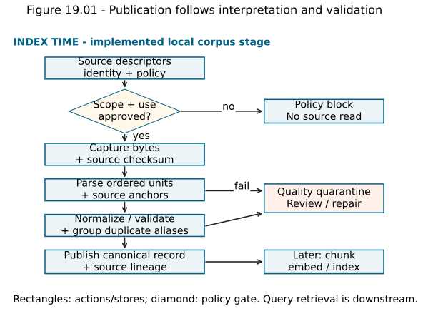
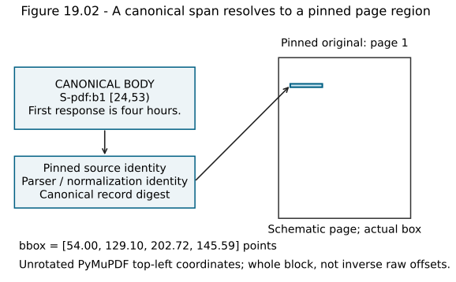
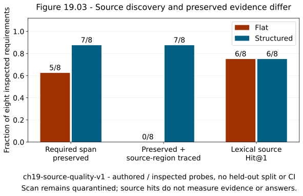

# Chapter 19 — Source ingestion and document quality [INTERMEDIATE / PRODUCTION]

The search experiments of Part IV assumed that trustworthy vectors already existed. We could inspect an exact neighbor, locate its source segment and compare an approximate shortlist with an oracle. Those are useful guarantees, but they begin after a more basic decision: **what did we manage to extract from the original source?**

Imagine a support policy whose table gives East a retry limit of two and West a limit of four. A parser returns all four values, but loses the row and column relationships. The resulting document contains the right words and numbers. An exact search can return it instantly. An answer can still attach four retries to the wrong region. Neither a better embedding nor a larger HNSW search budget repairs that missing relationship.

This chapter starts **Part V: Building a trustworthy corpus**. We will transform heterogeneous source material into canonical documents while keeping the original evidence accessible. We will also refuse publication when extraction is too ambiguous. The relevant prerequisites are [source identity in Chapter 2](chapter-02-build-the-first-rag-loop.md), [text analysis in Chapter 5](chapter-05-text-normalization-and-inverted-indexes.md), and [system boundaries in Chapter 18](chapter-18-disk-ann-benchmarks-and-vector-databases.md). A tokenizer decides how searchable terms are represented; an ingestion pipeline must first establish what those terms came from.

The new [V5 laboratory](../projects/V5/README.md) uses book-authored Markdown, HTML and PDF fixtures. Its workload is **`ch19-source-quality-v1`**. It preserves V0–V4 and their historical results. No encoder is changed, no OCR model is run and no answer generator is added. The [independent source-span exercise](../labs/chapter-19/LAB.md#a0-construct-a-source-span-mapper) comes before the reference implementation. Solutions are [separate](../solutions/chapter-19-solutions.md).

## 1. Evidence can be lost before there is an index

**Ingestion** is the controlled process that obtains source material, interprets its representation, validates what was extracted and prepares an auditable corpus for downstream indexing. A **connector** obtains a source snapshot and associated identity or policy. A **parser** interprets that snapshot's format. Neither role decides relevance to a future question.

The simplest pipeline is attractive: read a file, turn it into a string, collapse spaces and embed the result. Begin there as a baseline, then inspect its failures. Removing HTML tags can leave navigation menus, scripts and footer text. Flattening a spreadsheet can separate a number from its unit. Reading a PDF's native text can miss an entire scanned page. Collapsing a code block's whitespace can change its meaning. Keeping every extracted character does not necessarily keep the evidence.

Four questions must therefore remain separate:

1. Was the source obtainable under the declared policy?
2. Did extraction recover the relevant content and relationships?
3. Does the canonical record retain enough lineage to inspect that content?
4. Did retrieval, context construction and generation later use it correctly?

An ingestion success count answers none of the last three questions by itself. A file may be parsed without preserving the evidence needed by a user. Conversely, rejecting an unreadable page can be the correct ingestion outcome even though extraction coverage falls.

Think of the canonical corpus as a ledger of interpretations. Every entry says which snapshot was interpreted, how it was interpreted and which source region supports the result. The analogy has a limit: provenance establishes origin, not truth. A precisely located draft can still be outdated or wrong. Authority and freshness remain explicit metadata rather than conclusions supplied by a parser.

## 2. Follow the source through the ingestion boundary

At **index time**, obtain a source snapshot; check policy; parse its content and structure; normalize under a named policy; validate; identify duplicates; and publish a canonical record or quarantine it. Later stages will choose retrieval units, embed them and write an index. Those stages must consume a validated corpus rather than accidentally treating a partial parser output as a complete document.

At **query time**, search only eligible indexed material. If a candidate becomes selected evidence, resolve its lineage against the particular source version that was indexed. Fetching today's live file under yesterday's citation can silently change the evidence. A source ID is a stable reference to a logical source; a source version and checksum identify the particular content that supported the candidate.

**Quarantine** is a recorded disposition that excludes an input from the published corpus pending repair or review. It is not an empty successful document. A quarantine record needs a safe reason code, source/version identity where authorized, parser identity and a route for resolution. The protected source store can retain the original for review under its retention policy. Ordinary telemetry should not copy source text or exceptions into a log.

**Figure 19.01 — Publication follows interpretation and validation.** Solid arrows show the local index-time flow; rejection branches stop publication. The last box is a later consumer, not an embedding/index stage executed in this chapter. Source policy is checked before reading fixture bytes. [Editable source](../visuals/chapter-19/plot-19-01-03-ingestion.py).



*Alt text:* A policy block and a quality quarantine are different stopping points. Canonical publication retains source identity and transformation lineage.

Our local fixture follows this flow without a network connector or queue. Its scope gate is an explicit fixture eligibility rule, not authentication. Likewise, `indexing_allowed` is an already reviewed policy input, not a software determination of legal permission.

## 3. A format adapter must preserve the right relationships

Formats encode different kinds of structure. A single generic string interface is useful downstream, but it should not erase what matters upstream. The adapter contract is: **return ordered content units with their kinds, source anchors, transformation metadata and known omissions, or return an explicit failure disposition**.

| Source family | Structure to retain | Failure to inspect |
|---|---|---|
| Plain text and Markdown | Encoding, headings, paragraphs, lists, code fences and line ranges | Silent replacement of invalid bytes; heading loss; collapsed code indentation |
| HTML and websites | Main-content region, headings, links, list order, table headers/cells and capture identity | Navigation/script contamination; JavaScript-dependent content missing; CSS order differing from source order |
| Born-digital PDF | Page identity, text blocks, reading order and coordinates | Columns interleaved; detached footnotes; glyph encodings; headers repeated as body text |
| Scanned or mixed PDF | Page images, OCR text/boxes and OCR provenance where used | Empty native text; digits or negations misrecognized; some pages extracted and others silently omitted |
| Word documents | Paragraph/style structure, tables, notes, tracked revision policy | Export retaining deleted revisions; text boxes or notes disappearing |
| Spreadsheets | Workbook/sheet, row/column, cell value, formula/value policy, units and merged cells | A cached formula result treated as current; dates or identifiers coerced; row labels detached |
| Slides | Deck/slide, title/body, speaker notes and object positions | Notes omitted; visual order unlike XML order; decorative text dominating |
| JSON/API responses and SQL rows | Schema, keys, nulls, record identity, pagination and capture/snapshot time | Truncated pagination; missing versus null conflation; values detached from field names |
| Email, tickets and wiki | Thread/message/page identity, authorship/time, quote/revision policy and attachments | Repeated quoted replies becoming duplicate evidence; attachment or permission loss |
| Code repositories | Repository revision, path, symbol/code boundaries and exact syntax | Generated files dominating; imports/references flattened; indentation changed |
| Images, audio and video transcripts | Image/page or media identity, derived text provenance, speaker/segment and temporal anchors | A caption treated as exhaustive image content; omitted speech; time codes lost |

This is an adapter design inventory, not a claim that our reference code implements every row. [Apache Tika's format inventory](https://tika.apache.org/3.2.3/formats.html) illustrates the breadth a production parser portfolio can cover. Broad format support still requires source-specific validation and readable provenance. The current lab implements three bounded adapters. Chapters 40–44 later deepen web, structured, layout, multimodal and code retrieval; Chapter 50 adds production ingestion lifecycle mechanics.

### Markdown: keep the evidence and its syntax

The small Markdown adapter recognizes headings, paragraphs and fenced code. It records one-based inclusive source line ranges. A heading's leading `#` markers become a content kind rather than ordinary searchable punctuation. A code fence becomes a code block whose indentation survives normalization. The original bytes remain the authority for reconstructing the full source region, including fence markers.

It is deliberately a miniature dialect. It does not resolve Markdown links, parse arbitrary nested lists or implement a complete CommonMark tree. Do not label every unrecognized Markdown construct a correctly interpreted paragraph. A production adapter should use a specified syntax parser and expose unsupported structures. Here an unclosed code fence fails explicitly; fresh exercises test that behavior.

### HTML: preserve rows, then remove reviewed boilerplate

HTML provides structural clues such as heading tags, IDs and table cells. Our structural adapter retains selected block tags, supports inline text, converts character references and serializes each simple data row with its column headers:

```text
Region=East; Retry limit=2
Region=West; Retry limit=4
```

The relationship is carried into the canonical text. The table's existence alone would not tell a retriever which number belongs to East. [W3C's table tutorial](https://www.w3.org/WAI/tutorials/tables/) explains why header/data association matters in interpreting tables; the ingestion consequence is to retain that association rather than concatenate disconnected cells.

The adapter excludes reviewed HTML regions: head, navigation, footer, scripts/styles and explicitly hidden regions. It records their locators and reasons. This is a fixture rule, not a generic website cleaner. A legal condition could appear in a real footer, and repeated banners can contain important emergency information. Review removal policies against source samples and required evidence before applying them broadly.

Our strict dialect requires balanced structure and rejects nested content blocks or ambiguous table geometry. [Python's HTML parser](https://docs.python.org/3.14/library/html.parser.html) supplies callbacks, not a browser DOM or layout engine. The custom checks impose our contract. They do not discover CSS-hidden content, execute JavaScript or infer visual order. A real adapter must declare whether it captured raw HTML, a rendered DOM or both.

### PDF: the visible page and native text are different representations

A **born-digital PDF** can contain a native text layer produced by software. A **scanned PDF** can contain only page images. A document can mix both. Successful native text extraction on page 1 is not evidence that page 2 was processed successfully.

[PyMuPDF's text recipes](https://pymupdf.readthedocs.io/en/latest/recipes-text.html) describe several text representations and ordering options. A top-to-bottom sort is a useful heuristic for some pages, not a semantic reading-order oracle. On a two-column page, blindly traversing horizontal rows can alternate unrelated paragraphs. Headers, footnotes and floating captions add other ordering choices. Render representative pages and compare the extracted sequence with what a reader sees.

The fixture contract has a single-column body. The adapter returns native blocks ordered by the library's sort rule and keeps one-based page numbers and bounding boxes. A reviewed margin rule removes the fixture's header and page number. It is safe for these inspected pages; a condition printed in the same margin of another document could be lost. The contract PDF's body note on page 2 is retained, regardless of whether someone informally calls it a footnote.

The second PDF fixture is a raster-only retention amendment. A person sees “Retention is 15 days.” Native extraction returns no text. Our adapter emits `native_text_absent_requires_ocr_review` and quarantines the source. It does not label the amendment irrelevant, empty or nonexistent.

**OCR**, optical character recognition, estimates characters from an image. Its outputs can need deskewing, resolution adjustments, language selection and layout analysis. [PyMuPDF's OCR guidance](https://pymupdf.readthedocs.io/en/latest/recipes-ocr.html) describes a separate OCR path; [Tesseract's quality guidance](https://tesseract-ocr.github.io/tessdoc/ImproveQuality.html) identifies image-processing considerations. OCR is not run in this lab. A future OCR route must retain input page/image, engine/model/language version, coordinates, confidence where meaningful and manual validation of consequential values. A plausible OCR string is still an estimate.

Zero text on a page can also mean an intentionally blank page. This bounded adapter rejects such a page because it has no reviewed blank-page exception. Conversely, some native text alongside an image does not prove complete extraction. Native-text presence is a limited gate, not a complete image-content detector. Chapter 42 develops layout-aware treatment after the baseline corpus and evaluation foundations are established.

## 4. Design a canonical record that can be audited

A **canonical document** is the chosen normalized representation of a specific source snapshot. “Canonical” means governed by a declared schema and normalization policy, not universally correct or interchangeable with the original.

Separate at least these identities:

| Identity | Meaning in V5 | Why it is separate |
|---|---|---|
| `source_id` | Stable logical source such as `S-pdf` | A source may change while retaining its ID |
| `source_version` | Declared source snapshot version | Upstream version labels can be reused incorrectly |
| `source_sha256` | Digest of exact captured bytes | Detects actual content changes under unchanged labels |
| Parser/normalization versions | Rules used to interpret the bytes | Same source can yield different canonical content |
| `body_sha256` | Digest of canonical UTF-8 body | Detects changed extracted/normalized text |
| `record_digest` | Canonical JSON digest including content, policy, anchors and transformations | Equal bodies can have different evidence identities |
| Block ID and canonical range | Local content unit and half-open body offsets | Needed to map a retrieved span back to its source |

The record also carries sorted allowed scopes, license/indexing-use policy, retention policy, ordered typed blocks, raw extracted text and its digest, and reviewed dropped regions. Raw extracted text belongs in the protected canonical artifact, not an ordinary request log. It helps diagnose normalization loss without reopening the parser. Original bytes are needed to diagnose extraction loss.

For every block, the body slice `[start:end]` must equal the normalized block text. Canonical offsets count **Unicode code points**, using Python string indexing. They are not UTF-8 byte offsets, model-token offsets or grapheme positions. Source locators use their own coordinate systems. A Markdown locator is a line range; an HTML locator identifies a tag/ID and source line; a PDF locator uses page coordinates. No single integer convention should silently mix these units.

In the reference, local block IDs depend on extraction order. They are not promised stable across parser changes. To identify evidence, combine source/version/digest, parser policy, block content and locator. A changed ordering can move `b1` to different text. Later chunkers must carry the record identity rather than cite a bare block number.

### A checksum detects a change, not truth or permission

SHA-256 maps a byte string to a fixed-size digest. For this project, matching digests are a practical integrity check, not evidence of factual correctness, authorship or legal permission. A modified source with the same logical ID must fail source-bound judgment validation. Replacing a stored checksum to make that failure disappear is not a review of the changed evidence.

Byte-level source checks are intentionally strict here. Even a line-ending change changes raw bytes and requires review under this fixture policy. The fixtures include a local Git attribute that preserves their exact bytes across checkouts. This differs from the earlier [evidence-identity normalization](../evaluation/EVIDENCE_IDENTITY.md), which tolerates incidental source whitespace. Both are defensible declared policies; neither may be silently substituted for the other.

## 5. Cleaning is a transformation with consequences

Begin with strict decoding under an explicit encoding. If UTF-8 decoding fails, replacing the invalid byte with a replacement character can conceal a corrupted identifier or amount. Our invalid-byte fixture is quarantined. Production sources may have known alternative encodings; record the selected decoder and uncertainty rather than guessing without a trace. [Python's codec documentation](https://docs.python.org/3.14/library/codecs.html#codec-base-classes) distinguishes strict and alternative error policies.

Unicode normalization then handles different code-point representations of canonically equivalent text. Our prose policy uses NFC, normalizes line endings and collapses Unicode whitespace runs. Our code policy uses NFC and line-ending normalization while preserving indentation and internal newlines. Neither policy lowercases evidence, removes punctuation, stems words or folds compatibility characters. Those may be search-analysis choices; they are not automatically safe changes to source evidence.

[Unicode's normalization specification](https://unicode.org/reports/tr15/) and [Python's normalization API](https://docs.python.org/3.14/library/unicodedata.html) distinguish canonical from compatibility forms. A useful hand example is decomposed `cafe` followed by a combining acute accent. The raw string has five code points; NFC yields `café`, four code points. In UTF-8, those forms occupy six and five bytes, respectively. This is why copying canonical offsets directly into raw text can cite the wrong range.

NFC does not mean “convert all unusual-looking characters to ordinary ASCII.” Roman numeral IV remains a separate character under this policy. Compatibility normalization could change it. Numbers, minus signs, mathematical symbols and exact identifiers require source-aware handling. Retaining the raw input and transformation version lets an engineer inspect whether cleaning changed an important distinction.

Do not remove a repeated line solely because it is repeated. Do not infer that hyphenated text at a line break can always be joined. A word broken by PDF layout may need joining; a literal identifier split around a hyphen may not. A cleaning policy should say which pattern it handles, what evidence justifies the repair and what remains unresolved. The toy PDF adapter normalizes whitespace but does not perform general dehyphenation.

**Enrichment** adds derived information such as language, document type, headings or entities. Preserve whether each field is source-supplied, parser-derived, model-estimated or human-reviewed. A guessed language is useful for routing but must not overwrite the original bytes. A generated summary can be a search aid while remaining separate from source evidence. No enrichment model is run in V5's current stage.

## 6. Work a source-span example by hand

Before opening the [reference mapper](../projects/V5/ingestion_ch19.py), complete lab A0. The bounded task is to map a canonical span to the source blocks it actually intersects. It deliberately returns **whole source regions**, not invented character-level inverse offsets.

Suppose the canonical body is `ABC\n\nDEFG`. Block a covers `[0,3)` and comes from page 1. Block b covers `[5,9)` and comes from page 2. The two newline code points are separators introduced by canonical assembly; they have no source block.

For requested span `[2,7)`, compute each intersection:

`left = max(request_start, block_start)`

`right = min(request_end, block_end)`

Retain the block only when `left < right`. Block a contributes `[2,3)`; block b contributes `[5,7)`. The separator interval `[3,5)` contributes nothing. A request containing only that separator returns an empty locator list. This differs from an invalid span: negative positions, zero width, an end beyond the body, or an overlapping/out-of-order block map must raise an error.

For B blocks and H overlaps, a straightforward validation-and-scan implementation takes O(B) time and O(H) output space. No tree or interval index is needed for this bounded construction. A production corpus can validate its maps once and use indexed lookup if measurement warrants it. Implement and test the simple rule first.

### Trace a real PDF retrieval unit

The structured contract fixture has four retained native blocks. Its page-1 sentence `First response is four hours.` occupies canonical range **`[24,53)`** in `S-pdf:b1`. The following two separator code points and page-2 heading are different units.

A fixed exercise unit covering `[24,53)` maps to page 1, unrotated PyMuPDF top-left coordinates, approximately **`[54.0,129.10,202.72,145.59]` points**. The full-precision values, source checksum and record digest are saved in the canonical artifact. A point is 1/72 inch. The ReportLab generator used a bottom-left drawing coordinate system; the parser's returned boxes use a different convention. Record the parser convention instead of treating those numbers as interchangeable.

The locator encloses the native text block. It is not a per-character polygon, and normalization may have changed spacing. Open the pinned PDF page and inspect that region. If an actual chunk spans several blocks or pages, preserve every intersecting anchor. Choosing only the first page can hide part of the evidence.

**Figure 19.02 — A canonical span resolves to a pinned page region.** This uses the actual V5 contract block and its saved coordinates. The page sketch is schematic, while the canonical offsets and bounding box are extracted values. The exercise's fixed span is a provenance probe, not a chunk-size experiment. [Editable source](../visuals/chapter-19/plot-19-01-03-ingestion.py); [canonical artifact](../projects/V5/canonical_ch19/structured.json).



*Alt text:* Canonical offsets identify text in the normalized body; page and bounding-box coordinates identify a whole original source region. The source version and checksum connect the two.

Chapter 20 will study where retrieval boundaries should fall. Here we use parser blocks and a fixed manually chosen span to make source tracing executable. We do not compare chunk sizes, overlap, semantic boundaries or parent expansion yet.

## 7. Deduplicate content without deleting provenance

Two different source IDs can contain exactly the same bytes. The fixture's runbook and runbook copy do. Their canonical bodies match, but their source identities and locators remain separate records.

**Exact deduplication** groups equivalent content under a declared equality rule. V5 groups accepted documents by canonical body digest plus sorted scope membership, license and retention policy. It reports the duplicate group `S-copy, S-md`; it keeps both records and their aliases. This identifies possible storage reuse without pretending that one origin never existed.

Why include policy in the grouping key? If identical content exists in two tenants with different permissions, merging their metadata into one permissive record can leak it. Likewise, one alias can expire earlier or have different allowed indexing uses. A shared representation needs policy-safe lookup and a complete alias-to-source map. Content equality is not authorization equality.

**Near deduplication** detects similar documents through shingles, fingerprints or similarity measures. A reasonable-looking duplicate can contain a changed number, a negation, an effective date or a signature. Near-duplicate deletion can therefore remove the only current or contradictory evidence. Introduce it only with explicit thresholds, sampled pair review and a policy for preserving distinct versions/authority. This chapter explains that risk but implements only exact duplicate grouping.

Byte hashes and canonical hashes answer different questions. Different HTML wrappers can produce the same body. Equal raw bytes can exist at different logical sources. Different extraction versions can produce different bodies from the same bytes. Do not use one digest to answer every identity question.

## 8. Validate before publishing

A useful validation ladder proceeds from cheap integrity checks to expensive semantic inspection:

1. **Policy and capture:** scope and indexing uses approved; stable source/version; bytes captured under a known limit.
2. **Decoding and format:** encoding valid; adapter supported; encrypted/truncated/malformed inputs handled explicitly.
3. **Structural completeness:** expected pages/sections present; table/header and reading-order assumptions checked; unsupported content reported.
4. **Canonical invariants:** ordered nonoverlapping maps; body slices match blocks; content, metadata and locators have checksums.
5. **Evidence probes:** consequential identifiers, amounts, exceptions, negations and relationships remain inspectable in the original.
6. **Downstream validation:** retrieval units and their source lineage are checked before embedding/index publication.

The last step is a future consumer in this chapter. Passing the first five does not make a production index visible. V5's present output is a canonical corpus snapshot. The runner records that queueing, OCR, chunk design, embedding, index writes and search visibility were not executed.

A partial document needs an explicit publication policy. One option is all-or-quarantine; another publishes verified regions with a completeness flag and restricted answer behavior. The bounded PDF adapter uses all-or-quarantine when a page has no native text. It does not publish the other pages and silently call the document complete. Such a conservative rule sacrifices coverage; a mature pipeline may support a reviewed page-level repair workflow.

Our merged-cell HTML fixture illustrates deliberate refusal. Its first data cell spans two rows. Flattened text can look usable, but this adapter does not know how to assign every value to the correct header/row. It emits `ambiguous_table_geometry`. A more capable table adapter could succeed, provided its cell grid, spans and validation are explicit. Quarantine is a present capability boundary, not a claim that merged cells are inherently unusable.

## 9. Measure what extraction preserves

The checked [experiment](../projects/V5/chapter-19-experiment.json) compares two interpretation bundles on **`ch19-source-quality-v1`**. Nine descriptors include seven scope-eligible sources with approved indexing uses and two policy blocks. The seven eligible inputs are the three ordinary format examples, an exact runbook copy, a scan, invalid UTF-8 and a merged-cell table.

The **flat baseline** extracts text, collapses whitespace and keeps file-only anchors. It applies the same scope/rights gate as the structured route. The **structured route** uses typed blocks, NFC, code-preserving whitespace, reviewed exclusions and strict table/structure checks. Because several interpretation choices change together, this is a bundle comparison, not an isolated measurement of NFC or a particular parser alone.

Eight authored, inspected probes specify a required source span or relationship and reviewed original locator. They include a release ID, negation, accented text, table relation, exception, two PDF statements and the scanned amendment. [The requirements file](../projects/V5/span_requirements.json) binds source bytes, version, path, scope and license/retention policy. It contains eight span requirements, not every graded query–block pair. There is no train/dev/test split or held-out generalization claim.

Define **preservation rate** as the fraction of these eight requirements whose declared canonical text exists in an accepted intended source or exact-copy alias. For the table requirement, existence means its specified header/value serialization, not merely finding all its words somewhere. Define **traceable preservation rate** as the fraction that also maps to a retained original region finer than a file-only locator. These are extraction diagnostics, not standard relevance-ranking metrics.

| Measure on `ch19-source-quality-v1` | Flat bundle | Structured bundle |
|---|---:|---:|
| Required-span preservation | 5/8 = .625 | 7/8 = .875 |
| Traceable preservation | 0/8 = 0 | 7/8 = .875 |
| Alias-aware lexical source Hit@1 | 6/8 = .750 | 6/8 = .750 |
| Accepted / quarantined / policy-blocked descriptors | 5 / 2 / 2 | 4 / 3 / 2 |

The structured route restores the accented span and table relation under their declared requirements. It still misses the scanned amendment. It also accepts fewer sources because it refuses the unsupported merged table. That is useful evidence of a quality gate, rather than a reason to force its ingestion-success count above the baseline.

**Figure 19.03 — Source discovery and preserved evidence differ.** Bars show exact fractions on eight inspected requirements from `ch19-source-quality-v1`. Source Hit@1 stays .750 while preservation/traceability change. There are no confidence intervals or population generalization claims. [Editable plot](../visuals/chapter-19/plot-19-01-03-ingestion.py); [record](../projects/V5/chapter-19-experiment.json).



*Alt text:* A document retrieval hit can coexist with lost source evidence. Explicit quarantine prevents the structured pipeline from claiming complete extraction.

### A deliberately weak retriever localizes a different failure

The lexical diagnostic counts distinct query terms shared with each accepted document, sorts by descending overlap then source ID and returns one positive-score source. It is a transparent smoke test, not a new ranking algorithm or a replacement for BM25/dense retrieval. It evaluates source IDs, so extraction modes can be compared without treating different canonical block IDs as the same retrieval units. Exact-copy aliases are both accepted targets.

For the table question, the flat route finds `S-html` even though the header/value relation was not preserved. For the accented ownership question, it finds the runbook copy despite failing the NFC text requirement. These cases show why source Hit@1 cannot substitute for evidence preservation.

For the clock question, the required PDF statement survives both routes, but lexical overlap returns `S-copy`. This is a ranking failure, not a parse failure. For the retention question, neither route publishes the scan; a weak positive overlap still returns `S-pdf`. A candidate return is not evidence availability, and we do not infer abstention or answer confidence from this result. No answer/context stage runs.

### Timing the ingestion attempt

Each mode has 27 ingestion samples: three attempts for each of nine descriptors, randomized together with seed 19013026. The timer includes policy/path handling, authorized file reading, parsing and canonicalization; it excludes trace/output serialization. Blocked and quarantined attempts remain in the population. The checked nearest-rank p95 is approximately **8.545 ms flat and 9.004 ms structured**, on this local run. With 27 samples, p95 selects sorted sample 26. These mixed tiny-source attempts are not a production parse-throughput or OCR budget.

There is one lexical diagnostic call per query/mode, eight each. Its measured p95 is saved separately. It is neither ingest latency nor end-to-end RAG latency. The record retains environment, parser/normalization/code identities, per-probe outcomes, samples, uncertainty and decision. Small inspected data, bundled transformations, filesystem warmth and few repetitions preclude a general performance verdict.

**Decision:** use the structured canonical corpus for V5 development; retain the flat comparison, duplicate aliases and three unresolved quality inputs. Keep historical corpora and results unchanged. The new .875 is not a longitudinal improvement over any V0/V3/V4 retrieval metric: its workload and denominator are different.

## 10. Keep ingestion telemetry correlated and useful

The common [sample envelope](../observability/SAMPLE_ENVELOPE.md) continues: request ID, query/operation ID, mode, trial, workload, corpus/query/qrel/index/model identities, status/reason and stage timings. For an ingestion operation, `query_id` is an opaque ingest-slot identity, not a user question. `index_version` and `model_version` are null because those stages are not run. Generic candidate pools are empty and context/evidence fields are null; normalized and published block IDs use ingestion-specific fields rather than fabricated relevance scores.

The runner records source/version/hash where policy permits, parser/normalization version, record digest, normalized/published blocks, dropped-region locators and not-run stages. Policy blocks expose neither a source ID nor a path. The ingestion's accepted raw extracted text and normalized body remain available in the canonical artifact; ordinary samples contain no text. A quality quarantine records its controlled reason code without copying an exception message.

For the lexical diagnostic, traces retain **all scored accepted source IDs and scores**, then the positive-score pool and actual final top one. Those are actual intermediate stages. A missed target can be located before or after ranking; a missing span requires inspection of the extraction artifact, not a reconstructed candidate trace. The diagnostic snapshot digest identifies the mode-specific accepted records.

In a mature asynchronous system, add source event/run identity, parent/child spans, queue attempts, dead-letter disposition and source-to-visible timestamps. The [observability contract](../observability/OBSERVABILITY_CONTRACT.md) already specifies that future lifecycle. Do not assign an index-visible timestamp to a canonical file write. File persistence, searchable visibility and durable replication are separate responsibilities from Chapter 18.

## 11. Debug the earliest loss

| Observation | First diagnostic boundary | Useful repair |
|---|---|---|
| Required statement absent from canonical body | Original page/region versus raw extracted block | Repair adapter/OCR/layout; do not tune ANN |
| Raw extracted statement present, canonical statement changed | Normalization input/output and policy version | Preserve syntax/units/negation; revise transformation and judgments |
| Correct words present, wrong table interpretation | Row/cell/header associations | Recover grid/merged-cell structure or quarantine |
| Statement preserved, wrong source ranked first | Actual scored/positive/final pools | Improve retrieval/ranking after extraction is validated |
| Candidate locator points to changed live content | Source version/raw hash/record digest | Resolve pinned snapshot and review stale labels |
| High ingest success, many empty or scrambled documents | Status definitions and quality slices | Count empty/partial/quarantined outcomes explicitly |
| Duplicate body with a different tenant or retention rule | Dedup policy key and alias map | Keep policy boundaries and independent source lineage |

A practical debugging probe samples the corpus independently of query success. Use stratified samples by source family, language, size, native/scanned pages and extraction confidence where available. Include successful, failed and quarantined sources; inspecting only successful short PDFs creates selection bias. Ask a reviewer to compare rendered source, extracted blocks, canonical body and dropped regions. Track the sampled population, counts, rubric and disagreements.

Measure coverage of critical values, identifiers, dates, negations, units, tables and captions rather than treating characters per second as quality. A large amount of boilerplate can inflate extracted length. Conversely, a short contract exception can be the only consequential evidence. Drift in source formats or parser outputs can alter the corpus even when the retriever model is unchanged. Register a new workload/version when samples or judgments change.

## 12. Governance and operational costs belong in the record

Before indexing, obtain a source-specific decision about allowed capture, indexing, model processing, retention and sharing. Record its authority and applicable scope in a real deployment. Public availability is not a complete policy. This chapter's `book-authored-fixture` license marker is a teaching provenance statement, not legal advice or an automated license classifier.

Retention and deletion requirements can affect originals, canonical text, embeddings, indexes, caches, backups and debugging exports. A deletion request does not become complete merely because a source file is removed. The alias map must identify derived objects and shared representations without deleting another source's independently permitted evidence. Chapters 22 and 50 teach executable lifecycle treatment after metadata and chunking prerequisites.

Sources can contain private data, malformed structures or malicious instructions. Reading and parsing should occur under bounded resource and permission rules. Production adapters need time, byte, page, archive-expansion and memory limits; isolation is appropriate for untrusted parser inputs. Source text is data for retrieval, not an instruction to change the indexing policy or execute tools. Chapter 49 develops the security mechanisms; the present local adapters neither execute source code/JavaScript nor fetch links.

Parsing work grows roughly with input size only for simple bounded formats and implementations; pathological markup, compressed inputs, images and layout inference can make that model inadequate. Our in-memory text adapters retain input, extracted and normalized representations, adding memory copies. PDF extraction has native-library allocations beyond Python object sizes. Canonical JSON bytes are measured storage, not RSS or parser peak memory. Exact digest grouping is expected linear in record count with a hash table plus text hashing, subject to ordinary implementation assumptions.

For a hypothetical 10,000 pages, if native extraction takes .02 seconds/page and OCR takes .8 seconds/page, replacing all-native work with all-OCR work changes the serial compute budget from 200 to 8,000 seconds, before setup, contention or I/O. These are invented arithmetic assumptions, not measurements. A mixed corpus needs its actual page mix and observed failure/retry costs. Cost accounting should include review, quarantine, raw/canonical storage and later reprocessing, not just embedding calls.

## 13. Build, defend and remember

Complete the [lab](../labs/chapter-19/LAB.md) in order: hand-map a span, independently implement the mapper, inspect three originals, run the two ingestion bundles, diagnose failures, trace the fixed PDF unit, and defend a publication/dedup policy. The source snapshots, requirements and canonical artifacts make the experiment reviewable. [Separate solutions](../solutions/chapter-19-solutions.md) explain the calculations and decisions after your attempt.

V5 currently supplies validated canonical records and an extraction-quality plane. V4 remains the index laboratory; its algorithm comparisons are still valid for their original vectors/workloads. The new project stage does not claim a fully integrated new RAG service. Its useful upgrade is an explicit upstream contract that future retrieval units can inherit.

### Misconceptions to correct

- **A parser returned a string, so the document was ingested correctly.** Check missing regions, relationships and provenance.
- **A source hit proves the needed evidence is present.** Our table and accented-span probes disprove that implication.
- **More accepted files means a better pipeline.** Unsupported merged tables may be accepted under a weak contract.
- **Normalization is harmless formatting.** It can change code-point offsets, syntax and consequential distinctions.
- **The checksum proves the source is true or authorized.** It identifies captured bytes under a separate policy.
- **Duplicates have one origin.** Shared content can have multiple source/policy identities.

### Exercises and design defenses

1. Calculate the block intersections for `[1,6)` and `[3,5)` in the nine-code-point example. State the source pages and missing separator mapping.
2. Explain why NFC canonical offsets cannot be treated as raw UTF-8 byte offsets. Give the decomposed-accent counts.
3. Diagnose a page where native extraction has a heading but the rest is a chart image. Would this lab's nonempty-text test prove coverage?
4. Construct a footer-removal counterexample containing the only cancellation exception. Specify a regression requirement.
5. Ingest a merged-cell table with this adapter. Defend quarantine, then describe the cell-grid evidence a more capable adapter would need.
6. Trace the PDF unit `[24,53)` to the source checksum, page and bounding box. Repeat for a cross-page canonical span and preserve both anchors.
7. Explain why source Hit@1 remains .750 while structured preservation reaches .875. Localize the `clock` and `retention` failures separately.
8. Design deduplication for identical text under two scopes and different retention policies. Defend your alias/deletion behavior.
9. Calculate the hypothetical native/OCR serial budgets. List three costs the arithmetic excludes.
10. Design a 60-source stratified review sample across four source types. Specify what it can and cannot establish about production coverage.

### Recall schedule

After one day, draw the ingestion boundary and its two stopping dispositions from memory. After three days, map a fresh canonical span and explain its offset units to a novice. After seven days, reopen a failure trace and distinguish extraction, normalization and ranking loss. After 21 days, defend a source-policy/dedup/publication design without looking at the field table. These are practice tasks, not observed learner outcomes. The Part V cumulative checkpoint comes after Chapter 22.

### You understand this chapter if you can…

- trace a canonical evidence span to the pinned original source region and state both coordinate systems;
- independently implement and validate the bounded block-intersection mechanism;
- explain how three source families encode structure and how a flat baseline loses it;
- preserve identifiers, code indentation, negations and raw transformation inputs under a named policy;
- distinguish policy block, parse quarantine, accepted canonical record and searchable index visibility;
- bind extraction requirements to actual source bytes/version/policy and refuse stale labels;
- interpret the workload's denominators without substituting source hits for evidence or answer quality;
- defend exact deduplication with complete source aliases and separate policy/retention boundaries.

## Further reading

Use [Unicode normalization](https://unicode.org/reports/tr15/) to distinguish canonical and compatibility equivalence; the hand example comes before the specification. Use [PyMuPDF's text recipes](https://pymupdf.readthedocs.io/en/latest/recipes-text.html) and [page API](https://pymupdf.readthedocs.io/en/latest/page.html#Page.get_text) to compare supported representations and coordinate conventions against the installed adapter. Consult [W3C table semantics](https://www.w3.org/WAI/tutorials/tables/) when inspecting header/cell relationships. Read [OCR quality guidance](https://tesseract-ocr.github.io/tessdoc/ImproveQuality.html) before assuming image recognition preserves numerical evidence. The [source register](../REFERENCES.md) records verification and scope; [Chapter 20's syllabus](../SYLLABUS.md) is the next dependency, not work started here.
