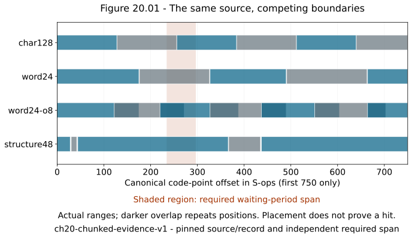
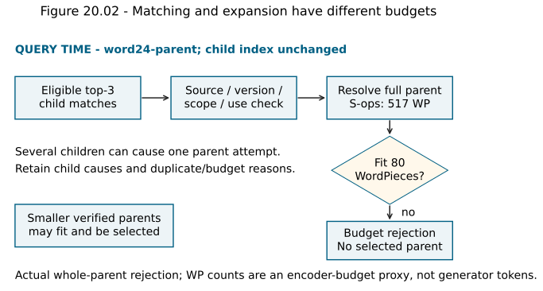
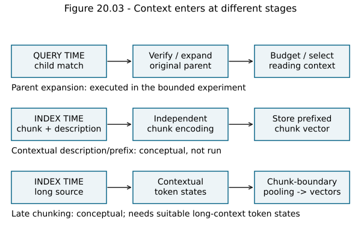
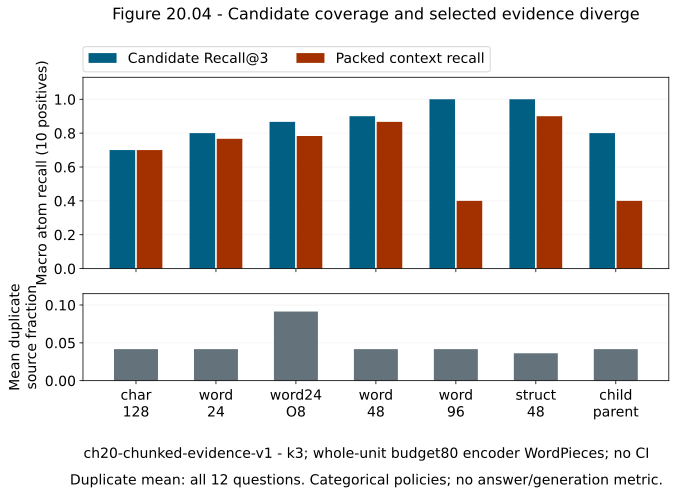

# Chapter 20 — Chunking as a retrieval design decision [INTERMEDIATE / PRODUCTION]

Chapter 19 gave us a canonical corpus whose retained statements could be traced back to original source regions. It also preserved the uncomfortable facts: a scanned amendment was not readable through native text extraction, and some inputs remained quarantined. Chunking begins after that quality boundary. It cannot recover a missing page, decide that an unsigned policy is authoritative or make an ineligible source available.

Its new question is narrower: **which pieces of a validated document should be represented, retrieved and carried into context?** A whole operations manual contains several procedures. A query about an emergency rollback needs its exception and condition, not every historical discussion. A tiny fragment may match the exception while losing the subject or the restriction that makes it safe to interpret. Both too much and too little text can fail.

We will compare source-preserving boundaries with exact retrieval before adding another approximate search mechanism. Read [Chapter 9's relevance judgments](chapter-09-relevance-judgments-and-ranking-metrics.md), Chapters [11](chapter-11-how-embedding-models-learn-retrieval-spaces.md)–[13](chapter-13-dense-candidate-retrieval-in-practice.md), and [Chapter 19's canonical maps](chapter-19-source-ingestion-and-document-quality.md) first. V5 now completes its source-and-segmentation stage; [the lab](../labs/chapter-20/LAB.md) requires an independently written window chunker before reference exposure. [Solutions](../solutions/chapter-20-solutions.md) are separate.

The new workload is **`ch20-chunked-evidence-v1`**: twelve inspected questions on five approved canonical sources, with eighteen required source spans on ten positive questions and two no-evidence questions. It adds a fictional deployment manual to Chapter 19's four accepted records. Earlier snapshots, extraction probes and results remain unchanged. The scan is still unavailable. No generator, reranker, learned semantic splitter or late-chunking model runs in this chapter.

## 1. A chunk is a decision about information, not a storage convenience

A **chunk** is a bounded retrieval unit derived from a source under a declared segmentation policy. Its text, source version, canonical ranges, original anchors and policy membership travel together. The chunk is an interpretation of boundaries; it is not a new independent source.

Consider the pair:

```text
An emergency Blue rollback may start immediately when two responders
confirm customer impact.
This exception does not permit a routine deployment without approval.
```

The first sentence supplies a positive condition. The second prevents an overbroad conclusion. A window that retrieves only “may start immediately” offers an attractive but incomplete candidate. Conversely, embedding the entire manual can compress Blue, Green, billing, drill and historical discussion into one vector. An exact nearest-neighbor search then operates correctly on a representation that is too broad for the question.

The unit for **matching** need not equal the unit for **reading**. A small child can provide a focused retrieval signal; a larger parent can supply the surrounding condition. That distinction is useful only when expansion preserves source/policy identity and fits the context budget. Expanding every successful child to its whole document can undo the benefit of smaller units.

Keep five boundaries separate:

1. The captured source snapshot, from Chapter 19.
2. The canonical content blocks and their source maps.
3. The unit encoded or indexed for retrieval.
4. The candidate unit returned by search.
5. The text selected for context and later cited or used in an answer.

There is no rule requiring all five to have the same size. There is a requirement to explain every transformation between them. A chunk ID alone cannot prove which original evidence a later answer used.

## 2. Decide which units your sizes count

“Chunk size 500” is incomplete. It might mean characters, whitespace words, model tokens or some library's accounting unit. These yield different boundaries and costs.

**Characters** in our Python code mean Unicode code points. They are not bytes or grapheme clusters. A character window can split an identifier, word or combining sequence; normalization from Chapter 19 does not make every arbitrary boundary meaningful. **Whitespace words** are consecutive nonwhitespace matches. They provide a transparent teaching unit, but punctuation and many languages do not align with this definition. **Model tokens** depend on the particular tokenizer and its version.

For example, `TK-042` can be one whitespace word while becoming several WordPieces. Code, URLs and rare identifiers can have a different token expansion than ordinary prose. Neither a fixed number of words nor a fixed number of code points proves that an embedding model will see the complete input. Count the actual tokenizer output, including any title, context prefix and special tokens.

The existing pinned MiniLM checkpoint has a 256-WordPiece sentence-encoder limit. Its [model card](https://huggingface.co/sentence-transformers/all-MiniLM-L6-v2) describes default truncation, and our installed model reports the same limit. In this experiment every indexed chunk is audited before encoding; the largest input is 123 WordPieces including two special tokens. Inputs over the limit would fail instead of silently becoming a different chunk representation.

The **context budget** is a different limit. Our bounded packing demonstration allows a sum of 80 encoder WordPieces, excluding each item's two special tokens. This is an explicitly named proxy, not an actual generator prompt-token budget. A production generator needs its own tokenizer and must count the full assembled prompt, instructions, citation markers, separators and output reservation. Do not assume two models share tokenization.

## 3. Start with a source-preserving window

The simplest useful mechanism is a fixed window. Choose length L, overlap O and stride `S=L−O`. Require `L>0` and `0≤O<L`. Emit the first window, advance by S, and emit a final shortened window if needed. Stop as soon as a window reaches the last unit; adding further windows would repeat a tail that is already covered.

For N words, the number of windows is zero for an empty source, one for `0<N≤L`, and otherwise:

`C = 1 + ceil((N−L)/(L−O))`.

This formula describes our window convention. A different library can use different tail or overlap semantics, so inspect its actual output rather than importing this count uncritically.

For `N=10, L=4, O=1`, the word-index windows are `[0,4)`, `[3,7)` and `[6,10)`. They emit twelve word assignments covering ten unique words. Two assignments are repeated; the repeated-assignment fraction is `2/12=1/6`. It is not `2/10`, which would be repeated work relative to the unique source size. State the denominator.

On a long source, total word assignments are approximately `N·L/(L−O)`. With overlap fraction `ρ=O/L`, the approximate expansion factor is `1/(1−ρ)`: 25% overlap approaches 1.333 times the assignments, 50% approaches twice the assignments. Short tails and boundary policies change exact counts. O equal to L would give zero progress, which our implementation rejects.

### Preserve offsets while discovering words

Do not split a string into words, join them with spaces and then pretend those reconstructed offsets refer to the canonical body. That loses repeated spaces, newlines and code indentation. Locate each `\S+` match in the original canonical text instead, and return intervals from the first match's start to the final match's end.

For the body ` A  BB\nCCC D E `, the word spans are:

| Word | Canonical code-point range |
|---|---|
| A | `[1,2)` |
| BB | `[4,6)` |
| CCC | `[7,10)` |
| D | `[11,12)` |
| E | `[13,14)` |

With `L=3, O=1`, emit `[1,10)` and `[7,14)`. The overlap is CCC. The copied strings retain their internal whitespace. Leading/trailing whitespace outside the word endpoints is not part of the windows. This is a declared policy, not a claim that every whitespace character is semantically irrelevant.

Before inspecting the [reference](../projects/V5/chunking_ch20.py), construct [lab A0](../labs/chapter-20/LAB.md#a0-build-the-window-chunker). Validate integer settings, reject booleans, preserve offsets, cover a shortened tail once, and test empty text. Produce an additional fresh fixture of your own.

```text
validate length and overlap
find word intervals in the original body
first = 0
while first < word_count:
    last = min(first + length, word_count)
    emit [word[first].start, word[last-1].end)
    if last == word_count: stop
    first += length - overlap
```

Finding word boundaries takes O(T) time for T code points under this simple matcher. Emitting C interval pairs takes O(C) space beyond the word map; copying all chunk strings costs the sum of their emitted lengths. Overlap can increase that cost without adding unique evidence. These bounds concern the bounded algorithm, not an arbitrary regex engine or a complete language-specific tokenizer.

## 4. Let the observed failure motivate a better boundary

Fixed character windows are easy to implement and can be useful for rough storage limits. Their limitation is that the boundary has no knowledge of a sentence, identifier, table row or procedure. Word windows avoid many midword cuts, but can still separate a condition from its exception. Adding overlap can help a boundary-spanning statement enter a candidate; it also creates multiple highly similar candidates and repeats content in context.

**Figure 20.01 — Competing boundaries cut the same source differently.** This shows actual intervals from the first part of the pinned operations manual. Character, word, overlapping and structure-aware policies share one canonical coordinate axis. The shaded requirement is a reviewed source span; boundary placement alone does not imply retrieval success. [Editable source](../visuals/chapter-20/plot-20-01-04-chunking.py); [source/index artifact](../projects/V5/index_ch20/documents.json).



*Alt text:* Overlap repeats source positions; structural units can keep relationships intact while producing uneven sizes. All intervals refer to the same source body.

### Sentences, paragraphs and recursive splitting

A sentence boundary often carries a complete assertion, but punctuation alone does not reliably identify sentences. Abbreviations, decimals, lists, code and different writing systems need appropriate segmentation. Even a grammatically complete sentence can contain “it,” “this exception” or an unnamed quantity whose interpretation depends on earlier text.

A paragraph can preserve a local argument or procedure. It can also mix unrelated topics or exceed the model limit. **Recursive splitting** uses a hierarchy of preferred separators: for example section, paragraph, sentence, word and ultimately a bounded fallback. Try the largest meaningful unit first, descend when it is too large, then optionally assemble neighboring units under a cap. A recursive splitter must still state its order, tail behavior, overlap unit and fallback. Calling it recursive does not prove that the final units are semantically complete.

The reference's `structure48` is a limited two-level policy over Chapter 19's parser blocks. A heading begins a new group. Short neighboring prose blocks are packed greedily up to 48 whitespace words. An oversized prose block falls back to nonoverlapping 48-word windows. Code blocks and table rows are atomic units; they are not cut by this structural branch. The supplied corpus's atomic blocks fit the encoder limit. A longer atomic unit would need an explicit alternative or quality refusal, not silent truncation.

This policy can emit small headings, rows or code blocks and larger prose groups. It does not execute a universal sentence detector or a semantic model. A heading can become a separate short candidate when the following paragraph exceeds the cap; it is not automatically added as a prefix to every descendant. That remaining limitation matters when evaluating self-contained evidence.

### Use source structure according to its meaning

| Source structure | Useful boundary | Relationship that can be lost |
|---|---|---|
| Markdown/HTML sections | Heading plus governed prose or list | A rule detached from its section subject |
| Tables | Header-linked row or cell group | Value detached from units, header or merged-cell association |
| PDF layout | Verified reading-order region with page/coordinates | Footnote, caption or column relationship separated |
| Code | Function/class or bounded syntax node | Definition separated from imports, callers or explanatory comments |
| Conversation | Turn pair or bounded episode | Reply detached from question, speaker or resolved reference |
| Procedure | Step group with preconditions/exceptions | Action retrieved without required approval or stopping rule |

These are design choices, not a demand to implement every source-specific parser here. The lexical code identifiers and exact syntax still matter alongside embeddings. Document intelligence, multimodal and repository retrieval later deepen the structures whose extraction/relationship mechanisms need more prerequisites.

## 5. Semantic and proposition boundaries need their own evidence

Paragraph structure may still combine several subjects. **Semantic segmentation** proposes cuts from changes in content representations. One simple idea embeds consecutive units, computes their normalized dot products and cuts where similarity drops below a calibrated threshold.

For unit vectors A=`(1,0)`, B=`(.8,.6)` and C=`(0,1)`, adjacent similarities are `.8` and `.6`. A threshold of `.7` suggests a cut between B and C. The calculation follows Chapter 10; the threshold is not a relevance judgment. A subject can continue across dissimilar wording, while two unrelated procedural steps can use nearly identical vocabulary. Inspect false cuts, false joins, unit sizes and consequential evidence spans on the actual corpus.

A splitter that embeds each sentence first adds computation before final chunk embedding. Model, unit representation, context window and threshold influence the boundary. Tune on a declared development set and freeze before held-out evaluation if claiming generalization. We do not train, tune or run a semantic splitter in this experiment; it is a mechanism motivated by mixed-topic structural units, not a substitute for the measured baselines.

**Proposition segmentation** seeks compact statements that express specific facts in a self-contained form. A derived proposition might rewrite “It waits ninety minutes” into “An ordinary Green rollout waits ninety minutes after approval.” This can reduce representation dilution, but it has created text that must be checked against the original. Subject resolution, condition loss, altered negation and invented specificity are possible errors. Preserve the original spans and transformation/model identity.

[Dense X Retrieval](https://arxiv.org/abs/2312.06648) investigates retrieval granularity including propositions. Its results motivate testing that unit, not a universal instruction to rewrite every corpus into facts. The paper's derived propositions, benchmarks and budgets are distinct from our source-preserving window experiment. A proposition can help local fact lookup while making a cross-step question harder if related statements are retrieved independently.

**Query-aware or adaptive boundaries** can retrieve a coarse region, then choose a finer window around the question's information need. They can address variable question granularity without pre-indexing every possible window. They also add query-time work and a policy that can accidentally exclude the exception. Save original source/ranges, proposal/selection stages, query/transformation identity and budgets. This chapter does not require a dynamic chunk planner; later context and retrieval-policy chapters evaluate those choices after a complete baseline.

## 6. Match narrowly, read with bounded expansion

**Parent-child retrieval** separates matching units from expansion units. At index time store small children with parent identity and source ranges. At query time retrieve eligible children, select a parent or neighboring region, validate its source/policy identity and expand before packing. Several children may map to one parent; deduplicate that expansion while retaining which children caused it.

**Small-to-big** describes this direction of expansion, not a specific algorithm. The parent can be a paragraph, section, page or document. A whole document is simple, but its content may be too large or include unrelated historical/contradictory material. A bounded ancestor or neighbor expansion can be more suitable; its policy must be specified and measured rather than assumed helpful.

The executable `word24-parent` mode uses exactly the same child index and scores as `word24`. It expands top-three children to their whole source document, then applies the same 80-WordPiece budget. It adds no parent embedding and does not rescore relevance. Parent identity, child-to-parent causes and every packing disposition are saved. Scope and approved-use checks apply again before parent content is selected.

The operations manual's full body has 517 encoder WordPieces without special tokens. The tokenizer can count them without running the encoder. That parent is never encoded as a 517-token MiniLM sentence and is rejected by the context budget. A library warning during untruncated counting is not evidence of a forward pass; the stored chunk inputs remain below the 256-token encoding limit.

**Figure 20.02 — Matching and expansion have different budgets.** Children are retrieved with one index; verified parents are expansion candidates. A 517-WordPiece parent fails the fixed 80-WordPiece packing budget even when its child matches. No generator or new parent embedding is represented. [Editable source](../visuals/chapter-20/plot-20-01-04-chunking.py); [actual packing traces](../projects/V5/chapter-20-experiment.json).



*Alt text:* A successful child match does not ensure that parent expansion fits context. Candidate IDs, parent IDs and selected context IDs remain distinct.

### Hierarchical summaries address another information scale

Some questions concern themes or relationships across many passages. Local children alone may not provide a useful matching representation. A hierarchy can index summaries of groups, then connect each summary back to its constituent sources. Retrieval can match a higher-level representation and resolve supporting leaves for evidence.

[RAPTOR](https://arxiv.org/abs/2401.18059) is a research example that recursively embeds, clusters and summarizes text into multiple abstraction levels. It differs from deterministic child-to-original-parent expansion: its upper nodes contain generated summaries. Summary error and omission can propagate, so a retrieved summary needs a trace to original support. The current experiment builds no RAPTOR tree or summaries, and imports none of the paper's measured gains into our workload.

## 7. Three ways of supplying surrounding context are different

**Heading context** is deterministic source-derived information. Prefixing a child with its document title and heading path can disambiguate it without changing the original body. It also consumes tokens and can dominate short chunks. Save the prefix separately with its own source ranges; copying one heading into every child can increase repeated context. If a generated title or guessed heading is used, mark its derivation rather than calling it source text.

**Contextual retrieval**, as exemplified by [Anthropic's account](https://www.anthropic.com/engineering/contextual-retrieval), prepends a short document-informed description before embedding/indexing a chunk. A generated description changes the searchable representation. Check subject/date/authority/condition claims against the original; retain the raw chunk and added description separately. This can add generation and embedding cost at index time. It is not merely parent expansion after a match.

**Late chunking** changes when pooling occurs. With conventional chunk embedding, split the source first, run the transformer separately on each chunk, then pool each chunk's token states. With late chunking, run a suitable long-context transformer over a larger source region, then pool contextual token states within each chunk's token boundaries. The vectors can encode surrounding information even when the returned text remains local.

Let H be a matrix of T contextual token states with D coordinates. For eligible token indices `[a,b)` belonging to a chunk, a simple pooling view is:

`v_chunk = (1/(b−a)) · sum(H_i for i=a,…,b−1)`, followed by the representation's declared normalization.

Attention masks, special tokens and text-to-token offsets need explicit handling. The important distinction is that H was computed with larger context before the chunk pooling boundary. This is not concatenating previously pooled sentence vectors or calling a chunk independently with a longer title.

[Late Chunking](https://arxiv.org/abs/2409.04701) studies this mechanism and long-context limitations. A model must actually support the larger input and return appropriate token states. Memory/context costs and window boundaries remain. Our pinned short MiniLM embeddings are conventional independent chunk embeddings. We do not truncate the manual and relabel the result late chunking.

**Figure 20.03 — Context can enter at three different stages.** The diagram separates original-parent expansion after search, descriptive prefixing before encoding, and token contextualization before chunk pooling. These are mechanism diagrams; only the first has an executable expansion mode here. [Editable source](../visuals/chapter-20/plot-20-01-04-chunking.py).



*Alt text:* Expansion, prefixing and late pooling intervene at different boundaries and incur different costs. They should not share one ambiguous architecture label.

## 8. Bind chunks to evidence before comparing them

Each actual chunk stores source/version/raw checksum, canonical-record digest, chunker version/configuration, canonical range, copied text/digest, original block anchors, parent ID and allowed scope membership. Its ID is derived from the source/record/configuration/range identity. A parser or boundary change can create new IDs; never attach old chunk judgments to a new same-named source without reviewing identity.

A chunk must satisfy `text == canonical_body[start:end]`. Its locator list is the Chapter 19 map for that actual interval. A cross-page unit retains all intersecting anchors. These locators describe whole source blocks, not exact inverse raw characters or a verified answer citation. **Citation span accuracy** concerns whether the cited original region actually supports a claim. Correct mapping is necessary; it does not prove that a generator made or supported the right claim.

Boundary comparisons make chunk-specific qrels difficult: a “relevant chunk” under one policy may become several fragments under another. The workload therefore judges **required source spans independently of chunk IDs**. Each information need has zero or more required atoms anchored to a canonical source. All emitted units can be projected onto those spans without pretending that different chunks are identical judgments.

The eight extraction requirements from Chapter 19 are not reused as this new ranking set. The new twelve questions are inspected single-author questions, not train/dev/test partitions. Ten positives require eighteen spans; two ask for unavailable or unpublished evidence. They remain no-evidence cases even though a dense retriever returns plausible candidates.

### Calculate source-span recall and duplicate context

For each required atom, collect its nonwhitespace canonical code-point positions. For retrieved or selected units, collect the union of positions from the same governed source identity. An atom is fully covered only if all its required positions appear in that union. Fragments across several chunks can complete it; missing whitespace-only gaps do not create a false failure.

Per-question **evidence recall** is fully covered atoms divided by required atoms. Candidate recall uses top three. Context recall uses only packed units. The headline is the macro average over ten positive questions. A complete-context-evidence indicator requires all atoms for that question. It measures availability, not answer correctness, faithfulness or logical connection of the fragments.

Also record partial required-span coverage and which units contributed. For duplicate context, count all emitted nonwhitespace source positions E and the union U, then use:

`duplicate_source_fraction = 1 − |U|/E`.

This is an exact positional redundancy measure, not semantic duplicate detection or a token-repetition metric. Two equal runbook copies are mapped to one governed alias identity only after verifying equal bodies and scope/license/retention policy. Their original source aliases remain distinct. Identical text in unrelated or differently authorized sources must not be merged by this rule.

As a hand example, intervals `[0,6)` and `[4,10)` over ten nonwhitespace characters emit twelve positions with a union of ten. The duplicate fraction is `2/12`. A requirement `[3,8)` is fully covered by the pair even though neither unit alone covers all five positions. If one interval is dropped by packing, that atom can become incomplete.

## 9. Run the matched boundary experiment

The [checked experiment](../projects/V5/chapter-20-experiment.json) uses the pinned frozen encoder revision from Chapter 11, normalized float32 vectors and exact dot-product scoring with float64 accumulation/stable ID ties. Each searchable input is **canonical chunk body only**; it does not use Chapter 13's title-plus-body convention. That input change and the new source/query/label roster require the new workload identity. No numerical result is a longitudinal improvement over earlier V3/V4 experiments.

All modes use the same questions, sources, source-span labels, alias policy, exact scorer, candidate depth three and whole-unit packing proxy of 80 WordPieces. Packing considers top-three candidates in rank order, accepts complete units that fit, and skips those that do not. It does not truncate them, search deeper for replacements, reorder source text, rerank or optimize a knapsack. Those limited choices make the first losses visible before later context engineering.

| Policy on `ch20-chunked-evidence-v1` | Candidate evidence Recall@3 | Context evidence recall | Complete context evidence | Mean duplicate context |
|---|---:|---:|---:|---:|
| `char128` | .700 | .700 | .600 | .0417 |
| `word24` | .800 | .7667 | .600 | .0417 |
| `word24-o8` | .8667 | .7833 | .600 | .0914 |
| `word48` | .900 | .8667 | .700 | .0417 |
| `word96` | 1.000 | .400 | .400 | .0417 |
| `structure48` | 1.000 | .900 | .900 | .0362 |
| `word24-parent` | .800 | .400 | .400 | .0417 |

Recall/complete columns average ten positives. Duplicate context averages all twelve questions, including wrong no-evidence candidates. Both no-evidence questions return candidates in every mode, a rate of 2/2. No abstention or answer is generated. The table demonstrates the danger of optimizing only candidate recall: `word96` reaches full required coverage before packing while losing most of it afterward.

**Figure 20.04 — Better candidate coverage can yield worse selected evidence.** The measured candidate/context comparisons and positional redundancy use `ch20-chunked-evidence-v1` with the table's denominators. Configurations are categorical, not a continuous interpolation or general law. No confidence interval is inferred from three timing repeats. [Editable plot](../visuals/chapter-20/plot-20-01-04-chunking.py); [record](../projects/V5/chapter-20-experiment.json).



*Alt text:* Large units can have excellent candidate recall yet fail the fixed packing budget. Overlap adds repeated positions; none of these measures is answer quality.

### Inspect the failures rather than only the means

For `green-fail`, the overlapping policy has complete candidate evidence but only half the required atoms after packing. The ranked units cost 29 and 28 WordPieces, while the next required unit costs 27; total 84 exceeds the 80 budget. The third candidate survives retrieval and is then explicitly dropped. It is not an ANN miss or missing source.

For `drill`, the `word24` candidates cover all three required atoms, but packing takes units of 31 and 27 WordPieces and rejects the next 31. Context recall falls to 2/3. Increasing retrieval quality alone cannot repair this packing policy. Overlap can also spend part of that budget on already represented source positions.

For `green-wait`, `structure48` has complete candidate evidence but selects a 58-WordPiece unit and rejects 61/55-WordPiece units. The selected unit lacks the required atoms, so this question's context recall is zero. Even the best inspected aggregate retains a concrete failure. A later selector might deduplicate or choose different combinations; no such repair is hidden in the result.

Whole-document parent expansion rejects the 517-WordPiece operations parent. Smaller accepted source parents can still fit, but all operations questions lose their selected evidence. The child rankings are identical to `word24`; the lower context result isolates expansion/packing rather than a different embedding model.

### Account for index-time work

| Base policy, same workload | Chunks | Actual encoded WordPieces including specials | Max input including specials | Float32 coordinate payload bytes |
|---|---:|---:|---:|---:|
| `char128` | 28 | 717 | 37 | 43,008 |
| `word24` | 22 | 671 | 40 | 33,792 |
| `word24-o8` | 31 | 939 | 40 | 47,616 |
| `word48` | 13 | 653 | 64 | 19,968 |
| `word96` | 9 | 645 | 123 | 13,824 |
| `structure48` | 31 | 689 | 63 | 47,616 |

Coordinate payload is `chunk_count·384·4`, not actual JSON size, Python RSS or total corpus/index memory. Metadata, source stores and retained vectors add costs. The parent mode reuses the 22-vector child index and creates no new vectors. The teaching JSON snapshot serializes the shared rows again under the parent mode; it is not a storage-deduplication implementation.

The overlap branch processes 939 versus 671 input WordPieces and stores 31 versus 22 vectors. Its local batch embedding time is approximately 172.8 versus 131.1 ms in the checked run. These are one build each, not a general speed estimate or monetary cost. Different padded batch lengths and hardware utilization can dominate wall time; total tokens alone do not predict it.

Each mode has 36 randomized request samples: twelve questions times three repeats, seed 20013026. Queries are encoded once independently and reused. Exact-search p95 ranges approximately .634–2.080 ms in this tiny Python scorer; packing p95 is recorded separately. Neither includes query encoding, generation, service queueing or concurrent load. Never add stage p95 values to invent a request percentile.

All seven mode/query pairs replay with the same ordered candidate IDs after trusted snapshot reload: 84 checks. The verifier checks independently expected manifest digest, model revision, source/policy identities, exact chunk maps/roster, normalized vector shape and index identity. Rewriting a digest from a modified snapshot is not an integrity check.

**Decision:** provisionally use `structure48` for V5 development on these inspected questions, retaining all competing snapshots and the `green-wait` failure. This is a corpus-specific development decision with no held-out transfer claim. No generator is improved, and the missing scan is unchanged. A larger, independently judged workload could reverse the ranking.

## 10. Preserve the first-loss trace as boundaries multiply

The runner retains 264 correlated envelopes: twelve query-encoding samples plus 252 actual search/packing requests. Each has request/query/mode/trial/workload identity and explicit corpus/query/qrel/index/model versions, status/reason and stage timings. Query encoding has no candidate/context stage; its index version is null.

Search samples retain every eligible actually scored chunk and score, then the final top three. Packing attempts retain each child, resulting context-unit ID, inherited score, canonical span, WordPiece count and reason: selected, budget-rejected or duplicate-parent attempt. Context IDs identify actual selected children or parents. Parent IDs do not pretend to be independently scored matches. An index/manifest digest identifies the policy-specific representation.

Use this diagnostic order:

1. Is the required source published and eligible? The scan remains a known ingestion limit.
2. Does a correctly mapped chunk contain the required positions? Check boundary completeness.
3. Did the exact scorer rank its fragments into top three? All scores are saved.
4. Did expansion resolve the right source/version/policy? Inspect child-to-parent causes.
5. Did packing retain the necessary units under the declared budget? Inspect real attempts.
6. Did an answer correctly use and cite them? This stage is not run here.

Ordinary samples contain no question/source text or exception messages. The governed snapshot carries source/chunk text and original anchors for authorized debugging. Eligibility is checked before chunk construction and scoring, and again before parent expansion. Source/record/span identity changes invalidate labels or the snapshot. Content hashes do not replace authorization, licensing, freshness or source credibility.

## 11. Choose a policy by question granularity and measured constraints

An exact number lookup, a procedural exception, a cross-page answer and a document-wide synthesis impose different evidence needs. Start with a transparent baseline and a representative reviewed question set. Include identifiers, negation, contradictory/current-versus-historical statements, source-type/language slices and no-evidence needs. Avoid selecting a chunk size because it is a common default or a flattering average.

Measure a quality/cost frontier under the actual model, candidate depth and context budget. Keep candidate recall, selected evidence, redundancy, token/input cost, source tracing and answer metrics separate. If a larger chunk only improves the former, inspect the later losses. If overlap improves a few boundary questions, disaggregate its duplicate/context penalty and vector/build increase.

Heading context and section continuity can be better repairs than arbitrary overlap when the problem is a missing subject. A bounded neighbor expansion can be better than the full document when the problem is a local exception. A semantic splitter needs evidence that its cuts improve required-span coverage; a generated proposition or summary needs source support checks. More elaborate representations are justified by measured failures of the simpler branch.

Chunking also changes lifecycle costs. A one-word source update can shift later window boundaries and invalidate many vectors. Structure-anchored units may localize some changes but are not universally stable: headings and parser order can change. Keep chunker/model/input policy and source identity in index/cache keys. Tenant-safe caches must not reuse expanded parents across incompatible policies. Chapters 21–22 add executable metadata and update lifecycle treatment on top of this working local corpus.

For languages without whitespace word boundaries, our toy word splitter is not a language-aware policy. For code, whitespace collapse or cutting syntax can change evidence. For visual tables, raw text may omit relationships despite good token counts. Treat source extraction and chunking quality as related but separate gates. Quarantine or retain known missing structure rather than manufacture a complete unit.

## 12. Build, explain and revisit

Complete the [lab](../labs/chapter-20/LAB.md): independently construct the interval-based word chunker, freeze reviewed source spans, compare at least three policies with exact retrieval, inspect duplication and packing loss, trace selected spans to original pages/lines, and defend the provisional V5 policy. The [separate solutions](../solutions/chapter-20-solutions.md) provide calculations and a rubric after your attempt.

### Misconceptions to correct

- **A fixed token count guarantees complete evidence.** It controls an accounting unit, not relationships or model use.
- **Overlap is free recall.** It increases repeated assignments, vectors and possible duplicate context.
- **Larger chunks always help.** The 96-word branch reaches full candidate recall while context recall falls to .400.
- **A parent is automatically evidence.** It still needs source/policy validation and bounded selection.
- **Semantic splitting, contextual prefixes and late chunking are one technique.** They change different boundaries and have different failure/cost models.
- **Complete source-span coverage proves the answer.** It establishes evidence availability; correctness, faithfulness and citation support remain separate.

### Exercises and design defenses

1. Derive the window count for 19 words, length eight and overlap three. List starts and the shortened tail.
2. Implement a fresh whitespace-word fixture while preserving original newlines and code-point offsets. Show why split-and-rejoin offsets fail.
3. Compute overlap's approximate assignment expansion at 25% and 50%; state where the approximation fails.
4. Calculate exact positional redundancy for `[0,6)` and `[4,10)` and explain how the pair covers `[3,8)`.
5. Diagnose `green-fail` and `green-wait` from actual scored/ranked/packing stages. Propose one explicit later repair without inventing an observed improvement.
6. Trace one PDF chunk crossing pages and one operations chunk crossing a sentence boundary. Distinguish canonical range, whole original block locator and claim-level citation.
7. Defend a heading-prefix policy for an ambiguous pronoun and name the source-derived versus generated fields.
8. Explain why calling the pinned encoder independently on every chunk is not late chunking. State the additional states/offsets/context support required.
9. Design a parent expansion that selects a bounded section rather than a whole manual. Specify permissions, deduplication, version, budget and stopping behavior.
10. Propose development/test questions for a real corpus and keep parameter selection away from the test set. This chapter's inspected workload does not supply that split.

### Recall schedule

After one day, sketch source→canonical blocks→encoded children→candidates→expanded/packed context from memory. After three days, hand-calculate overlapping windows and teach a novice why recall differs before and after packing. After seven days, diagnose a stored missing atom and distinguish boundary, ranking and budget loss. After 21 days, defend a policy and critique a retrieval-granularity claim using matched metrics. The Part V cumulative checkpoint remains after Chapter 22; delayed tasks are assignments, not fabricated completion results.

### You understand this chapter if you can…

- independently implement a source-preserving window chunker with validated progress/tail behavior;
- state whether a size counts code points, words, embedding tokens or generator tokens;
- explain and quantify overlap's coverage, duplication, vector and build costs;
- compare at least three policies on the same source-bound judged questions and context budget;
- trace candidate and selected evidence spans through actual source maps without inventing citation precision;
- diagnose a required atom's first loss using scored/ranked/expansion/packing stages;
- distinguish structure/semantic/proposition boundaries, parent expansion, descriptive prefixes, summary trees and late pooling;
- retain negative results, source-policy boundaries and workload-specific uncertainty when selecting a provisional design.

## Further reading

An optional [Dense X Retrieval](https://arxiv.org/abs/2312.06648) granularity card can follow this chapter. [RAPTOR](https://arxiv.org/abs/2401.18059), [Late Chunking](https://arxiv.org/abs/2409.04701) and [contextual prefixing](https://www.anthropic.com/engineering/contextual-retrieval) provide mechanism previews here; defer their full summary/context-system reading and experiments until Chapter 28's prerequisites, as specified in [the paper path](../PAPER_READING_PATH.md). External results do not replace V5's benchmark. [The source register](../REFERENCES.md) records verification. Stop before Chapter 21's metadata implementation.
