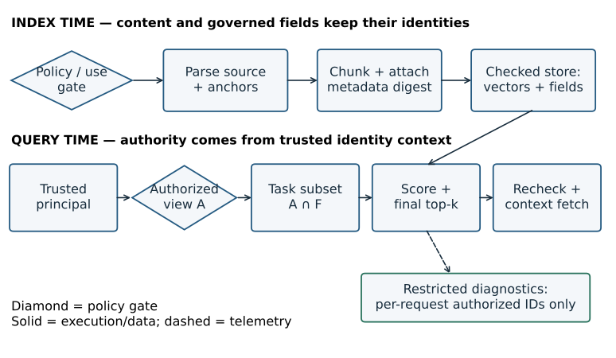
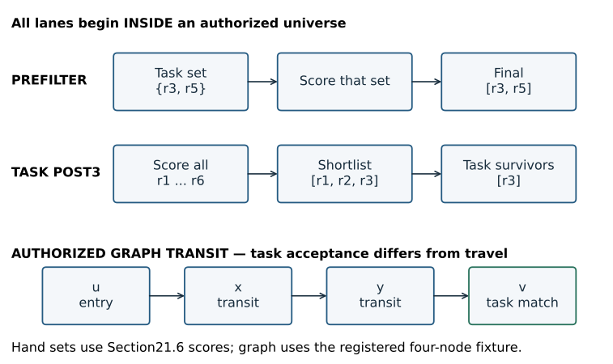
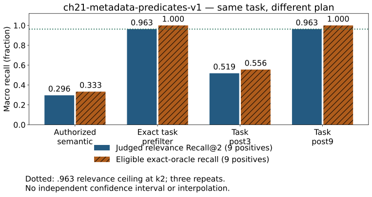
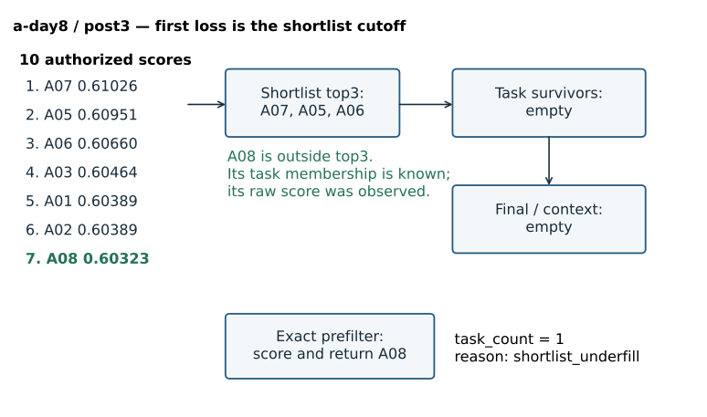

# Chapter 21 — Metadata schemas and filtered retrieval

**Part V · Module 10 · [INTERMEDIATE], with [PRODUCTION] extensions**

**Prerequisites:** Chapters 05 and 13 supply postings, exact predicates and materialized vectors; Chapter 18 supplies filter-specific exact oracles and the distinction between an index and a service; Chapters 19–20 supply trustworthy canonical records, source-preserving chunks and inspected evidence spans. Continue from completed [V5](../projects/V5/README.md), preserving its sources, judgments and negative results. This chapter begins [V6](../projects/V6/README.md). The quarter-book [remediation checkpoint](../audits/QUARTER_BOOK_REMEDIATION_VERIFY_CH01_16.md) remains binding.

**Learning objective:** construct a typed metadata selection mechanism, explain where filters execute, and demonstrate that exact constraints and permissions cannot be replaced by a similarity score. By the end, you will independently implement a bounded selector, compare four retrieval plans, and diagnose a filtered miss from a correlated trace.

## 21.1 A good passage from the wrong set

The operations manual in Chapter 20 taught a painful lesson: evidence that reached the candidate list could still disappear during context packing. Another failure happens earlier. Suppose two organizations both maintain an Orion rollback procedure. Their prose differs by only a waiting period. Within one organization, several publications use nearly identical wording. A question asks for the English publication dated October 8. The nearest passage describes October 7.

The retriever has found the right topic. It has failed the information need. Increasing embedding dimensions does not establish that a publication date equals October 8. A higher HNSW search width can recover a closer vector without recovering the required date. A better chunk boundary can preserve a sentence from the wrong organization perfectly.

We therefore need a different kind of operation: **selection by structured facts**. A date interval, exact record identifier, or tenant boundary defines which records may participate. Similarity ranks the records that remain. This distinction joins the source-quality work of Chapter 19 to the candidate-selection work of Chapters 13–18.

Some structured facts express a user's task. Others express permission. Confusing those two classes is dangerous. A user may change a date restriction to broaden an investigation. A user cannot broaden their permissions by writing “search every tenant.” Authorization determines the searchable universe before relevance scoring. Task predicates narrow that universe further.

**Failure-first sequence:** authorized semantic top2 → wrong date or ID → inspected predicate violations → typed selection → bounded postfilter underfill → eligible exact oracle and physical-plan reasoning. We will preserve each failure rather than describe every empty list as successful filtering.

## 21.2 Metadata is a governed schema

Metadata is structured information associated with a source or retrieval unit. It is not simply whatever a parser happened to place in a dictionary. A **metadata schema** declares fields, types, allowed values, missing-value rules and ownership. A **predicate** is a condition evaluated against those fields. A schema version identifies those semantics; an authorization-policy version identifies the rule that uses them.

Consider the following fields. They answer different questions and should not be collapsed into one “metadata” score.

| Field | Meaning and type | Important boundary |
|---|---|---|
| Source identity and locator | Stable source ID plus original page/line/region anchor | A URL or path can change; retain an identity and a resolvable origin. |
| Tenant | Exact governed string | Taken from trusted identity/policy context, never granted by query text. |
| Owner | Responsible person/team identifier | Ownership does not imply read permission. |
| ACL | Explicit allowed principals/groups/roles | Missing ACL denies here; absence is never interpreted as public. |
| Published timestamp | Time the source was published | Different from ingestion time, event time and effective time. |
| Updated timestamp | Source modification time under a stated clock | A parser run does not make an old policy current. |
| Source version | Positive integer in this fixture; separately bound raw version string | Version comparison needs a declared scheme, not arbitrary string ordering. |
| Entity | Controlled identifier such as `Orion` | Entity resolution and aliases are separate from exact equality. |
| Language | Governed string or unknown/null | Unknown does not mean every language; multilingual text needs a deliberate representation. |
| Hierarchy | Original parent/section identity | Child permission must respect the parent's policy; expansion needs another check. |
| Record/chunk IDs | Stable logical record and content-bound retrieval-unit identities | Exact record lookup differs from embedding lookup and physical ordinal access. |
| Extraction confidence | Finite numeric estimate with method/version | A parser-confidence field is neither relevance nor answer confidence. |
| License, permitted use, retention | Recorded source-governance decisions | Indexing approval is a gate; vector similarity cannot grant usage rights. |

V6 uses a small role-based ACL: same tenant **and** at least one granted role. It has no explicit deny rules, group nesting, expiring grants or document-specific policy language. Those are production extensions, not properties of the toy implementation. Chapter 50 develops the broader security system.

**Authentication** establishes an identity from a trusted credential. **Authorization** decides what that identity may access. V6's `Principal` is a trusted fixture object supplied by the experiment runner; it performs no authentication. In a service, the identity layer must construct that context. An LLM extraction step or client-supplied JSON cannot grant itself a tenant or role.

The fixture's metadata is manually curated and checksum-bound. There is no cryptographic signature mechanism. A body sentence mentioning a signed approval is source content, not proof that an extracted tenant field is authoritative. Give security fields to a policy-owning system, and retain provenance for task fields extracted from documents. A model may suggest an entity or publication date; an uncertain suggestion must not silently become a permission grant.

### Missing, null and malformed values

An absent date could mean “not supplied,” “unparseable,” or “not applicable.” Those meanings often deserve separate quality states. Our bounded schema rejects missing or malformed required timestamps. An optional unknown language is represented by null. An exact `language='en'` predicate does not match null; omitting a language predicate imposes no language restriction. An explicitly requested null is invalid in this exercise. This is a defined local rule, not a claim that all SQL/OData systems share it.

An empty ACL and a missing ACL both deny in V6. Unknown schema or policy versions deny. Booleans are rejected as source-version integers even though Python treats `bool` as an integer subclass. Nonfinite confidence values are invalid. These checks prevent permissive defaults from turning a data-quality problem into access.

> **Checkpoint.** A source has an owner, a language and a very high extraction-confidence score, but no ACL. Explain why none of those three facts supplies a read grant.

## 21.3 Index time: preserve identity while adding fields

Chapter 19 captured exact raw bytes and original locators. Chapter 20 generated chunks whose text equals a canonical source slice. Adding metadata must preserve both contracts. The source/version/hash/record digest and canonical range still identify the text; a new metadata digest binds the structured attributes and policy version. A changed date or ACL can alter eligibility without altering the vector's coordinates.

At index time, the bounded V6 job follows this sequence:

1. Validate the governed metadata and approved indexing use before resolving or reading a source path.
2. Check consistency among metadata record/version, descriptor source/version and allowed scopes.
3. Run the unchanged Chapter 19 parser and normalization policy.
4. Use Chapter 20's `structure48` boundary mechanism; these short fixture sources each produce one original-source unit.
5. Attach the verified metadata and its digest to that unit; preserve its original anchors.
6. Encode the body with the same pinned, normalized 384-dimensional MiniLM model; metadata is not prepended to the embedding input.
7. Store vectors, fields, content identity, ID mapping and model/schema/policy versions in a checked snapshot.

The indexer has explicit fixture privileges for each valid source. That does not make all its indexed rows searchable by every reader. The accepted corpus includes an admin-only document that ordinary readers never score. Two other descriptors stop before source reading: one has an empty ACL, and one lacks approved indexing use.

**Figure 21.01 — Metadata joins the source lineage and gates the query.** Source identity and policy remain bound at index time. At query time the trusted principal establishes the authorized universe before vector access. Task predicates cannot widen that universe. [Editable source](../visuals/chapter-21/render_visuals.py); [fixture metadata](../projects/V6/sources_ch21.json).



*Alt text:* The upper lane validates approved source policy, parses original content, attaches inherited metadata and materializes vectors. The lower lane receives a trusted principal, forms an authorized set, applies task predicates, scores candidates and rechecks permission before context fetch. A separate diagnostic lane receives only permitted IDs.

Parent and child metadata require explicit inheritance rules. A child cannot grant access that its parent forbids. If a child carries additional restrictions, expansion must satisfy both relevant policies; taking the union of grants can accidentally enlarge access. This chapter uses one original parent per source and no parent expansion. Chapter 20's expansion lesson still applies whenever a later system fetches larger original units.

Exact duplicate text also does not justify merging records across metadata boundaries. A01 and A02 have identical prose but different publication dates and original identities. A date-constrained question can require one and exclude the other. Keep both origins; any content-storage deduplication must preserve their policy and query-visible identity. A shared embedding is a storage possibility, not permission to collapse the records.

## 21.4 Query time: set algebra before ranking

We need only finite sets and the already-taught exact scorer. Let `U` be the stored retrieval-unit roster. Let `A(p)` be the subset authorized for trusted principal `p`. Let `F(q)` be the subset matching the task predicates of query `q`. The searchable task set is

```text
E(p,q) = A(p) ∩ F(q)
```

Intersection means membership in both sets. It does not average two scores. Within `E`, use the declared ranking function `s(q,d)` and stable ID tie rule to compute `Top_k(E)`. If fewer than `k` units are eligible, exact search can return only those units. If `E` is empty, there is no eligible candidate for that task, however large a similarity elsewhere might be.

For the V6 ACL, membership in `A` requires approved indexing use, valid policy metadata, tenant equality and role overlap:

```text
authorized(d,p) = use_approved(d)
                  AND schema_and_policy_valid(d)
                  AND tenant(d) = tenant(p)
                  AND roles(p) ∩ acl_roles(d) is nonempty
```

Role overlap is an OR among grants inside the same tenant boundary. Tenant equality remains an AND. The query may request `tenant='B'` as a task restriction, but under principal A that yields an empty intersection. It cannot replace the principal with B.

### Exact equality, date ranges and Boolean predicates

An exact ID comparison tests the governed identifier string; it does not tokenize, stem or embed it. `A03` and `a03` are different here. A controlled ingestion policy could canonicalize them, but then both index and query must use that policy, and collisions need review.

Dates are timezone-aware instants. We normalize comparisons to UTC and use half-open intervals `[a,b)`: include `a`, exclude `b`. The UTC October 8 day is from `2026-10-08T00:00:00Z` through, but excluding, `2026-10-09T00:00:00Z`. The first instant is also `2026-10-08T05:30:00+05:30`. These offsets describe the same instant; stripping the timezone would change the comparison. An aware timestamp must also be distinguished from a calendar date in a user's locale. Decide whose day the question means before compiling it.

Half-open ranges make adjacent days meet without overlap. They do not solve time-zone rules, ambiguous daylight-saving local times, late updates or as-of validity. Published, effective and ingested times answer different questions. Chapter 22 handles lifecycle and temporal-version semantics; this chapter compares a frozen publication field.

Our typed predicate dictionary supports conjunctions of exact record, tenant, owner, entity, language and version predicates, plus publication lower/upper bounds. A SQL-like spelling illustrates the intent:

```sql
WHERE tenant = :trusted_tenant
  AND role_allowed = true
  AND entity = :entity
  AND language = :language
  AND published_at >= :start_utc
  AND published_at < :end_utc
```

This is conceptual SQL, not a database launched by V6. In a real query builder, use parameter binding and an allowed field/operator grammar. Never `eval` model-generated expressions or concatenate raw query text into SQL. Parentheses and typed values matter when extending conjunctions to OR/NOT. Under three-valued null semantics, `NOT(field='en')` need not mean “include every unknown language.” Specify and test the target engine's rules before compiling expressions.

Unknown fields or malformed values fail validation before selection. A question parser is a future Chapter 23 component; V6 uses reviewed predicates stored beside the frozen questions. Consequently the experiment evaluates predicate execution, not natural-language date/entity extraction.

## 21.5 Three placements, one authorization boundary

**Prefiltering** determines task eligibility before scoring. With an exact scorer, it computes `Top_k(A ∩ F)` directly. An exact equality posting or date index can make the subset small enough that exact vector search is attractive. “Prefilter” describes placement; the implementation still needs a safe authorized universe.

**Task postfiltering** scores an already authorized set, obtains a bounded shortlist `Top_L(A)`, then applies the task predicate and takes up to `k` survivors. The operation is

```text
Top_k( Top_L(A) ∩ F )
```

It is generally different from `Top_k(A ∩ F)`. Top-L is lossy. Filtering cannot restore a match already cut away. Our `post3` and `post9` plans use exact scoring over A, so every miss they introduce is a task-shortlist loss rather than an ANN approximation. An ANN postfilter may suffer both losses.

**ANN-aware filtering** integrates task membership into approximate search. In a graph, the result-acceptance rule can test a task bitset while traversal continues through other *authorized* vertices. In IVF, an engine can intersect task IDs with probed lists, increase probing when matches are scarce, or fall back to exact scoring over a small task set. These are distinct physical plans with different work and recall. A product's `filter` option alone does not tell you which one ran.

**Figure 21.02 — The same eligible set, different candidate losses.** Exact prefiltering scores the matching subset. A task postfilter can discard every short-listed item while a matching document sits below the cutoff. Traversal-aware acceptance can use a task-ineligible bridge inside an already authorized graph. [Editable source](../visuals/chapter-21/render_visuals.py); [actual plans](../projects/V6/metadata_ch21.py).



*Alt text:* Three lanes start after authorization. Prefilter narrows the score pool to task matches. Postfilter takes a short list before intersection and can miss a lower-ranked match. The graph lane traverses an authorized nonmatching bridge while accepting only a matching endpoint; no unauthorized transit is depicted.

### Why graph filtering can damage connectivity

Recall Chapter 17: neighbor edges guide discovery. Removing all vertices that fail a task predicate can remove the route to the nearest matching vertex. The deterministic bridge workload has chain `u → x → y → v`; only v matches the task. Allowing authorized x/y as transit discovers v. Pruning x on task membership stops immediately and misses v. [Actual frontier events](../projects/V6/chapter-21-experiment.json) record both outcomes under `ch21-authorized-task-bridge-v1`.

This is exhaustive traversal of four preassigned nodes, not HNSW, a trained index or a latency benchmark. It demonstrates connectivity, not a production filtering algorithm. Authorization is a different constraint: this book does not permit scoring or traversing private vectors and calling the result safe because private vertices are not returned. Use authorized partitions, a verified policy-specific index/view, or another design that satisfies the before-scoring boundary. Handling many overlapping ACLs efficiently is real engineering work; the bridge example does not solve it.

### Why final ACL postfiltering is insufficient

A global top-k list followed by an ACL check can already have accessed a forbidden vector, ID, source, cache entry or trace. It can also consume all k slots with forbidden items, leaving no permitted result. Deleting the final text cannot undo an earlier disclosure or wasted slots. No such global-ACL baseline runs in V6. Every running plan first constructs the principal-authorized view; postfilters apply only to task attributes inside it. A forward fetch rechecks authorization before text enters context.

## 21.6 Selectivity, oversampling and a hand example

Define **task selectivity** relative to the authorized universe as

```text
σ = |A ∩ F| / |A|, when |A| > 0
```

State the denominator. Selectivity over the entire multi-tenant store can be very different from selectivity within a tenant's authorized rows. No authorized rows is a separate state, not a divide-by-zero ratio to silently replace with zero.

If each shortlist item independently matched with probability σ, the expected number of survivors at depth L would be `Lσ`. Setting `L ≈ k/σ` targets an expectation, not a guarantee. Under that artificial independent model the probability of no survivors is `(1−σ)^L`. Real metadata and rank are correlated: recent documents, one language, or a specific category may cluster at particular ranks. An average-selectivity rule can fail badly on the requests that matter.

For a hand calculation, suppose an authorized list has six rows:

| Rank | ID | Similarity | Matches requested day? |
|---|---|---:|---|
| 1 | r1 | .90 | No |
| 2 | r2 | .88 | No |
| 3 | r3 | .85 | Yes |
| 4 | r4 | .84 | No |
| 5 | r5 | .80 | Yes |
| 6 | r6 | .70 | No |

For k2, the eligible exact oracle is `[r3,r5]`, and σ is 2/6. Postfilter depth 3 returns only r3: oracle recall is 1/2, even though the underlying global scorer is exact. Depth5 recovers both in this example. Depth2 returns none. At depth 6, an exact global ordering with the same scores/ties necessarily contains all eligible rows; a bounded ANN search still needs its own coverage guarantee.

The expectation heuristic gives `k/σ=6`. It does not promise that a depth 6 approximate search visits all six rows, and neither it nor a larger `efSearch` establishes task recall without comparison to the eligible oracle. If only one row is eligible at k2, returning one is complete for the eligible oracle. Calling that result an “underfilled error” would punish correct behavior. Define underfill as returning fewer than `min(k,|E|)` when E is known.

Dynamic depth can be useful: start with a declared budget, inspect authorized task survivors, expand the search, and stop at enough candidates or a work/time bound. Retain each actual intermediate pool. On an uncertain empty result, an exact authorized-subset fallback can distinguish insufficient search from no task matches. Do not relax an exact date automatically, and never relax authorization. Explain any user-approved broadening as a different task with a different predicate.

## 21.7 Build the bounded mechanism before reading the reference

Complete [lab A0](../labs/chapter-21/LAB.md#a0-construct-the-metadata-selector) now. Implement a metadata-only selector on a fresh six-row fixture. It must intersect tenant/role eligibility with optional language and aware date predicates, reject malformed query predicates, preserve half-open endpoints and return stable sorted IDs. Do not open the separate solution first. Running V6's completed code is not this construction task.

After your attempt and hand checks, inspect the larger [reference implementation](../projects/V6/metadata_ch21.py). It materializes a private per-principal metadata view. Exact fields have postings keyed by `(field,value)`; publication instants have a sorted array. For `[a,b)`, two lower-bound binary searches locate the date slice. Intersect the resulting ID sets with exact-field postings, processing smaller sets first.

A lower bound is the first array position whose value is at least the requested instant. On sorted day values `[6,6,7,8]`, lower bounds for6 and 7 are positions0 and 2, so the half-open slice `[0,2)` contains both day 6 rows and excludes day 7. Binary search repeatedly halves the possible position interval; it locates a boundary in logarithmic comparisons. Materializing the selected IDs still costs work proportional to the range size. Equal timestamps therefore require no arbitrary single-row choice.

Here is the query sequence, with scoring and content fetch deliberately separated:

```text
validate typed predicate
authorized_view = build view from trusted principal + policy metadata
task_ids = intersect exact postings and date slice within authorized_view
if prefilter: score task_ids
else: score authorized_view; retain actual top-L shortlist
if task postfilter: retain shortlist IDs in task_ids
take up to k final candidates under score/ID order
recheck permission before forward content access
pack actual whole units under the inherited context budget
emit correlated, access-controlled stages; evaluate separately
```

The semantic baseline omits the task-intersection step after scoring; it still satisfies authorization. It is useful precisely because it can rank a topically plausible wrong-date passage. The baseline is not presented as a finished exact-constraint service.

The reference supports an exact record-ID predicate, but still scores the singleton through the common experiment path. A service can route known exact IDs directly to an authorized lookup and avoid embedding the question. That query-routing design belongs to Chapter 23. Comparing such a route's latency requires a new timing boundary rather than crediting this experiment with an unrun bypass.

### Complexity and storage

For N authorized rows, F indexed exact fields and dimension d, building the toy view takes `O(NF + N log N)` time and `O(NF)` posting memberships plus the date array. Exact equality lookup gets a posting set; a date interval costs `O(log N + R)` to locate and materialize R matches. Set-intersection cost depends on the sets actually processed.

This Python implementation also copies the N-ID authorized roster on every selection and rebuilds the view per request. Its selection is therefore not an `O(log N)` end-to-end claim. Scoring E costs `O(|E|d)`; full sorting costs `O(|E| log |E|)`, plus repeated policy checks. Heap top-k from Chapter 10 can reduce ordering work. The reference favors inspectability over optimal data structures.

Packed normalized float32 coordinates need `N_store × d × 4` bytes before IDs/metadata/graphs/allocator overhead. V6's fifteen accepted rows imply 23,040 coordinate bytes; A's reader pool has ten rows and B's four. These are arithmetic payload lower bounds. The JSON file is larger and is not resident-memory measurement. Metadata postings, stored locators, repeated strings, authorized-view copies and repeated policy evaluation have their own costs.

Production designs may use sorted IDs, compressed bitmaps, range indexes, persistent partitions and cached views. A dense bitmap for one predicate over N rows uses approximately N/8 payload bytes; a posting list can be smaller for a sparse predicate. Whole bitmap intersection reads words across the universe, whereas sparse-list intersection depends on posting lengths. Which wins depends on cardinality, representation and memory locality. High-cardinality fields can make one-index-per-value impractical; arbitrary role combinations can explode policy-view counts.

Tenant-safe caching includes authorization context/policy identity as well as corpus/index/model, task predicate and query identity. An identical question across tenants is not an interchangeable cached result. Revocation and version changes require invalidation or revalidation. A semantic-cache near match can differ in date, tenant or exact ID; similarity cannot approve cache reuse. V6 implements no cache or live-revocation protocol.

## 21.8 A controlled experiment with exact constraints

**Workload: `ch21-metadata-predicates-v1`.** [Frozen labels](../projects/V6/qrels_ch21.json), [source descriptors](../projects/V6/sources_ch21.json), [checked record](../projects/V6/chapter-21-experiment.json) and [registry](../evaluation/WORKLOAD_REGISTRY.md) define the comparison. This is a new corpus, not a relabeling of V5 or evidence of longitudinal improvement over its context recall.

**Question and hypothesis.** Does a similarity ranking obey exact date, ID, entity, language and tenant constraints? Exact prefiltering should obey them and match the task-eligible oracle. Shallow task postfiltering should sometimes miss a match that exists lower in the authorized exact ranking.

**Data and judgments.** Seventeen fictional descriptors produce fifteen accepted single-unit sources: ten A-reader sources, four B-reader sources and one A-admin source. Invalid ACL and unapproved-use descriptors stop before source read. Twelve inspected questions have nine positive cases and three empty task cases: requested other tenant under A's principal, absent publication day and absent French publication. One positive range has three relevant sources, yielding eleven positive memberships in 108 fully reviewed authorized query–unit pairs. All other authorized pairs are labeled nonrelevant under the bounded waiting-period task. Unreadable/private pairs are not relevance negatives.

Requirements bind exact waiting-period source spans and original line anchors. The manifest binds raw/canonical/record identity, approved-use/retention/scope and metadata digest, including schema/policy versions. A changed date, ACL, locator or source byte rejects the labels rather than refreshing a checksum automatically. The expected task matches are also checked against the manually reviewed source IDs. This is possible because every fixture match directly answers this narrow template task; arbitrary matching metadata in a real corpus is not sufficient for relevance.

The questions and labels were authored and inspected by one author. They form a development/diagnostic fixture with no train/dev/test split. Predicates are supplied correctly; language and date extraction are not tested. The Spanish singleton cannot establish cross-lingual encoder quality when the predicate leaves only one candidate.

**Plans and controls.** All four plans share each principal, question, task predicate, source/qrels, body-only pinned MiniLM revision, normalized stored float32 vectors, exact dot accumulation and stable ID ties. Semantic returns top2 from the authorized universe. Prefilter scores the task subset. Post3 and post9 filter authorized top3/top9 then return at most 2. The inherited whole-unit selector uses the Chapter 20 proxy budget of 80 encoder WordPieces without special tokens; it is not a generator token budget. No reranker or answer model runs.

**Procedure.** Encode approved source units and twelve questions using the cached model with downloads disabled. Audit tokenizer lengths first; the longest indexed input is 64 including two special tokens, below 256. Execute three warm repetitions per query/plan in randomized order with seed 21013. Save real scored pools, shortlists, task survivors, final candidates and context packing attempts. Save actual vectors and replay all 144 ordered search results after a trusted snapshot reload. Twelve query-encoding envelopes plus 144 search/context requests yield 156 common envelopes; the bridge adds two separate workload samples.

**Metrics.** Macro relevance Recall@2 averages nine positive queries. The range query has three positives, so its maximum at k2 is 2/3; the workload ceiling is `(8 + 2/3)/9 = .962963`. Eligible-oracle recall divides by the exact top `min(2,|E|)` set and measures plan loss separately. Context source recall measures whether judged original-source requirements remain in selected units, not answer correctness. Precision@2 uses denominator 2 even on short lists and averages all twelve queries. Empty correctness is candidate emptiness on three zero-positive queries, not generated abstention. Predicate violations count returned units outside the task set, never unauthorized units.

**Table 21.01 — Measured quality on `ch21-metadata-predicates-v1`.** Three repetitions reproduce deterministic quality; they are not 36 independent questions. Recall uses nine positives, empty correctness three, and precision all twelve. [Data](../projects/V6/chapter-21-experiment.json).

| Plan | Relevance Recall@2 | Eligible-oracle recall | Context source recall | Mean Precision@2 | Correct empty fraction | Predicate violations/pass |
|---|---:|---:|---:|---:|---:|---:|
| Authorized semantic | .2963 | .3333 | .2963 | .1667 | 0/3 | 20 |
| Exact task prefilter | .9630 | 1.0000 | .9630 | .4167 | 3/3 | 0 |
| Task post3 | .5185 | .5556 | .5185 | .2500 | 3/3 | 0 |
| Task post9 | .9630 | 1.0000 | .9630 | .4167 | 3/3 | 0 |

**Figure 21.03 — Correct filtering and complete retrieval are separate.** Post3 has no predicate violations but loses eligible evidence. Prefilter/post9 match the eligible oracle here while relevance recall remains below 1 because k2 cannot return all three range-query positives. [Editable plot](../visuals/chapter-21/render_visuals.py); [registered data](../projects/V6/chapter-21-experiment.json).



*Alt text:* Categorical bars compare authorized semantic, exact prefilter, task post3 and task post9. Oracle recall is .333,1,.556,1; relevance recall is .296,.963,.519,.963. A line marks the .963 relevance ceiling. All values refer to the same nine positive fixture queries; the three empty cases are a separate denominator.

Prefilter scores an average of 11/12=.9167 units per question; the other plans score an average of 9 authorized units, because ten queries use A's ten-row pool and two use B's four-row pool. These are work counts, not proof that a production engine is nine times faster. In the checked record, [stage timing summaries](../projects/V6/chapter-21-experiment.json) report nearest-rank p50/p95 over 36 requests/plan for the combined filter-and-search operation, and separate authorized-view construction and context packing. Query encoding, model load, passage encoding, serialization and quality evaluation are outside search timing. Three local repeats on tiny templates cannot establish service p95 or an ANN algorithm's advantage.

**Table 21.02 — Checked local work and latency on `ch21-metadata-predicates-v1`.** Units are milliseconds, except mean scored units. Each plan has 36 warm requests with the same twelve questions; view and packing are separate stage medians, not contributions to be added to a search percentile. [Data](../projects/V6/chapter-21-experiment.json).

| Plan | Mean scored units | Filter/search p50 ms | Filter/search p95 ms | View p50 ms | Packing p50 ms |
|---|---:|---:|---:|---:|---:|
| Semantic | 9.0000 | 0.9166 | 2.2115 | 0.2009 | 0.0118 |
| Prefilter | 0.9167 | 0.1814 | 0.3466 | 0.1887 | 0.0085 |
| Post3 | 9.0000 | 0.9921 | 2.1333 | 0.2000 | 0.0088 |
| Post9 | 9.0000 | 0.8994 | 2.2581 | 0.1883 | 0.0087 |

**Conclusion.** Keep exact prefiltering for this small frozen V6 fixture. It obeys the task and avoids unnecessary vector scores; post9 costs more scored work while tying its quality. Retain post3's negative result. A different corpus/selectivity/physical plan needs a new matched test. Neither singleton success nor these inspected queries demonstrate generalization, live authorization, freshness or correct answers.

## 21.9 Trace the first lost candidate

For `a-day8`, the requested task is A's October 8 English Orion publication. The eligible source is A08. The authorized exact ranking begins:

| Authorized rank | Source | Actual cosine, rounded | Task match |
|---|---|---:|---|
| 1 | A07 | .61026 | No |
| 2 | A05 | .60951 | No |
| 3 | A06 | .60660 | No |
| 4 | A03 | .60464 | No |
| 5 | A01 | .60389 | No |
| 6 | A02 | .60389 | No |
| 7 | A08 | .60323 | Yes |

The actual trace stores full content-bound chunk IDs and unrounded scores. Source IDs above are a teaching abbreviation. A08 is scored. It disappears at the top3 cutoff, before task intersection. Postfiltering then returns an empty list despite `task_count=1`. This is `shortlist_underfill`, not `no_task_matches`. Exact prefilter scores only A08 and returns it. Nothing about its near-neighbor score difference constitutes confidence that October 7 answers October 8.

**Figure 21.04 — Locate the first loss, not merely the final empty list.** A08 survives authorization and task membership but is rank 7 in the scored authorized pool. Post3 loses it at the shortlist boundary; predicate filtering cannot restore it. [Editable source](../visuals/chapter-21/render_visuals.py); [actual sample](../projects/V6/chapter-21-experiment.json).



*Alt text:* The trace begins with ten authorized scored IDs and highlights A08 at rank 7. The shortlist retains A07,A05,A06. None match the requested day, so survivors, final candidates and context are empty. The recorded task count is 1 and reason is shortlist_underfill; an adjacent prefilter lane returns A08.

Two other failures remain instructive. `b-day8` loses B03 under post3 even though B's authorized pool has only four sources. Oversampling is still bounded. For `a-range`, prefilter returns two correct sources but cannot include the third at k2. That is a cutoff/task-completeness limit, not an eligibility error or an ANN miss. Deciding to change k is a task/budget decision; evaluating such a change requires the new cutoff to be explicit.

### Correlated observability

Every sample retains request/query/mode/trial/workload IDs, corpus/query/qrel/index/model versions, status/reason and stage durations. Search requests additionally retain schema/policy versions, a predicate digest, authorized/task/scored counts, task-match IDs, requested k/depth, all actual scored IDs/scores, shortlist IDs/scores, task survivors, final IDs/scores and inherited packing attempts/context IDs. Candidate scores are carried through selection, not invented for unscored filter members. Query encoding has empty candidate lists and null context. Evidence-claim IDs, answer correctness, faithfulness, citation support and generated abstention remain unrun.

The collector validates against **that request's authorized roster**, not the union of both tenants. A diagnostic that logs B's ID in A's request is a boundary failure even if the final answer is empty. The combined experiment file is an instructor/offline artifact containing fictional A/B fixtures; production traces need access controls equivalent to the data they reveal. It is not a tenant-facing response. Query/source text, raw predicates, exception strings and excluded private IDs never enter ordinary sample envelopes. Protected security events can record authorized audit detail under their own retention/access policy.

Filter logs can themselves leak existence through IDs or counts. Keep internal exact counts and principal associations restricted; expose a neutral authorized no-result behavior at the user boundary. Do not place exact tenant/document/request IDs in metric labels. Bounded plan/status/workload-slice labels support aggregate dashboards; restricted traces support diagnosis.

### A debugging sequence

Start with the known source requirement, then ask:

1. Is the expected source licensed, parsed and content-bound under this snapshot?
2. Is the trusted principal correct, and does the current policy authorize this source?
3. Does the governed metadata express the requested day/entity/language/ID? Is a missing value or timezone conversion responsible?
4. Does the task set contain it? If not, inspect metadata/extraction/query compilation before tuning ANN.
5. Was it scored or visited? Inspect authorized partitions, IVF probe membership or graph frontiers where available.
6. Did shortlist truncation, predicate acceptance or final k remove it?
7. Did context packing preserve the actual source unit? Only after that inspect future generation/verification stages.

Do not reconstruct a hidden native frontier from final IDs. If an engine exposes only counts and a returned pool, state that visibility limit. Exact authorized-subset comparison and a matched fallback can narrow the diagnosis without inventing observations.

## 21.10 Production plans and their limits

After the mechanism, read the verified primary examples. [Elasticsearch's filtered-kNN guide](https://www.elastic.co/docs/solutions/search/vector/knn/filtered-knn-search) distinguishes filter placement and approximate execution. [pgvector's filtering section](https://github.com/pgvector/pgvector#filtering) describes scan-then-filter behavior, bounded iterative scanning and partition/partial-index options. These are examples of different physical plans, not executions performed by V6. Query syntax does not itself establish this book's before-scoring authorization requirement; inspect the engine/version, isolation and actual plan.

[Azure AI Search's OData filter reference](https://learn.microsoft.com/en-us/azure/search/search-query-odata-filter) illustrates typed Boolean/range/collection/null expressions. [Python's datetime documentation](https://docs.python.org/3.14/library/datetime.html) explains aware versus naive times used by our code. Engine null/array/negation rules and clock semantics need explicit tests. Primary documentation was checked on2026-10-13; no vendor performance/default is imported as a recommendation.

A planner should consider task cardinality, authorized partition size, vector dimension, available metadata indexes and observed search difficulty. A narrow exact ID/date subset may favor exact scoring. A broad subset may favor ANN with task-aware acceptance or iterative expansion. Poor graph connectivity can defeat naive task-pruning even when the subset is large. Filter selectivity alone is therefore insufficient; measure eligible-oracle recall, judged recall, work, latency and underfill by slice.

Distributed retrieval complicates this further. Each shard must apply authorization and the same typed task semantics before local relevance scoring. For exact identical scoring, taking at least the global k from each shard's eligible set is sufficient to recover global top-k after a correctly tied merge. Taking only a small global shortlist and filtering later is insufficient. With local ANN, deeper shard shortlists can reduce omissions but do not guarantee global correctness. Shared score definitions/normalization and stable ties are necessary; source-specific scores may be incomparable. Full distributed top-k, shard oversampling and failure handling come in Chapter 51.

The exact argument is simple: if a document has more than k better documents on its own shard under the same total score/ID order, it cannot be in the global top-k. It is safe to drop that document for this exact task. Approximate local omissions and filtering after local truncation break the premise; they need measured oversampling or a different plan.

Metadata statistics and policies drift. A new source mix changes selectivity; a changed language distribution changes retrieval difficulty; a parser upgrade changes field completeness. Record schema/parser/policy/index identities and monitor missing-field and underfill slices. A retriever change is a separate drift dimension. Frozen benchmarks can remain stable while new production dates, languages or tenants fail; review sampled new questions and register new workloads. Chapter 22 develops update/delete/version visibility, including the difference between stored metadata and current source state. A static checked snapshot is not a revocation or freshness guarantee.

## 21.11 Practice, project decision and retention

The [lab](../labs/chapter-21/LAB.md) combines independent construction, source/policy inspection, exact-oracle comparisons, trace diagnosis and a design defense. [Separate worked solutions](../solutions/chapter-21-solutions.md) and a [separate code answer](../solutions/code/chapter_21_mechanisms.py) follow the attempt. The [V6 README](../projects/V6/README.md) supplies reproduction commands and checked decisions.

**Project upgrade.** Keep V0–V5 artifacts as historical baselines. Add the new V6 typed snapshot and workload rather than editing their scores. Compare the four plans on the same questions and evidence requirements. Retain source-bound labels, exact oracle, separate context availability, latency boundaries and at least two actual failure traces. Do not present Chapter 20's .900 context recall and this chapter's .963 as an improvement sequence: corpus, queries and judgments differ. V6's freshness lifecycle remains unstarted until Chapter 22.

**Reasoning and interview prompts**

- Defend a plan for a rare exact date filter on a large authorized vector corpus. What observation would make you switch from exact subset scoring to ANN?
- A team proposes adding tenant match as a ranking feature. Identify the violated invariant and the earliest possible disclosure.
- All returned rows pass the task predicate, yet recall is poor. Distinguish membership correctness, candidate completeness, ranking and source coverage.
- A source lacks a language tag. Give a missing-value policy, an extraction-quality probe and the invalid inference from a singleton language-filter success.
- Describe a cache key and invalidation requirement that prevents an identical question from crossing tenant or policy boundaries.

**Delayed recall.** After1,3,7 and 21 days, redraw `U → A → A∩F → scored pool → shortlist → task survivors → final candidates → context` from memory. Explain which stages each plan omits/reorders, calculate the six-row hand example, and teach why an empty list can indicate correct absence or search loss. Compare the conceptual roles of V0 literal matching, V5 evidence-preserving chunks and V6 governed predicates. The cumulative Part V architecture/project/teach-back assessment follows Chapter 22.

**Flashcards**

- *Does a requested tenant grant authority?* No; it can only narrow the trusted principal's authorized set.
- *Does a legal task survivor prove recall?* No; relevant matches may have been lost before filtering.
- *What is the oracle denominator?* The exact top `min(k,|E|)` members under the declared score/tie rule.
- *What does null language match here?* No requested language equality; an omitted language predicate leaves it unrestricted.
- *What does empty correctness measure here?* Candidate emptiness on three reviewed zero-positive tasks, not generated abstention.
- *What distinguishes task bridges from private bridges?* Task-ineligible vertices may be authorized transit; private vectors remain outside the scoring/traversal universe.

## You understand this chapter if you can…

- Independently implement the bounded authorization/predicate intersection and defend its null, type and timezone behavior on a fresh fixture.
- Explain and compute the difference between `Top_k(A∩F)` and `Top_k(Top_L(A)∩F)` without confusing task filtering with ACL enforcement.
- Preserve source/chunk/locator identity while binding metadata/schema/policy changes to judgments and snapshots.
- Trace a filtered miss to metadata selection, approximate discovery, shortlist cutoff or context packing using actual correlated stages.
- Compute selectivity, underfill and eligible-oracle recall with the correct denominators, and explain the workload's Recall@2 ceiling.
- Defend a provisional exact/ANN/partition/iterative plan under measured quality, work, latency and access constraints.
- State precisely which authentication, freshness, generalization and generation claims the local experiment has not established.

**Next:** Chapter 22 asks how these identities and permissions remain correct as sources change. Do not implement that lifecycle as an invisible extension to this frozen experiment.
