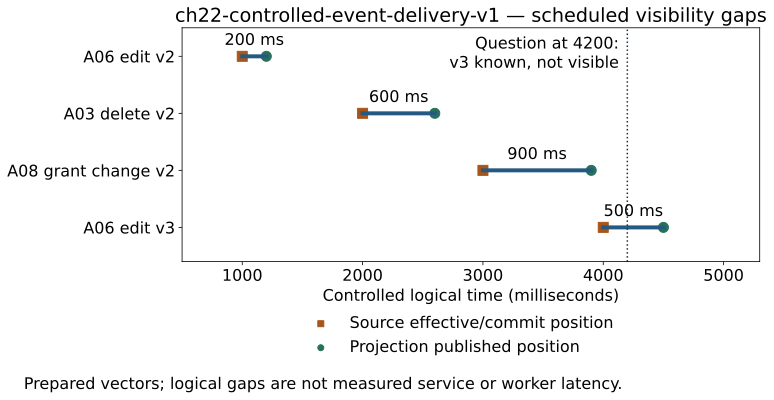
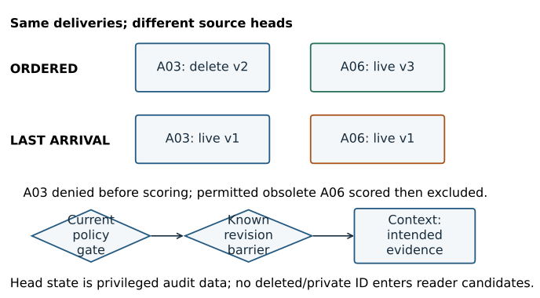
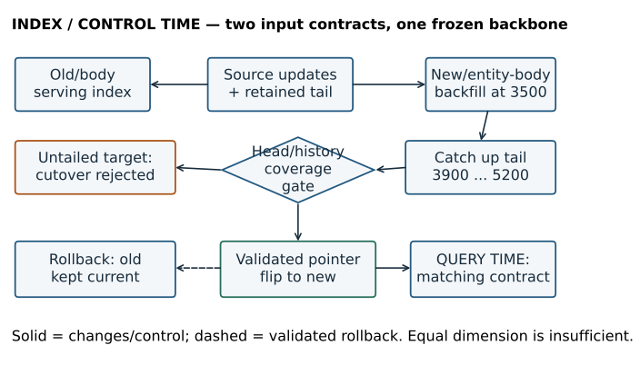
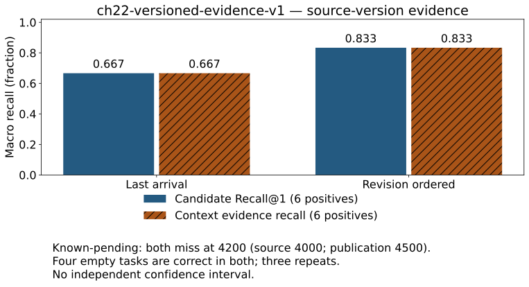

# Chapter 22 — Freshness, versions, and incremental indexes

**Part V · Module 10 · [INTERMEDIATE], with [PRODUCTION] extensions**

**Prerequisites:** Chapters 19–21 supply source approval, canonical records, original locators, source-preserving chunks, typed metadata, current permission checks and a measured exact retrieval baseline. Continue from [V6's metadata stage](../projects/V6/README.md) and the current [remediation checkpoint](../audits/QUARTER_BOOK_REMEDIATION_VERIFY_CH01_16.md). Historical sources and judgments remain unchanged.

**Objective:** keep retrieved evidence tied to the intended source revision while updates, deletions and index migrations occur. You will independently implement a revision/tombstone reducer, trace an edit through search visibility, compare event-order policies, reject an incomplete migration and complete the cumulative Part V assessment.

## 22.1 Yesterday's correct index

Chapter 21's October 6 publication was a perfectly valid input to its frozen experiment. It said that the Orion coordinator waits ninety minutes after approval. Now the source owner changes the waiting period to nine minutes, then to twelve. A search service still has the ninety-minute vector and source unit. Every byte in that old unit can match its old checksum. The old unit can be authorized, well ranked and accurately cited. It nevertheless fails a question asking for the current procedure.

A second source is deleted. An old delivery of its upsert arrives afterward. A worker that treats arrival order as source order recreates the record. A third source changes its readers to an admin-only group. An old cache entry still holds its previous result. Neither a better embedding nor a more selective date filter resolves these failures.

We need a lifecycle contract around the evidence: what changed, which revision supersedes which, when the index reflects it, and which request snapshot the answer uses. This chapter adds that contract to the mechanisms already built. It does not replace relevance with recency. The latest incident note can be less relevant than an older signed procedure, and the newest document can still be wrong.

**Progression:** frozen source/index → observed stale revision → source identity and change detection → ordered upsert/tombstone mechanism → visible publication and retry → current/as-of evidence → dual-generation migration → measured failures and Part V synthesis. The local experiment keeps a known delivery gap rather than forcing freshness to be perfect.

## 22.2 Five identities and several clocks

A stable **source ID** identifies the logical document. A **source revision** identifies one immutable state of that document. A **content hash** identifies bytes or canonical text under a declared normalization policy. A **retrieval-unit ID** identifies a particular source-derived range with its record/chunker identity. An **index generation** identifies a physical searchable representation with its model, input, metric, metadata and publication contract.

These identities are related, not interchangeable. Two source revisions can have identical text and different permissions. Two chunks can have identical words and different origins. A new embedding model can change vectors without changing source text. Renaming an index does not prove that it contains the latest source revisions.

An event needs at least its source ID, operation, source revision, payload identity and an event/delivery identity. The source must supply a trustworthy ordering rule: a monotonic revision, database sequence or another declared cursor. A worker's wall-clock receive time is not that rule. Content hashes detect a difference; they do not order two different contents.

| Clock or position | Question it answers | Common mistake |
|---|---|---|
| Business effective time | When did this fact or rule apply? | Substitute publication or ingestion time. |
| Source commit/revision position | Which source state supersedes which? | Sort by worker arrival or file modification time. |
| Publication/update timestamp | When did the source publish/change this record? | Assume it establishes a universal truth or ordering guarantee. |
| Received/detected time | When did the pipeline learn of the change? | Claim the new evidence was searchable then. |
| Indexed time | When was a representation written? | Treat an unrefreshed write as search visibility. |
| Searchable time | When could a declared reader/index route observe the change? | Ignore replicas, permission views or stale caches. |
| Request snapshot | Which coherent source/policy/index state did this request read? | Combine old vectors with unrelated new text. |

Our fixture uses a **controlled logical millisecond clock** beginning at zero. It specifies source-effective and receive/publication positions to make event ordering reproducible. It is not an observed production clock or service benchmark. Ordinary trace timestamps and CPU durations use actual UTC and `perf_counter_ns`; neither is substituted for the logical timeline.

For a declared source change, define update-to-searchable lag as `t_searchable − t_source`. Detection lag is `t_received − t_source`; post-detection publication lag is `t_searchable − t_received`. All require a clock/position contract, a reader scope, a visibility probe and an explicit denominator. Clock skew can make naive cross-host subtraction meaningless. If an update is superseded before becoming visible, record that disposition rather than inventing a searchable timestamp.

**Figure 22.01 — A source revision can be known before its evidence is searchable.** The controlled fixture separates source commits and projection publication for four changes. These gaps are scheduled arithmetic, not measured worker throughput or an SLO. [Editable source](../visuals/chapter-22/render_visuals.py); [event record](../projects/V6/chapter-22-experiment.json).

*Alt text:* Four lanes show source times 1000,2000,3000,4000 and publication times 1200,2600,3900,4500 milliseconds. The respective logical gaps are 200,600,900,500. A question at 4200 knows revision 3 exists while the projection still holds revision 2; that positive task remains an evidence miss.

## 22.3 Detecting changes without confusing detection with correctness

**Polling** periodically lists sources and compares a trusted version or captured hash with the last observed state. It is simple and can reconcile missed events. Its detection delay depends on the interval and source behavior. A disappeared entry is a deletion only if the listing is authoritative and complete; a timeout, pagination error or lost permission can look similar. Do not turn an incomplete crawl into a delete sweep.

With a polling interval Δ and an ideal independent uniformly timed change, detection wait ranges from zero to Δ and averages Δ/2. A sixty-second interval suggests thirty seconds of average detection wait under those assumptions. It says nothing about fetching, parsing, OCR, embedding, queueing, refresh or cache visibility. A small changed source and a scanned manual have different downstream work.

**Source events** let the producer announce an operation near its commit. Webhooks, message queues and event logs can reduce listing work, but notifications may duplicate, arrive out of order or omit changes. An event carrying only an ID can trigger a fetch whose content is newer than the notified revision. Decide whether the worker processes the specified immutable revision or reconciles to the current authoritative state; preserve the actual fetched identity either way.

**Change data capture (CDC)** reads committed changes from a database log or equivalent source. A snapshot seeds existing state; a log position establishes how to continue afterward. Updates and deletes need source keys and a meaningful cursor. Connector restart, log retention, transaction boundaries and snapshot/log handoff matter. CDC is a source mechanism, not a promise that the vector index or context cache shares the source transaction.

[Debezium's PostgreSQL connector documentation](https://debezium.io/documentation/reference/stable/connectors/postgresql.html) provides a primary example of snapshot/log capture and source positions. The chapter runs trusted fixture events, not Debezium, Kafka or PostgreSQL. It imports no live delivery or durability guarantee from a connector name.

In practice, event-driven capture and periodic reconciliation can complement each other. Reconciliation compares source versions, expected child-unit rosters, permission state and searchable manifests; it should detect an index that acknowledged a receipt but never published its replacement. The source-to-evidence distinction from Chapter 19 remains: a captured revision can still be malformed, unlicensed or missing the required span.

## 22.4 Upserts, retries and tombstones

An **upsert** creates the source if absent or replaces its current projected state if the incoming revision is newer. A **tombstone** records a deletion at a revision even when there is no live content pointer. An **idempotent** operation has the same logical effect when repeated. An idempotency key identifies a delivery/operation; revision comparison prevents an older operation with a different key from superseding newer state.

Use both protections. Deduplicating one event ID does not stop an old upsert with a new ID. Revision comparison alone does not identify an event ID reused for a conflicting payload. At an equal revision, identical content/policy is a duplicate; different content/policy is a conflict requiring investigation. Silently choosing one loses the source-order contract.

The local reducer has these decisions:

| Incoming event | Decision | State to retain |
|---|---|---|
| Seen event ID, identical payload identity | Duplicate event | Existing head/history; receipt remains known |
| Seen event ID, different payload identity | Reject conflict | Existing state unchanged |
| Equal source revision, identical payload | Duplicate revision | Existing state; permit retry of unfinished publication |
| Equal source revision, different payload | Reject conflict | Existing state unchanged |
| Older source revision | Stale under ordered policy | Newer head, including any tombstone |
| Newer valid revision | Accept | New head, immutable history entry and receipt |

Metadata belongs in payload identity. A08's text remains 120 minutes, but revision 2 changes its readers to admins. Deduplicating by text alone would discard an authorization change. This reference reencodes that metadata-only revision for uniform fixture preparation; a production embedding cache can reuse coordinates when actual input/model/normalization are unchanged while still publishing new permission and source-unit identity.

### Hand example: why deleting the record is insufficient

Begin with source x revision 1. Apply upsert revision 2, then delete revision 3. A late upsert revision 1 arrives under a new event ID. Ordered processing retains the revision 3 tombstone. Last-arrival processing replaces the current pointer with revision 1. If deletion instead erased every ordering marker, the worker would have no remembered revision to reject the old operation.

An explicit revision 4 recreation is a different source action. A system may permit it under policy, or require a new logical ID/incarnation. It is not the same as accepting an old retry. Where IDs can be reused, version comparisons need an incarnation/generation component; a revision counter reset cannot safely compete with an earlier tombstone.

Tombstones consume storage and need a retirement rule. Retiring one is safe only when obsolete events, replicas, restore points and caches can no longer recreate the old state, or when a stronger durable ordering record remains. A time-to-live chosen without that reasoning is not a deletion guarantee.

### Construct before reference exposure

Complete [lab A0](../labs/chapter-22/LAB.md#a0-construct-the-revision-reducer) now. Implement the metadata-only revision/tombstone reducer on a fresh fixture, predict the states and add your own replay/conflict case. Keep the first attempt. Only afterward inspect [the separate code answer](../solutions/code/chapter_22_mechanisms.py) and the larger [VersionStore reference](../projects/V6/lifecycle_ch22.py). Running the completed experiment does not replace independent construction.

The reference stages head, history and receipt dictionaries before publishing a successful local transition. A conflict leaves old state intact. History holds immutable source revisions; the head selects the current one. Restore preserves the deletion revision and processed receipts. These are bounded local mechanisms, not a distributed transaction manager.

## 22.5 From accepted source state to visible evidence

For a source edit, the indexer must fetch the intended approved revision, parse it, preserve source/locator identity, produce its chunk roster, encode under a compatible input contract and publish a searchable generation or update. A changed chunking policy can produce fewer, more or differently bounded children. Replacement must retire every obsolete child belonging to the previous source version; appending new chunks while leaving old children live makes current retrieval ambiguous.

Keep the original source ID while giving new content-bound units their appropriate IDs. Store the expected per-source child roster so reconciliation can identify orphaned old chunks. A whole-source replacement is useful for teaching; an optimized system can reuse unchanged chunks only when text, locators, inherited policy and representation contracts remain valid.

**Canonical acceptance and search publication are separate commits.** Suppose the receipt and source head reach revision 2, but encoding or index publication fails. A retry sees the same event ID. If “duplicate” causes the entire job to exit, the index can remain at revision 1 forever. The worker must reconcile desired source state with published index state even on a duplicate receipt. The reference's `Generation.publish` performs that check; a regression injects invalid prepared vectors, then repairs them and proves that a duplicate retry completes publication.

The classroom experiment prepares real vectors before playing its logical event schedule. Its apply/publication CPU timer therefore excludes parsing and encoding. Its controlled visibility gaps are not measurements of a live worker. A real pipeline needs observed fetch/parse/encode/write/refresh/visibility spans and failure/retry states under actual arrival load.

[Elasticsearch's near-real-time documentation](https://www.elastic.co/docs/manage-data/data-store/near-real-time-search) illustrates the difference between a write, refresh/search visibility and a durable commit. Our JSON prototype does not reproduce Lucene segments or refresh behavior. The production question is always which readers can observe which version, not merely whether an API returned success.

### A request must use a coherent representation and text

Do not score a revision 1 vector and fetch revision 3 text through a mutable logical-ID lookup. The ranking then describes one unit while the citation describes another. Bind the forward fetch to the candidate's actual source/version/unit/content/locator identity. Pin an index generation and a declared source/policy snapshot for the request; recheck permission before evidence leaves the service.

This reference has a trusted current source authority separate from the compared projections. It applies known source changes at the controlled source time. Every query intersects **current** authorization with the stored revision's policy before scoring. Deleted sources and revoked readers therefore cannot use old indexes or historical routes to recover evidence. The authority is deliberately more current than a delayed projection to isolate their roles. A real service must obtain a sufficiently current authority or use an explicit fail-closed/expiry policy; the toy does not create instantaneous distributed knowledge of a delete.

For an authorized current task, the reference additionally compares the candidate revision with the known intended source revision. A lagging candidate may be scored and retained in the raw trace, but a **known-revision barrier** prevents it from entering final candidates/context. The result is a visible evidence gap, not silent use of a known obsolete procedure. This barrier is a freshness/task contract beyond the authorization boundary.

**Figure 22.02 — A tombstone prevents resurrection; current policy prevents exposure.** Both projections see the same deliveries. Ordered state retains deletion 2 and current A06 revision 3; last-arrival state regresses. Current authorization and the known-revision barrier remain active in both routes. [Editable source](../visuals/chapter-22/render_visuals.py); [actual transitions](../projects/V6/chapter-22-experiment.json).

*Alt text:* Ordered A03 remains a revision 2 tombstone after a late revision 1 upsert, while last-arrival stores revision 1. Ordered A06 remains revision 3 after late revision 1, while last-arrival regresses. Current deletion denies A03 before scoring in both routes; an obsolete permitted A06 candidate is recorded then dropped before context.

## 22.6 Current, as-of and freshness-biased questions

“What is the current waiting period?” and “What was the waiting period at source time 1500?” are different information needs. A **current** view selects the intended current head. An **as-of** view selects the revision whose declared effective interval contains the requested time. With boundaries 1000 and 4000, revision 2 applies on `[1000,4000)`; time 4000 selects revision 3. Chapter 21's half-open timestamp reasoning now applies to version intervals.

Our bounded history assumes per-source revisions advance with nondecreasing effective times. A higher revision that backdates a correction is rejected under this temporal policy. The historical selector chooses the latest effective boundary not after the requested time, with revision as an explicit tie rule. Backdated corrections, overlapping intervals and multiple truth perspectives require a richer design.

**Valid time** describes when a fact applies. **Recorded/transaction time** describes when the system knew or stored that claim. A rule effective yesterday but received today has two distinct positions. A bitemporal system can answer both “what applies to yesterday?” and “what did we know yesterday?” Those questions need explicit intervals and correction semantics; our one-effective-time history does not implement general bitemporal storage.

Historical access is also a permission question. Keeping an archive does not grant a former reader access after revocation. The prototype intersects current and revision-time grants. Its delete policy blocks every serving route, including as-of, while retained fixture history remains available to the privileged audit artifact. This is logical serving deletion, not physical erasure of raw files, vectors, backups or Git history.

Physical purge requires a separate retention/usage policy covering source copies, canonical stores, vector/posting payloads, caches, logs, backups and derived summaries. Preserve enough noncontent ordering identity to prevent replay resurrection. Record approved licensing and retention decisions; do not infer them from a tombstone or a parser field. The book does not decide legal retention rights for a deployment.

A **temporal filter** constrains eligibility: a source revision must satisfy the requested time/version. A **freshness boost** changes ordering among otherwise eligible records. For example, one illustrative age decay is `r(age)=exp(−age/τ)`, with nonnegative age and positive τ in the same units. It gives 1 at age 0 and about .368 at age τ. Combining that feature with lexical/dense relevance requires calibration on judged questions and comparable score scales. It cannot grant permission, make an incorrect source true or repair a missing revision. This chapter runs no freshness-boosted ranker.

> **Checkpoint.** A document is updated at noon to repair formatting, while an older signed clause still supplies the operative waiting period. Explain why “latest update wins relevance” is an invalid inference, and specify the source/version question the system should actually answer.

## 22.7 Migration means two complete representation contracts

An embedding migration can change model weights, dimension, tokenization, normalization, chunking or input construction. “Both vectors have 384 numbers” proves only shape compatibility. Query and document vectors must obey the declared encoder/input/metric contract of the generation being searched.

The executed migration uses **one frozen MiniLM backbone and two input contracts**, not two trained models. The old generation embeds original chunk bodies and ordinary questions. The new generation prepends the controlled `Entity: Orion` field to both relevant inputs. Both have 384 dimensions, normalized float32 coordinates and exact dot scoring. Their contract identities differ. The experiment tests migration discipline, not whether entity prefixes improve semantic retrieval; exact-ID tasks leave little ranking choice.

### Snapshot, backfill and tail

1. Fix a source/index watermark and capture a consistent snapshot.
2. Build the new generation's actual source/chunk/policy/locator representations from that snapshot.
3. Continue applying changes to the old serving generation; retain or deliver every change after the watermark to the new generation too.
4. Catch up the new generation through a declared tail position, including deletes and policy changes.
5. Verify source heads, history where retained, child rosters, compatible vectors/model/input, permission behavior and frozen query gates.
6. Atomically switch the serving pointer if its expected old generation still matches.
7. Monitor and retain a compatible rollback path under an explicit window.

A backfill without tail capture can finish successfully and still miss an edit made during construction. Dual writing without reliable retry can update one index and fail the other. A durable source log plus replay/reconciliation is often easier to reason about than pretending two independent writes are one transaction.

The fixture snapshots ordered state at 3500. A08's revocation and A06 revision 3 are not yet projected there. A backfill-only target therefore fails the head/history cutover gate at the final checkpoint. Replaying deliveries after 3500 catches the target up, including stale/duplicate deliveries that remain harmless under revision ordering. A validated flip then succeeds.

**Figure 22.03 — Backfill completion is not tail completion.** The executed old/body and new/entity-body generations use distinct contracts. The untailored snapshot is rejected; caught-up state passes; rollback is permitted because the old generation still matches current source state. [Editable source](../visuals/chapter-22/render_visuals.py); [migration events](../projects/V6/chapter-22-experiment.json).

*Alt text:* The old generation serves while the new generation backfills at 3500. Tail changes after 3500 reach both logical states. A stale target fails comparison, a caught-up target passes the pointer switch, and a rollback uses an old generation kept current. Same-dimensional old query input is rejected on the new contract before scoring.

### The serving pointer and rollback

A compare-and-swap changes the pointer only if it still names the expected old generation. This prevents a stale administrator action from overwriting another successful change. It does not by itself prove data coverage or freshness; the gate must validate the target first. The local implementation is single-process. Its pointer update is not a distributed linearizability proof.

[Qdrant's collection-alias documentation](https://qdrant.tech/documentation/manage-data/collections/) offers a primary example of an atomic alias operation. We run no Qdrant service. An alias API does not automatically check an application's watermark, qrels, policy authority or embedding input contract.

Rollback needs both compatible query encoding and compatible source state. An old model index frozen at cutover can become stale as updates continue. Either keep it updated during the rollback window or rebuild/catch it up before reuse. Never roll back deletion or permission authority merely to recover an older ranking configuration. The fixture's old generation has received all source events, so the rollback gate succeeds. A stale old generation would fail the same comparison.

### Caches are another projection

The result cache binds trusted tenant/roles/policy, current source-authority digest, generation identity, encoder contract and frozen query/task identity including as-of. A cache hit retains its original scoring request ID; it is not a new score computation. The trace has an empty raw scored pool and an actual cached-payload stage. A generation, tenant or source/policy epoch change misses. Every retrieved cache payload is revalidated before returning IDs, and permission is rechecked before content fetch.

A query-text-only cache key cannot distinguish a current question from an as-of question or two tenants. A semantic near match can change an exact date, source ID or version. Exact task constraints and policy must validate a cache reuse independently of similarity. This prototype uses exact keys and conservative whole-authority invalidation; it implements neither semantic caching nor a distributed cache invalidation protocol.

## 22.8 A version-bound experiment

**Workload `ch22-versioned-evidence-v1`.** [Requirements](../projects/V6/qrels_ch22.json) bind the unchanged Chapter 21 approved corpus plus three immutable update capsules. A capsule contains a canonical source record, original source-unit map and governed metadata. Eighteen source-version capsules include fifteen initial sources, A06 revisions 2/3 and A08 revision 2. A03 deletion is an event without a live content capsule. [Descriptors and changed raw files](../projects/V6/fixtures_ch22/updates.json) are captured separately; old Chapter 21 files are preserved.

**Question/hypothesis.** Does revision ordering prevent replay regression while keeping current/historical evidence correct under current permissions? Ordered state should reject stale upserts, but a known source revision can still be unavailable before its delivery. A backfill target must not cut over until caught up.

**Baseline/controls.** Last unseen arrival wins versus ordered source revision. Both share event-ID/revision duplicate protection, current authorization, the known-revision barrier, actual normalized body vectors, exact record tasks at k = 1, query vectors and whole-unit 80 encoder-WordPiece context proxy. Authorization failures are not scored as relevance negatives. The known-revision barrier is deliberately present in both; the baseline is a flawed projection, not an unsafe permission experiment.

**Questions and labels.** Ten inspected single-author questions have six positive source-span requirements and four empty tasks. Positives cover initial current, visible edit, known pending edit, final current, and two as-of states. Empty tasks cover deleted current/history, revoked historical access and wrong tenant. These are version/content/policy/time-bound requirements, not complete graded query–chunk judgments. There is no train/dev/test split, unseen-source claim or model-generalization experiment.

The manifest binds raw/canonical/record/unit/locator/metadata identity; update-descriptor hash binds origins and approved-use policy; event-schedule digest binds the temporal questions. The loader independently checks each reviewed expected revision against the trusted source schedule and current/revision grants. Changed text, locators, metadata or event semantics reject the labels rather than refreshing a digest automatically. A learner's edited corpus needs a reviewed new workload and labels.

**Procedure.** Reuse the fifteen trusted Chapter 21 body vectors, actually encode three update units and all eighteen entity-prefix units, and encode ten questions under each contract using the cached pinned model. Audit limits before encoding. Play four source commits and seven deliveries against both projections. Query three warm repetitions per checkpoint/mode in fixed chronology; mode order is fixed, so latency order effects remain a limitation. Store actual candidates, freshness barriers and packing attempts. Save a local checkpoint with real vectors, source states, histories, receipts and query vectors. Reload it under an independently expected digest and replay twenty scored/final candidate sequences exactly.

Two additional registered workloads isolate mechanism drills. `ch22-controlled-event-delivery-v1` records fourteen privileged ingest/publication attempts, seven per ordering policy, after fifteen seeded sources. `ch22-compatible-generation-cutover-v1` records fourteen final-checkpoint queries across two input contracts plus six contract/cache controls. Its seven judged questions have three positives/four empty tasks; controls have no relevance labels. These records are not extra independent production questions.

**Metrics.** Recall@1 averages six positive questions; context evidence recall measures whether the required source-version unit survives packing. Correct-empty fraction averages four zero-positive tasks. Stale scored-candidate fraction averages all ten and identifies an observed raw candidate that fails the requested source-version requirement. None measures answer correctness, faithfulness, citation support or generated abstention. Logical lag arithmetic and CPU search/packing timings have separate units and boundaries.

**Table 22.01 — Quality on `ch22-versioned-evidence-v1`.** Three repetitions reproduce deterministic outcomes, not thirty independent questions. The positive delivery gap remains in both denominators. [Checked data](../projects/V6/chapter-22-experiment.json).

| Projection | Recall@1: six positives | Context evidence recall | Correct empty: four tasks | Stale scored fraction: ten tasks |
|---|---:|---:|---:|---:|
| Last arrival | .6667 | .6667 | 1.0000 | .2000 |
| Revision ordered | .8333 | .8333 | 1.0000 | .1000 |

**Figure 22.04 — Correct event order does not eliminate delivery lag.** Ordered processing repairs the final-current replay failure, but still misses the question asked before revision 3 publication. Current policy protects empty/deleted/revoked tasks in both controls. [Editable plot](../visuals/chapter-22/render_visuals.py); [registered data](../projects/V6/chapter-22-experiment.json).

*Alt text:* Last-arrival and ordered bars show .667 and .833 recall/context recall over six positives. The unresolved source-known/index-pending checkpoint is highlighted separately. Four authorized-empty tasks remain correct in both; the graph does not imply independent confidence intervals or a production freshness guarantee.

**Table 22.02 — Local search timings on `ch22-versioned-evidence-v1`.** Milliseconds, nearest-rank p50/p95 over thirty warm requests/projection. Version selection, current policy, exact score and known-revision barrier are included. Query encoding, fixture preparation, index publication, context, evaluation and serialization are outside the search timer; packing has its own median. [Data](../projects/V6/chapter-22-experiment.json).

| Projection | Search p50 ms | Search p95 ms | Packing p50 ms |
|---|---:|---:|---:|
| Last arrival | 0.2187 | 0.3212 | 0.0051 |
| Revision ordered | 0.2068 | 0.4462 | 0.0070 |

Three repeats on exact-ID singleton tasks cannot estimate service tail latency or an ANN quality curve. The ordered route's higher observed p95 is not hidden, and no speed superiority is inferred. The four scheduled source-to-publication gaps are 200,600,900,500 logical milliseconds on the event workload; they are not these CPU durations.

**Decision.** Retain ordered projection, known-current permission/revision barriers and tail-validated generation changes for V6. Preserve the pending-delivery miss and last-arrival regression. New-prefix and old-body generations both pass the final version tasks; that establishes migration parity on this fixture, not better embeddings. Keep historical V0–V6 metrics under their original workload identities.

## 22.9 Diagnose the first inconsistent boundary

At checkpoint 4200, A06 revision 3 is known at the source, but both projections still contain revision 2. The raw candidate is the actual 9-minute unit, with its actual score. The shortlist contains it. The known-revision barrier removes it because the task requires revision 3's 12-minute evidence. Final candidates and context are empty, with reason `known_revision_pending`. Increasing k or HNSW search width cannot discover a revision absent from the searchable generation.

At checkpoint 5300, last-arrival processing has accepted late A06 revision 1 after revision 3. It scores the 90-minute unit and drops it at the same barrier. Ordered state retains revision 3 and supplies the 12-minute unit. The trace makes these two failures distinguishable: delayed publication versus an incorrect source head after replay.

The deleted A03 behaves differently. Last-arrival's internal head has regressed to revision 1, but current source authority says deleted. It never enters the scored pool, including in an as-of query. Inspecting the privileged transition reveals the projection error; the ordinary reader trace does not expose an excluded ID. A final empty result is correct here but does not prove the projection itself is healthy.

### Correlated request and ingestion evidence

The eighty main envelopes comprise twenty actual query encodes and sixty search/context requests. Every search retains request/query/mode/trial/workload, corpus/query/qrel/index/model identities, status/reason, source-truth digest, controlled checkpoint/as-of positions, actual scored/shortlist/freshness-barrier/final IDs/scores and actual packing attempts/context IDs. Context is empty on a known pending revision; no missing generator/evidence-claim stage is fabricated.

Ingest envelopes have opaque delivery query IDs, empty scored candidate pools and null context/evidence. Their privileged transition fields record received/source positions, before/incoming/after revisions, duplicate/stale/accepted disposition, actual publication identity and published units. They do not invent relevance scores for an upsert. The checkpoint persists enough head/history/receipt state to replay and diagnose omissions.

Migration probes use the correct generation/input contract. An incompatible old-contract query emits a redacted invalid envelope with no candidate IDs. A cache hit carries an actual cached-payload stage and scoring-origin request ID; misses are measured in their actual tenant/generation/source-policy context. Exact IDs and source-truth digests belong in restricted traces, not unbounded metric labels. Combined fictional instructor artifacts are not tenant-visible logs.

### Debugging and recovery sequence

1. Verify trusted source ID/incarnation/revision and the event/payload identity; distinguish content from metadata changes.
2. Compare source, received, accepted and searchable positions; inspect queue, parser/quality, encoding, publication and refresh states actually available.
3. Check duplicates, out-of-order deliveries, equal-revision conflicts and tombstone retention. Do not acknowledge an unseen valid revision as a duplicate by text alone.
4. Compare desired source head/child roster with published index state. Retry unfinished publication even if the receipt already committed.
5. Pin generation, encoder/input/metric and actual forward-text version. Refuse incompatible query vectors rather than accepting matching dimensions.
6. Check current permission/deletion authority before current or historical retrieval and before context fetch.
7. Validate source/index/policy/task cache identity and origin; invalidate or revalidate stale results.
8. Compare the target with its snapshot watermark and full tail before cutover/rollback; validate representative frozen queries and visibility probes.

Do not infer an unobserved refresh, broker acknowledgment or replica state from a fast query. If authority is unavailable, there is no permission to assume an old cached grant remains valid. Define an explicit failure behavior and bounded staleness contract rather than inventing confidence.

## 22.10 Local persistence, cost and production limits

The reference writes one JSON checkpoint through a temporary file, flushes/fsyncs it and replaces the target path. Reload requires the independently expected payload digest. [Python's OS documentation](https://docs.python.org/3.14/library/os.html) supplies the relevant file primitives. A checksum detects mismatch relative to a trusted expectation; it is not a signature. This single-process checkpoint is not a distributed transaction, authenticated event log, universal power-loss guarantee or backup/restore service.

With H retained source revisions and R receipts, the toy state stores `O(H+R)` metadata/history entries. Copy-on-commit can cost `O(H+R)` per event. `Generation.sync` validates/rebuilds mappings and identities across retained rows, so it is not a production `O(changed documents)` implementation. Exact-ID queries narrow candidates to one intended unit; archival selection scans that source's retained revisions. A production design can use per-source ordered histories, incremental posting/vector mutations, immutable segments and compaction while preserving the same invariants.

Two complete 384-dimensional float32 banks over eighteen units have a coordinate payload lower bound of `2 × 18 × 384 × 4 = 55,296 bytes`, before query vectors, IDs, metadata, source text, maps, replicas, temporary build state and object overhead. This is not JSON size or measured RSS. Backfill can temporarily hold old/new indexes, raw/canonical sources, retained originals for refinement and a change tail. Dual-write work, validation, cache invalidation and rollback retention also consume compute/storage.

Changes to actual embedding input require encoding; pure policy changes can avoid it when validated input/model identity is unchanged. Hash comparison and chunk-diff logic have costs too. A source with thousands of changed children has different indexing work from this one-unit fixture. Corpus/source/language drift can alter both relevance and update workload; source-update lag and retriever quality need separate monitoring and versioned question sampling.

Production ingestion in Chapter 49 and distributed serving in Chapter 51 add queues/workers, backpressure, retries, independent failures, replica visibility and operational recovery. Chapter 50 adds deeper authorization/deletion/security tests. The durable lesson is already available: **a searchable evidence version is a publication state with permissions and provenance, not merely a vector write.**

## 22.11 Practice and V6 completion

Complete [the lab](../labs/chapter-22/LAB.md), including actual edited/deleted source proofs and the independent reducer. [Separate solutions](../solutions/chapter-22-solutions.md) explain the timeline, replay and migration outcomes. [V6 reproduction](../projects/V6/README.md) preserves the frozen Chapter 21 baseline and adds this explicitly new workload; .833 source-version recall is not longitudinal improvement over Chapter 21's .963 predicate recall.

**Design/interview questions**

- A duplicate receipt is acknowledged while the new evidence remains absent. Where can a job have partially committed, and what should retry reconcile?
- A backfill reports complete, but a delete arrived during construction. State a cutover gate that prevents resurrection.
- Two vectors have equal dimension and normalization. Explain which additional identities must match before dot products are meaningful.
- An as-of policy question requests evidence the user once could read but cannot read now. Defend a historical authorization policy and a safe rejection trace.
- A rollback target has excellent old quality metrics and stale source heads. Explain why those metrics do not establish rollback readiness.

**Flashcards**

- *Does a content hash order revisions?* No; it detects identity/difference under a declared policy.
- *What survives a delete to block stale replay?* A revision/incarnation-aware tombstone or equivalent durable ordering barrier.
- *Can a duplicate require more work?* Yes; canonical acceptance may precede failed index publication.
- *Is newest source necessarily most relevant?* No; temporal eligibility and freshness features differ from relevance/truth.
- *Does as-of bypass current permissions?* No under this book's serving policy; current and historical grants intersect.
- *What makes rollback valid?* Compatible query/index contracts, current source/policy state and passed visibility/quality gates.

## 22.12 Part V cumulative checkpoint — trustworthy evidence over time

Close notes before attempting this assessment. Use Chapters 19–22 and [the separate Part V rubric](../solutions/chapter-22-solutions.md#part-v-cumulative-assessment-rubric) only after your first attempt.

### A. Architecture from memory

Draw separate index-time, query-time and evaluation/control lanes. Include source approval and capture, parser/normalization/quality quarantine, canonical maps, chunks and original anchors, model/input identity, governed metadata, revision/tombstone processing, generation publication, current/historical selection, authorization, actual candidate/packing stages and source-bound judgments. Add a change tail and cutover pointer. Mark which V6 features run locally and which production duties remain unimplemented. An index write must not be labeled an answer or search-visibility guarantee.

### B. Cross-chapter reasoning

1. A source hit is correct but its scanned amendment is absent. Locate the earliest failure and explain why reindexing unchanged canonical text cannot fix it.
2. Candidate evidence recall is high but a whole parent exceeds 80 encoder WordPieces. Distinguish boundary, representation and packing choices.
3. A requested-date result is empty while a matching source is below top 3. Compute the Chapter 21 shortlist loss and the right eligible oracle.
4. A role change leaves text unchanged. Explain which hashes/versions/state must change and which vector work may be reusable.
5. An old upsert follows a delete. Apply your reducer, then explain tombstone retirement and request authorization separately.
6. A06 source revision 3 is known at 4000 but published 4500. Diagnose the 4200 question without calling the empty result a negative relevance judgment.
7. A new model index contains all snapshot rows but lacks the post-watermark tail. Defend a cutover and rollback decision with actual source/policy evidence.
8. Compare the meanings and denominators of extraction preservation, source-span candidate recall, predicate oracle recall and current-version/context recall. None alone proves answer correctness or citation faithfulness.

### C. Running-project comparison

Reconstruct V0's literal search/evidence/stub behavior, V5's canonical-source/chunk/packing responsibilities and V6's governed eligibility/lifecycle responsibilities. Preserve two recorded negative cases from each relevant later stage. For each numeric result, identify its workload, content/query/qrel versions, cutoff, eligibility and timing boundary. Compare paired mechanisms only on compatible workloads. Explain why .875 preservation, .900 chunk-context recall, .963 predicate recall and .833 version recall are not an improvement curve.

### D. Delayed recall and teach-back

On days 1,3,7 and 21, redraw the source-to-context and update-to-visibility paths without notes. On days 3/7, explain one actual stale-revision trace and one source/chunk/filter failure to a novice, predicting the next stage before opening its trace. Keep correction and successful-reattempt evidence. The author supplies tasks/solutions, not fabricated learner outcomes. Do not advance to Chapter 23 merely because reference code runs.

## You understand this chapter if you can…

- Independently implement and defend revision ordering, duplicate/conflict handling and retained tombstones on a fresh fixture.
- Distinguish source identity/revision, actual content/unit identity, source/effective/received/searchable positions and request snapshots.
- Trace an edited/deleted source through current/historical permissions, actual published candidates and context with bound evidence versions.
- Recover publication after a committed receipt without accepting stale replay or discarding equal-revision conflicts.
- Explain why shape compatibility, completed backfill, successful pointer switching and a cache hit each require additional validation.
- Reproduce the matched lifecycle experiment, preserve its known-pending negative result and avoid cross-workload/generalization claims.
- Complete the cumulative Part V architecture, reasoning, project comparison and delayed teach-back with the boundary gates satisfied.

**Next:** Chapter 23 changes how questions are normalized, classified and routed over this trustworthy corpus. Its authoring has not begun.
