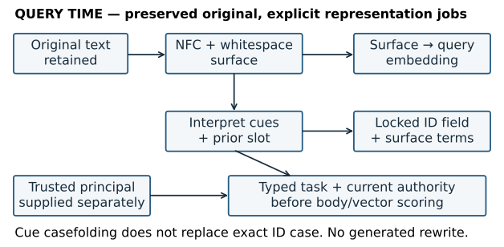
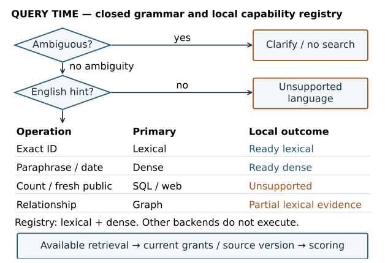
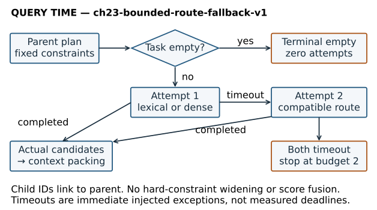
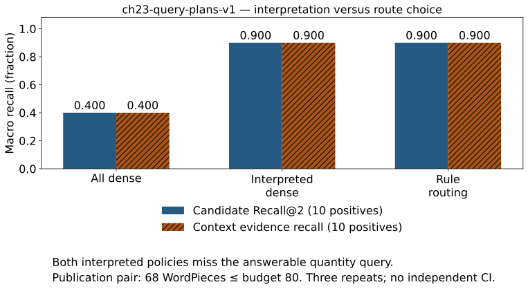

# Chapter 23 — Normalize, classify, route, and contextualize queries

**Part VI · Module 11 · [INTERMEDIATE]**, with [PRODUCTION] design extensions

**Prerequisites:** Chapters 05, 13 and 20–22. You can preserve identifiers through an analyzer, run a measured exact dense retriever, trace source-preserving chunks, enforce typed constraints before scoring, and distinguish current authority from a searchable source version. Complete the [Part V checkpoint](chapter-22-freshness-versions-and-incremental-indexes.md#2212-part-v-cumulative-checkpoint--trustworthy-evidence-over-time) before continuing. V6 is the binding source, permission and telemetry baseline; this chapter begins [V7](../projects/V7/README.md).

**Objective:** Turn a request into an explicit, bounded evidence-access plan while preserving what the user actually asked.

## 23.1 A healthy index can answer the wrong information need

The index now has a considerable amount of engineering behind it. Its text came through approved ingestion, its units retain original locators, its metadata has declared types, and its current and historical reads obey current permissions. Chapter 22 can reject obsolete evidence before context construction. None of those mechanisms determines what a new question means.

Consider three requests against that same system:

> “A06 waiting period?”
>
> “What was A06's waiting period as of source time 1500?”
>
> “How many Orion rollback records are there?”

The first asks for one precise record. The second requires a particular historical version. The third asks for an operation over a set of records. Embedding all three and returning two nearby passages changes none of these requirements. A semantically similar passage can be the wrong record; the current twelve-minute passage can be the wrong version; two passages can be an incomplete basis for a count.

Part V established **which source state may be served**. Part VI begins with **which evidence operation this request requires**. The distinction matters in an incident: an exact search over the wrong candidate universe can be entirely correct as a vector computation and still fail the information need.

Our progression is: preserve the request → expose its constraints → classify the evidence operation → choose an available route → enforce authority and version → inspect actual candidates → stop or make one compatible fallback. We will measure where this policy helps and where a coarse interpretation rule loses evidence. Generated paraphrases, expansion, decomposition and candidate fusion belong to Chapters 24–25.

## 23.2 The original query is an anchor, not a disposable string

A **query** is the text or structured request supplied to retrieval. An **information need** is what the person needs to know. They often differ: a short follow-up depends on prior context, a misspelling obscures a term, and an identifier can select one publication rather than a topic.

Store the original text in an appropriately governed request or evaluation plane. Derive separate representations with declared purposes. A readable normalized surface, a lexical token sequence, an embedding input and a typed predicate need not be identical. Their relationships must be inspectable. Keeping only the final transformed string removes the evidence needed to diagnose lost intent.

The local normalizer performs Unicode NFC composition and collapses whitespace. It preserves case, punctuation and numbers in its surface output. It retains the original bytes separately. For example:

```text
Original:    "  A06\t waiting period?  "
Surface:     "A06 waiting period?"
Exact slot:  record_id = "A06"
Lexical cue matching may casefold tokens.
Exact field matching still uses "A06".
```

NFC makes canonically equivalent character sequences comparable. Compatibility normalization such as NFKC can also remove distinctions: a full-width symbol can become an ordinary-width one. Whether that equivalence is acceptable depends on the field contract. Unicode's normalization specification explains the difference; it does not decide which product IDs your application should equate. Our narrow fixture requires confirmation for lowercase or full-width identifier-like inputs rather than silently inventing an exact ID. The Python runtime's actual Unicode database version is part of the environment; citing a newer specification does not upgrade it. [Unicode normalization forms](https://www.unicode.org/reports/tr15/tr15-58.html).

A case-insensitive vocabulary channel can coexist with a case-sensitive identifier field. Removing punctuation from `ERR-42`, lowercasing a code symbol, or compatibility-folding a product serial can destroy the only distinguishing signal. Chapter 05's query/index analyzer agreement still applies. An exact-field lookup must use the field's declared representation, not a token chosen because it looks close.

Spelling correction is another inference. A dictionary may suggest `rollback` for `rollbak`; an edit distance tells us the cost of transforming one string into another, not whether the correction is the intended term. One deletion or substitution costs one in the simplest edit-distance model. Real spelling systems use term frequency, neighboring words and domain vocabulary as additional evidence. An unfamiliar part number is not necessarily a spelling error. Offer a suggestion, retain the original search, or require confirmation when a protected token would change. [Spelling correction in classical IR](https://nlp.stanford.edu/IR-book/html/htmledition/spelling-correction-1.html).

The executable policy does not correct spelling. Its `Green rollbak waiting period` case keeps the typo and searches the original normalized surface. If that succeeds, it is a result of the available representation and preserved entity constraint, not evidence that a spelling corrector ran.

**Figure 23.01 — Preserve the request while giving each representation a job.** The query-time diagram separates original text, cue matching, locked fields and encoder input. It depicts actual local data paths; it is not generated query rewriting. [Editable source](../visuals/chapter-23/render_visuals.py).



*Alt text:* The original request remains an anchor. NFC and whitespace normalization produce a surface. Cue matching produces typed constraints and provenance; the surface supplies the dense encoder, while a locked record slot also supplies the exact lexical field. Neither path changes the trusted principal.

## 23.3 Interpretation produces typed slots and uncertainty

A **slot** is a named component of a request, such as a record ID, entity or time interval. An **intent** describes an operation or information need. “Orion” identifies a subject; “count Orion records” asks for an aggregation. An **entity mention** is a string in a question; entity resolution maps it to a governed identity. Our closed grammar recognizes only the two explicit entity names in the fixture. It does not claim open-world named-entity recognition.

A useful interpretation record separates:

- original request and normalized surface;
- language and its origin;
- exact IDs and explicit entities;
- time field, axis, interval and resolution rule;
- operation cues, unresolved references and ambiguity;
- slot provenance and competing interpretations;
- route decision and the reason for that decision.

Do not replace uncertainty with a single confident-looking paraphrase. `A01 or A06` has two IDs; selecting the first would invent a choice. Two entities may indicate a comparison, a relationship or an accidental collision. This chapter's bounded grammar asks for clarification rather than implementing a comparison planner it has not taught.

Our grammar recognizes an exact record as an isolated `A` or `B` followed by two ASCII digits. It retains the exact matched case. It recognizes `Orion` and `Green` through a separate case-insensitive cue channel. It validates dates rather than accepting every string with a date-like shape. These rules are deliberately visible: a learner can predict both their coverage and their failure.

Language requires equally explicit treatment. A declared English query is not proof that every word is English, and a detected language is not necessarily the language of the desired documents. Code-switched queries, transliterated names and cross-lingual information needs need their own slices and labels. Here a declared non-English query is unsupported by the English interpretation grammar. The corpus still contains Spanish evidence; no multilingual or cross-lingual quality result is claimed. A production detector and multilingual router would require separate calibration and multilingual retrieval evaluation.

### Calendar constraints are not source-version clocks

`published on 2026-10-06` becomes a half-open UTC interval:

```text
published_gte = 2026-10-06T00:00:00Z
published_lt  = 2026-10-07T00:00:00Z
```

The grammar declares UTC publication days. `published from 2026-10-01 to 2026-10-03` includes the first two days and excludes the third boundary. It uses Chapter 21's aware timestamp comparisons. February 30 is invalid; an apparently well-formed string is not a valid calendar date.

`as of source 1500` uses Chapter 22's controlled logical effective-time selector. It is a teaching-fixture clock, not a Unix timestamp or a publication date. A requested source time beyond the controlled reference clock is unresolved future state and requires clarification. Publication metadata and source version selection answer different questions. A06's revised body has changed while its original publication date remains October 6. Filtering publication date alone does not select the historical nine-minute version.

Natural relative expressions require a reference clock, timezone and semantic policy. “Yesterday” can mean a local calendar day; “last week” can mean a calendar week or the preceding seven days. Around daylight-saving transitions, a local day need not equal twenty-four elapsed hours. Clarify the axis and resolve to an explicit interval before execution. Our runner does not guess these meanings. It returns `unresolved_time` for unsupported relative expressions rather than silently using the execution host's clock.

## 23.4 Contextualize a follow-up without importing authority

“What is its waiting period?” can be a complete information need after a record selection and an ambiguous request in a fresh session. **Contextualization** resolves a reference using permitted conversation state. It need not create a new natural-language query.

The local prior-turn capsule contains one record ID, an entity, a session identity, a digest of the trusted principal, an expiration on the controlled clock and an origin query ID. The application supplies it separately from user text. To use it, the interpreter verifies session and principal binding, checks that it has not expired, requires exactly one syntactically valid record and rejects an explicit entity conflict. It then fills `record_id=A06` with provenance `prior_turn:prior-A06-turn`.

That slot is a task constraint. It does not grant access to A06. The normal current-policy check still runs. A record selected before revocation can no longer be read merely because the conversation remembers it. A copied capsule from another tenant/session is rejected. The fixture's principal digest detects a mismatch under this trusted application contract; it is neither a signature nor authentication of arbitrary client state.

The dense encoder still receives the unchanged normalized surface. The lexical route receives the surface and the separately locked record-field term. This is a declared field-selection operation, not an LLM rewriting the follow-up. The original question, slot and origin remain distinguishable. If the prior state contains A01 and A02, clarification is required: choosing the most recent or highest-scoring one would add an unsupported referent.

Do not carry all previous conversation text into every query. Unbounded state imports obsolete dates, stale preferences, private identifiers and irrelevant instructions. Define the lifetime and owner of each reusable slot. A later conversation chapter expands state management; this chapter uses one bounded prior-turn capsule because that is enough to make reference binding and its failure visible.

## 23.5 Choose an evidence operation before an available implementation

A **route** selects a source or retrieval mechanism. A **query plan** records the operation, constraints, selected route, capability checks, budget and terminal behavior. A deterministic router is a rule policy; a learned router predicts a decision from data. Neither name describes retrieval quality on its own.

**Table 23.01 — Operations constrain permissible routes.** These are candidate choices, not universal winners. The local runner implements only the two retrieval mechanisms already taught.

| Need | First route considered | What must survive dispatch |
|---|---|---|
| Exact ID or quoted token | Exact field / lexical | Exact symbols, current grants, requested source version |
| Paraphrased concept | Dense | Entity/time constraints, query/document model contract |
| Publication interval | Metadata selection then retrieval | Named time axis, aware half-open interval |
| Count, sum or join | SQL / typed API | Complete operation scope, schema and row permissions |
| Explicit relationship | Graph / planned traversal | Relation semantics, edges and source provenance |
| Fresh public change | Web / approved live source | Freshness need, source policy and trust |
| External operation | Specific tool | Validated arguments, permission and execution limits |

A date query is not necessarily a separate “date search engine.” In the implementation, typed publication constraints reduce the authorized candidate set, then the existing dense mechanism ranks it. Exact IDs use Chapter 21's record field, with lexical scoring inside the selected set. A route can compose taught mechanisms without claiming a new backend.

Counts are particularly easy to mishandle. Returning `k=2` passages and counting them computes the size of a truncated retrieval result. It does not compute the number of qualifying records in a corpus. A SQL or API route must execute the intended operation over the declared authorized set and return result provenance. That execution is taught later. A complete authorized metadata scan could also implement a bounded count; SQL is a representative route. This deployment publishes no aggregation operation, even though its fixture metadata is available. Here the router selects SQL as the required operation and reports its unavailability.

For relationships, the local capability policy permits an explicitly **partial, evidence-only** lexical fallback when graph execution is unavailable. It may return passages mentioning a dependency. It has not traversed a graph, established path completeness or verified a relationship answer. The partial flag is part of the result contract, not a footnote to a fabricated graph result.

A public-web need cannot safely become a local-current answer just because a local retriever exists. Current in the local source-state contract is not proof of latest public information. An unavailable live route remains unsupported. Tools are also not permission shortcuts: a route to an external API needs that API's input, identity and access contracts.

Elasticsearch's term-query documentation provides a production analogue for exact indexed-term matching versus analyzed full-text matching. Which mapping or normalizer applies still matters. We run no Elasticsearch service and import no engine default as our policy. [Exact term queries](https://www.elastic.co/docs/reference/query-languages/query-dsl/query-dsl-term-query).

### An independent construction gate

Before opening the running router, complete [lab A0](../labs/chapter-23/LAB.md#a0-construct-the-five-kind-policy). Implement the five-kind policy from its contract, predict a fresh fixture and add an ambiguity/capability counterexample. Retain the first failing run. Only afterward inspect [the separate bounded answer](../solutions/code/chapter_23_mechanisms.py) or [the larger interpreter](../projects/V7/query_ch23.py). The completed reference is an explanation target, not a substitute for construction.

**Figure 23.02 — A router may search, clarify, stop or return partial evidence.** The decision tree includes availability and terminal branches. It precedes the query-time authority gate; route selection cannot create eligibility. [Editable source](../visuals/chapter-23/render_visuals.py).



*Alt text:* Ambiguous inputs go to clarification and unsupported languages stop. Exact-ID, paraphrase/date, count, relationship and fresh-public classes request lexical, dense, SQL, graph and web respectively. The local registry offers lexical/dense. Missing SQL/web stop, missing graph permits only marked partial lexical evidence, and an available selected retrieval still passes authorization/version checks.

## 23.6 Confidence belongs to a decision with a measured meaning

The presence of an ID pattern is an observed feature. It is not a 0.99 probability that the whole request is understood. This router records reasons and leaves `route_confidence=null`. A lexical score, dense similarity, exact field match, route confidence and answer confidence measure different things.

A learned router might estimate probabilities over operations. A classifier logit is an unconstrained score for an operation. A softmax converts logits to probabilities summing to one, as in Chapter 12. That arithmetic does not make the probabilities empirically calibrated. Calibration asks whether decisions assigned approximately 0.8 confidence are correct approximately eighty percent of the time on a declared labeled distribution. Labels must describe intended operations and constraint retention, not merely which backend happened to return something. Route correctness is still insufficient: a correctly chosen dense route can miss relevant evidence.

The decision may depend on asymmetric costs. Suppose the probability of a correct interpretation is 0.8, the cost of executing a wrong operation is ten units, and clarification costs one. Under this simplified two-outcome model, executing has expected error cost `(1−0.8)×10=2`, while clarifying costs one. The corresponding execution threshold is greater than 0.9. These are illustrative policy costs, not a learned threshold or our measured scores. Different consequences and user contexts change the decision.

Evaluate trigger errors separately. A false positive may classify a duration request as aggregation and refuse searchable evidence; a false negative may send an actual corpus count to dense retrieval. Both can be hidden by average passage recall if unsupported questions are excluded. Keep operation labels, ready/partial/clarify/unsupported rates, per-class errors and user cost alongside retrieval metrics.

Likewise, no-result detection must name its boundary. An exact authorized task set can be empty. A lexical scorer can find no positive term match. A dense top-k can return neighbors despite missing relevant evidence. A timeout says the operation did not finish, not that there is no answer. A known unpublished version is a source-visibility failure, not a low similarity score. Preserve these distinct reasons internally while respecting what the user may learn about inaccessible sources.

A calibrated similarity threshold or dynamic `k` can be useful after judged development: increase depth when broader candidate coverage is needed, or reject poor matches under a defined no-result policy. A threshold fitted on one corpus/model/language does not automatically transfer. In this chapter `k=2` stays fixed and dense similarity has no answerability threshold. Exact-ID constraints naturally yield at most one eligible source; increasing `k` cannot create another correct record.

## 23.7 Exact execution and one compatible fallback

The [local executor](../projects/V7/retrieval_ch23.py) uses the frozen final ordered V6 state. It validates the independently expected checkpoint digest and source capsules, then restores the source authority and actual body-only vectors. It does not rebuild historical V6 labels or replace earlier metrics.

At query time, interpretation happens before text/vector scoring. The trusted principal is supplied separately. Current authorization excludes deleted, revoked and other-tenant records. An as-of request also intersects the archived revision's permissions. Metadata selection applies the interpreted task constraints inside that authorized, version-coherent view. Only then does a route score candidate text or vectors. The executor also requires an explicit compatible query model/input contract and rejects configured backends it has not implemented.

The lexical route uses Unicode word tokens over exact record ID plus source body. Its BM25 parameters are `k1=1.2`, `b=.75`; query terms are distinct. Authorized-view document statistics are rebuilt for this tiny fixture. Task constraints choose scored IDs, while document frequency and average length use that authorized view. The exact-ID slot is also a lexical field term, so a resolved follow-up does not depend on its pronoun matching the source body. Dense scoring is the existing normalized dot product over frozen body vectors and the compatible surface-query vector.

For a hand example, suppose the authorized view has three equal-length records and `A06` occurs once in only one record. For that term, positive BM25 IDF is

```text
ln(1 + (3 − 1 + .5)/(1 + .5)) = ln(8/3) ≈ .980829.
```

With term frequency one and length equal to the average, the saturation fraction is `2.2/(1+1.2)=1`, so the contribution is .980829. That is a lexical contribution, not a relevance probability. If the exact record predicate selects A06, other records are not scored for this task. If current authority has deleted A06, the task set is empty before any body or vector access; the same arithmetic is inapplicable.

The execution policy tries at most two routes. On a selected lexical or dense backend timeout, the alternative may run with exactly the same task constraints and source authority. A second timeout terminates with `retry_budget_exhausted`. Authorization, integrity and programming errors are not caught as retryable timeouts. A successful empty exact-ID task does not broaden to unrelated records. A zero positive lexical score is recorded as a successful no-match boundary, not converted into an unlimited search loop.

In compact pseudocode:

```text
plan = interpret(original, bound prior slots, capability registry)
view = currently authorized requested-version rows
task = select(view, plan.constraints)
if clarify/unsupported: stop with declared outcome
if task empty: stop; do not relax a hard constraint
for route in selected then one compatible alternative:
    try actual scoring within task
    on retryable timeout: record failure; continue
    on other failure: record redacted failure; raise
    on completion: retain actual pools; stop
recheck current permission; fetch actual version; pack context
```

**Figure 23.03 — Retry the mechanism without changing the question.** Parent and route attempts are correlated. A first controlled timeout permits one alternative; two failures stop. A successful empty hard-ID task takes the terminal branch directly. This is a bounded deterministic policy, not an agent. [Editable source](../visuals/chapter-23/render_visuals.py); [controlled cases](../projects/V7/chapter-23-experiment.json).



*Alt text:* One parent request binds the plan and authorized task. Each actual route attempt has its own correlated record. A timeout can switch lexical/dense once while retaining the same predicate. Both failures terminate; an empty exact-ID task performs no backend attempt. SQL, graph and web are not executed in this control experiment.

## 23.8 A matched query-policy experiment

**Workload `ch23-query-plans-v1`.** [Frozen questions and labels](../projects/V7/qrels_ch23.json) bind the eighteen immutable V6 source capsules and final authority to twenty-one original queries, session/principal/context definitions and expected plans. Ten positive questions have eleven inspected source-span requirements; four tasks require empty evidence; seven have separately judged guard outcomes. These are source requirements and operation labels, not complete graded query/document pairs.

The slices are exact identifiers, paraphrases, publication dates, a prior-turn reference, source history, spelling, a quantity counterexample, no-result boundaries and guard requests. The guard set includes ambiguity, unavailable SQL/web, partial relationship evidence and unsupported language. An evidence-only relationship fallback has no positive source requirement: we evaluate its declared partial decision, not graph-path correctness. Original strings and expected interpretations are frozen; changing either requires review.

**Question and hypothesis.** Does interpretation prevent wrong-evidence dispatch on the same healthy source state? Typed identifiers, dates and references should repair some all-dense mistakes. Choosing lexical after those constraints may merely tie dense within the same tiny candidate set. A coarse aggregation cue may reject an answerable duration question.

**Baseline and variable.** `dense_all` uses the normalized original surface and searches current authorized heads without interpreted constraints. `constraint_dense` shares interpretation, guards and requested-version/task selection but selects dense for ready searches. `rule_route` uses the same interpretation and chooses lexical/dense according to its rules. Comparing all-dense with either interpreted policy changes the interpretation/dispatch bundle. Comparing the latter two on shared plans is the narrower route-selection ablation. It is not valid to attribute the bundled gain entirely to lexical search.

**Controls and procedure.** All policies use the same frozen model, trusted final source state, current grants, query surfaces, `k=2` and inherited whole-unit eighty-encoder-WordPiece context proxy. One source-version lookup supplies actual original-version context. Query encoding has separate correlated samples. Three warm repeats shuffle query/policy pairs with seed 23014; search reuses the prepared vectors. There is no training, development/test split or generalization claim. Reloaded query vectors reproduce sixty-three scored/final/context outcomes.

**Metrics.** Positive Recall@2 averages ten questions, with the two-source publication question contributing one per-question recall fraction. Context evidence recall asks whether required source units survive actual packing. Required-empty correctness averages four tasks. Guard decision accuracy averages seven separately labeled guard tasks. Intent/slot accuracy checks class, predicate and time against their expected definitions. Full rule-plan accuracy additionally checks the selected route and declared planning outcome across twenty-one questions. These denominators are deliberately separate.

**Table 23.02 — Query-policy quality on `ch23-query-plans-v1`.** The values come from the checked experiment; three repeats reproduce the same deterministic decisions rather than create sixty-three independent questions. [Data](../projects/V7/chapter-23-experiment.json).

| Policy | Positive Recall@2 (10) | Context recall (10) | Required-empty (4) | Guard decision (7) |
|---|---:|---:|---:|---:|
| All dense | 0.400 | 0.400 | 0.000 | 0.000 |
| Interpreted dense | 0.900 | 0.900 | 1.000 | 1.000 |
| Rule routing | 0.900 | 0.900 | 1.000 | 1.000 |

**Figure 23.04 — Interpretation and route selection have different evidence.** The paired plot keeps candidate and packed-context recall separate. The source-state and constraint controls make the quantity false trigger and the actual packing outcome visible rather than removing failures from the denominator. [Editable plot](../visuals/chapter-23/render_visuals.py); [registered data](../projects/V7/chapter-23-experiment.json).



*Alt text:* Three categorical policies share one workload. Candidate and context bars use ten positive questions. Interpreted policies share constraints; lexical route selection can tie interpreted dense. The answerable quantity query rejected by the count rule remains a positive miss, and both required publication units fit this run's inherited budget. No independent confidence interval or population superiority is shown.

**Table 23.03 — Local stage timings on `ch23-query-plans-v1`.** Milliseconds, nearest-rank p50/p95 over sixty-three parent requests per policy. Query interpretation, eligibility, route-search totals and packing remain separate. Guard and known-empty requests with no backend attempt contribute zero route-search time. Prepared encoding, model/source loading, evaluation and trace serialization are outside that search total. This mixture is not a backend-only or service percentile. Packing medians use only requests that ran context: sixty-three for all-dense and forty-two for each interpreted policy. [Checked record](../projects/V7/chapter-23-experiment.json).

| Policy | Process p50/p95 ms | Search p50/p95 ms | Eligibility p50 ms | Packing p50 ms (n) |
|---|---:|---:|---:|---:|
| All dense | 0.0582 / 0.0905 | 0.6809 / 0.9009 | 0.5015 | 0.1072 (63) |
| Interpreted dense | 0.0565 / 0.0973 | 0.0000 / 0.3071 | 0.5101 | 0.0636 (42) |
| Rule routing | 0.0589 / 0.0978 | 0.0000 / 0.6113 | 0.5371 | 0.0661 (42) |

The separate **`ch23-bounded-route-fallback-v1`** workload contains four mechanism controls: an injected dense timeout, an injected lexical timeout, two injected timeouts and an empty unknown exact ID. An exception is raised immediately; this does not measure a real deadline expiring or production recovery latency. One alternative runs where allowed, two attempts stop, and an empty hard-ID task does not widen its scope. There are no relevance judgments for these fault controls.

The provisional decision is to preserve explicit constraints and bounded dispatch, while retaining failed interpretation and evidence cases. Both publication units contain 34 encoder WordPieces, so their combined 68 fits budget 80; candidate and context recall happen to match here. The model is frozen and corpus/questions are narrow. A tie between interpreted dense and rule routing establishes no lexical superiority; a correct guard establishes no generated abstention quality. V6's earlier version Recall@1 and metadata Recall@2 belong to different workloads and cannot form a longitudinal improvement curve.

## 23.9 Find the first wrong boundary

The quantity counterexample is particularly useful. “How many minutes does Green wait before rollback?” asks for a duration attribute found in one source. The coarse `how many` rule selects a corpus aggregation operation. SQL is unavailable, so the policy stops before retrieval. A healthy index and correct authorization cannot repair this interpretation error. Inspect the preserved original, count cue, expected operation and stopped route; do not tune dense similarity to fix a branch that never searched.

The publication-range question needs two separately identified records. Both enter top2 and both fit the actual packing budget: 34 + 34 = 68 encoder WordPieces, below eighty. There is no measured packing recall loss here. If a separately declared budget were sixty, one whole unit would be rejected; that is a hypothetical context-budget failure, not a result of this workload or a date-parser error. The source text may be identical, but the question asks for publication records; collapsing those identities without changing the requirement would erase needed provenance.

The exact missing/deleted/revoked requests illustrate another boundary. All-dense may return permitted neighboring procedures. It does not return the inaccessible record itself, so there need be no authorization violation. It still fails the requested exact-ID need. The interpreted task set is empty; that is an evidence-routing success and a user-facing absence, not an answer generated by a language model.

Debug in this order:

1. Compare the original text with the normalized surface; identify changed protected tokens.
2. Check entity/ID/time slots and their origins. Verify what was explicit and what came from prior state.
3. Check the intended operation against the rule that classified it, including quantity versus aggregation.
4. Check the capability decision and partial/unsupported contract; determine whether a backend was actually called.
5. Inspect current authorization and requested-version identity before candidate scoring.
6. Inspect actual task membership, route scored pool, positive-score stage and shortlist.
7. Check timeout/fallback branch IDs and whether hard constraints remained identical.
8. Inspect original-version forward lookup and actual packing attempts/context.

A source unavailable due to permissions need not be distinguishable from an unknown ID in a user response. Restricted diagnostic access may retain the policy facts needed for incident diagnosis. Do not make private-existence details ordinary query logs merely because the router would benefit from them.

## 23.10 Observability, cost and production extensions

The common envelope continues through query processing and route attempts. Each parent has request/query/mode/trial/workload IDs, source/query/qrel/index/model versions, status/reason, separate timings and actual raw/intermediate/final/context IDs and scores. Child attempts use the same query/trial and parent request ID, their actual route and route-index identity, score semantics and attempt number. Failed attempts are retained. Clarify/unsupported/failed plans leave context IDs and packing null and omit the unrun context timer; an actually constructed empty context remains an empty list. A parent refers to branch request IDs; its candidate pools describe the final completed branch rather than a fabricated fusion of incompatible lexical/dense scores.

Ordinary samples omit original/normalized text, raw predicates, context capsules, principal fields, source bodies and exception strings. They record protected digests and slot-origin classes instead. Hashing a short query or identifier is not anonymization: dictionary attacks may be possible, and allowed IDs/counts can still be sensitive. The combined fictional instructor artifact is not a tenant-visible logging design. Keep restricted evaluation definitions separate from ordinary telemetry and apply retention to both.

The parent route-search total is the sum of actual sequential attempt timers. Context and eligibility have separate boundaries. It is not an end-to-end wall time and does not include network queueing or query encoding. A production system must also measure root wall time, cold/warm paths, deadlines and success/timeout populations. Do not add stage p95 values to estimate request p95. If later routes run concurrently, their durations no longer add along the same critical path.

The local grammar scans query length `L`; fixed patterns and two entity names keep ordinary interpretation work proportional to `L`. The implementation caps input at 2,048 characters and rejects unsupported control characters. This bound is not a general proof of safe regular-expression execution for arbitrary user-supplied patterns. Source selection scans/validates the retained source view. Exact dense scoring costs `O(Nd)` for the selected rows, with dimension 384. Sorting costs `O(N log N)` in this small reference. A production top-k heap, postings execution or native index can replace that work under the same semantic contract.

The lexical reference rebuilds authorized term counts, DF and average length per request. This is deliberately transparent and expensive: it is not the efficient production posting execution taught in Chapter 08. Tokens, postings and field statistics can be maintained at index time in policy-safe partitions. Authorized-view statistics also mean lexical score values can change across principals and as-of views. Do not compare those scores with dense similarity or treat raw scores across routes as calibrated probabilities. Chapter 25 teaches fusion after these distinctions are understood.

Actual body vectors are reused from the trusted V6 checkpoint. New query vectors are encoded once. Query state, slot capsules, source history, indexes and traces have storage/retention costs; a second lexical index is not free because it reuses source text. A learned or LLM router adds training or inference cost, latency, failure modes and label maintenance. Its benefit must be measured against this deterministic baseline on representative query slices.

Source capabilities are configuration, not a model's permission to invent a tool. Use an allowlist of source IDs, operations and validated parameters; maintain health, freshness and permission boundaries for each connector. An unavailable source can trigger a supported fallback only if the information need survives. Preserve timeout and partial flags, limit attempts and prevent loops. Deterministic routing with two branches does not become agentic merely because one branch is a tool. Dynamic policies, state/action observations and larger loops arrive later.

Monitor query-distribution drift separately from corpus and retriever drift. A new identifier family, language or count phrasing can change interpretation accuracy without changing any vectors. A source update can change evidence while the route distribution stays constant. A representation update can change rank quality after the same correct routing decision. Create reviewed new workloads for these failures, retain old results, and compare only compatible task definitions.

## 23.11 Practice, design defense and V7 checkpoint

Complete [the lab](../labs/chapter-23/LAB.md), then use [separate solutions](../solutions/chapter-23-solutions.md). The project must show the original-query contract, independent rule construction, bound follow-up slots, actual lexical/dense branches, source/version-bound judgments, failed attempts and the known interpretation counterexample. V7 is begun, not complete: its rewrite/expansion and fusion stages have not been authored.

### Reasoning and interview questions

- An exact-ID query returns a highly similar permitted neighbor. Which contract failed, and why is this not automatically an authorization incident?
- Why does a date parser need an axis as well as a timestamp? Give one publication-date and one historical-version example.
- Which conditions make a prior-turn slot usable? Which conditions must still be checked after it is resolved?
- Why is counting top-k passages not a corpus count? When could a partial evidence fallback still be useful?
- A router reports 95% operation accuracy. Which errors, costs and denominators would you inspect before deployment?
- An alternative retriever runs after a timeout. What may change, and which task/authority constraints must remain fixed?
- Interpreted dense ties rule routing. What does that say about the route choice on this fixture, and what does it fail to establish?

### Active recall

- **Does normalization preserve intent automatically?** No. Its transformations need field-specific contracts and original-query retention.
- **Is an entity the same as intent?** No. One names a subject; the other describes what evidence operation is needed.
- **Does a remembered ID grant access?** No. Current and requested-version permissions still gate scoring/fetch.
- **Is route confidence answer confidence?** No. Correct dispatch can still retrieve incomplete or wrong evidence.
- **Does an empty exact task justify dropping the ID?** No. Widening would answer a different request.
- **Do lexical and dense raw scores share a scale?** No. Their representations, statistics and score meanings differ.

Revisit the original/slot/route distinction on days 1, 3, 7 and 21. Sketch the query path without notes, classify a fresh ambiguity/date/count example and trace the first wrong boundary. Keep the first attempt and a corrected explanation. This chapter is not a Part endpoint; the cumulative Part VI checkpoint follows staged ranking.

## You understand this chapter if you can…

- Preserve original query text while explaining each normalized, token, vector and typed-field representation.
- Independently implement the bounded five-kind router and defend its ambiguity/capability/partial-stop rules.
- Resolve a single follow-up slot only under its declared session/principal/lifetime contract and recheck current authority.
- Distinguish exact ID, paraphrase, publication interval, historical version, relationship and aggregation needs.
- Derive the UTC half-open day interval and hand-calculate the stated lexical contribution.
- Explain why a quantity question can trigger a false aggregation decision and locate that miss before retrieval.
- Reproduce matched positive/empty/guard/context metrics with their workload IDs and denominators.
- Trace parent/branch attempts, fixed constraints, retryable failure, budget stop and actual packing decisions.
- Explain which local routes ran and which SQL/graph/web/learned-router/generator claims remain untested.

**Next:** Chapter 24 examines query reformulation while retaining this original-query anchor and explicit constraints. It has not begun.
