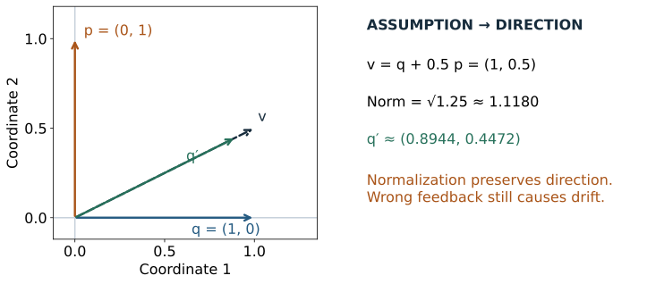
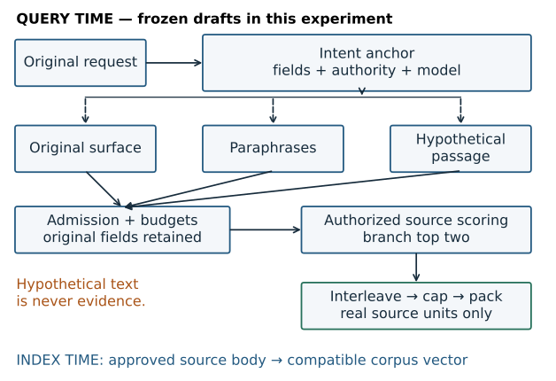
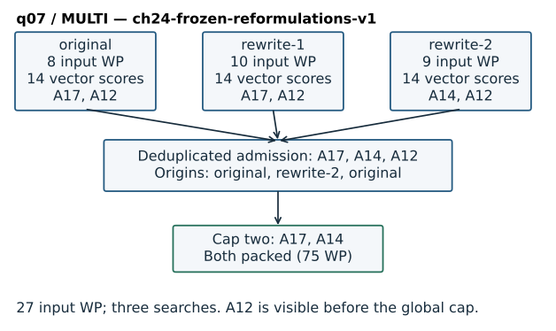
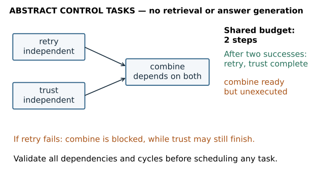
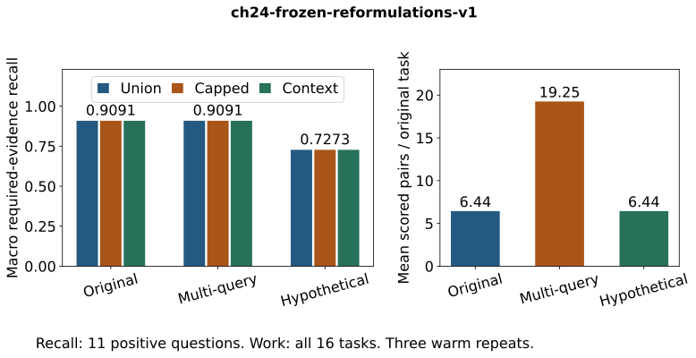

# Chapter 24 — Rewrite, expand, and decompose queries

**Part VI · Module 11 · [INTERMEDIATE]**, with [PRODUCTION] design extensions

**Prerequisites:** Chapters 09, 11–13 and 23. You can distinguish a judged relevant source from a similar candidate, inspect embedding inputs, run exact dense retrieval, and preserve a request's typed constraints through dispatch. Chapters 20–22 supply the source, permission and version machinery inherited by [V7](../projects/V7/README.md). Chapter 23's original request and interpretation contract remain binding.

**Objective:** Increase the opportunity to retrieve relevant evidence through alternative query representations, while measuring drift, candidate loss and additional work.

## 24.1 Correct constraints do not supply missing vocabulary

Imagine an engineer who asks for “credential rollover without leaving old secrets usable.” The runbook calls this “API key rotation.” An exact identifier would help if the engineer knew it. The entity filter can keep the search inside Orion's records, but it cannot supply the missing vocabulary. A dense model may connect the phrases; it may also emphasize the wrong relationship or confuse nearby operational procedures.

Chapter 23 repaired a different failure. It made the requested record, time interval and evidence operation explicit. An accurately interpreted request can still have an ineffective retrieval representation. We now hold that interpretation fixed and ask whether another representation finds useful candidates.

A **rewrite** replaces or restates a search representation. **Expansion** adds terms or representations. **Decomposition** makes distinct information requirements explicit. These are different operations. Three paraphrases of a retry question are alternative searches for one requirement; “retrieve the retry policy and the certificate policy” contains two requirements. Neither operation establishes that the retrieved material answers the question.

There is a practical temptation to accept whatever reformulation sounds most fluent. That changes a retrieval problem into an unobserved intent-editing problem. A rewrite from “HTTP 503” to “HTTP 429” may be beautifully written and precisely wrong. A hypothetical passage about billing can retrieve authentic billing records for a certificate question. The source can be real, authorized and current while being irrelevant.

Our progression is therefore: one interpreted original query → inspect a representation failure → propose bounded alternatives → enforce the original constraints → retrieve real source units → retain each branch's candidates → deduplicate and cap → inspect selected context. We will preserve a result in which the alternatives fail to improve recall. The ability to reject an unnecessary mechanism is part of retrieval expertise.

## 24.2 Reformulation changes what the retriever can match

### Lexical expansion and spelling variants

With lexical retrieval, an unindexed query term contributes no matching postings. An approved domain synonym map might connect `credential rollover` with `key rotation`. A spelling candidate might connect `credntial` with `credential`. An acronym dictionary might connect an established abbreviation with its documented expansion. These mappings need scope: an abbreviation can mean different things in different departments.

Query-time expansion sends more terms to the existing index. Index-time expansion attaches additional terms to documents and changes the indexed representation, corpus statistics, storage and rebuild contract. They are separate interventions. A query-time experiment should not quietly change document representations as well.

Adding terms is not equivalent to requiring them all. Under an OR-style candidate search, synonyms can broaden the candidate set. Under a strict intersection, adding a synonym can eliminate the desired document because it contains only one expression. With a scored bag of words, repeated or weighted terms can change the ranking. State whether expansion means optional alternatives, a weighted clause, an additional independent search, or a new hard requirement. The last interpretation is usually inappropriate for an uncertain synonym.

Protected atoms need a different treatment. A record ID, error number, quoted literal or source version can carry the entire information need. Maintain a field-specific contract for these values. A spelling model's confidence does not authorize changing them. For high-cost ambiguity, clarification can be more useful than searching a guessed identifier.

Our executable experiment uses alternative dense representations, including one corrected spelling. It does **not** implement a general spelling corrector, dictionary expander or lexical expansion benchmark. The distinction prevents an observed dense match from becoming a claim that a correction algorithm ran.

### Multiple paraphrases

Let the original query be q₀ and two proposed paraphrases be q₁ and q₂. Each is encoded and searched independently against the same eligible corpus. One might emphasize an action, another a documented technical term. Diversity is useful when it creates different opportunities to find the **same** required evidence.

Surface diversity is a weak proxy for retrieval diversity. Two very different strings may return exactly the same two passages. Two nearly identical strings may move an important document across the cutoff. Inspect candidate overlap and required evidence per branch. Counting generated strings tells us almost nothing about the extra evidence they supply.

Retaining the original as a search branch provides a measurable anchor. It does not guarantee that all its candidates survive a later global cap. We will make that loss visible rather than assume that adding a branch preserves the original ranking.

## 24.3 Feedback: useful geometry built on a fallible assumption

**Relevance feedback** uses judgments about initial results to revise a search. **Pseudo-relevance feedback**, or PRF, substitutes an assumption: treat a small leading set as relevant, extract useful terms or vectors, and search again. Its attraction is that the corpus supplies vocabulary. Its risk is that an initial mistake becomes the next query's center of attention. [Classical PRF and query drift](https://nlp.stanford.edu/IR-book/html/htmledition/pseudo-relevance-feedback-1.html).

Before implementing feedback, identify which objects supply it. Search only the authorized view, select feedback documents from that view, and preserve their source versions. Private passages must not influence a public query expansion, even when their text never appears in the final response. A permission check after feedback construction is too late.

One vector-space feedback mechanism starts with query vector q and document vectors of the same dimension d. A centroid is an elementwise mean, not a concatenation. With positively judged set P and negatively judged set N:

```text
μP = (sum of the vectors in P) / |P|     when P is nonempty
μN = (sum of the vectors in N) / |N|     when N is nonempty
v  = αq + βμP − γμN
```

Here |P| and |N| count documents; μP and μN each contain d coordinates.

The coefficients control the influence of the original and the two feedback sets. An empty set contributes a zero vector in our helper; it is never divided by zero. For cosine retrieval, normalize the result when its norm is nonzero:

```text
norm = sqrt(v₁² + v₂² + … + v_d²)
q′   = v / norm                       provided norm > 0
```

All additions are between vectors in the same representation space. Combining vectors from unrelated encoders is invalid even if their dimensions match. This is a normalized dense centroid demonstration inspired by Rocchio. Classical sparse term-weight implementations may clip negative weights; our signed dense coordinates are not clipped. [Rocchio's feedback mechanism](https://nlp.stanford.edu/IR-book/html/htmledition/the-rocchio71-algorithm-1.html).

**Worked geometry.** Let q = (1, 0), one assumed-positive vector be (0, 1), and α = 1, β = 0.5, γ = 0. Then v = (1, 0.5), its norm is √1.25, and q′ ≈ (0.8944, 0.4472). The revised query now assigns a positive dot product to the second axis. If that feedback passage is relevant, this movement may recover useful neighbors. If it describes the wrong topic, exactly the same arithmetic amplifies drift. Neither normalization nor a high similarity score validates the assumption.

If the update produces the zero vector, cosine direction is undefined. Reject the update or use an explicitly recorded original-query fallback. Do not divide by a tiny arbitrary constant and call the result a valid query. Our pure helper rejects zero, mismatched shapes, nonfinite inputs and negative coefficients. It computes no judgments and fetches no passages.

A lexical PRF variant can instead select expansion terms from top documents, discount common terms, and add a bounded number of weighted clauses. It must state feedback depth, term weighting, protected-field exclusions and how the revised ranking is evaluated. A dense centroid update is not a substitute for teaching that lexical mechanism. Both rely on an initial result set; both need an original-query comparison.

**Figure 24.01 — A feedback assumption becomes a geometric direction.** The two-dimensional construction shows the actual vector arithmetic above. It illustrates drift without claiming a retrieval benchmark result. [Editable source](../visuals/chapter-24/render_visuals.py).



*Alt text:* A horizontal original vector is combined with half a vertical feedback vector. Their sum points diagonally; normalizing changes length, not direction. A wrong feedback topic moves the query toward the wrong neighborhood.

## 24.4 Hypothetical passages and broader questions

### Hypothetical document embeddings

A short question may look unlike the passages that answer it. A **hypothetical passage** supplies document-like language: propose a plausible passage, encode it, then retrieve actual corpus documents using that vector. The passage is a query representation. Its statements have no evidentiary status.

HyDE is a specific research instance of this idea. It uses an instruction-following language model to produce a hypothetical document and an unsupervised contrastive encoder to find real corpus neighbors. The generated document can contain false details. The paper's encoder-based grounding intuition does not provide a general guarantee that false details have no effect on retrieval. [HyDE, ACL 2023](https://aclanthology.org/2023.acl-long.99/).

For one generated passage h, our conceptual retrieval query is the normalized vector E(h). The original question still controls eligibility, task fields and evaluation. If h invents an incident commander, deadline or protocol, its embedding may select documents about that invention. A real source selected through that process still needs relevance and support checks. Copying h directly into the answer's evidence list would bypass those checks entirely.

The controlled lab freezes **author-written** hypothetical passages and uses the existing MiniLM encoder. No language model generates them, and the author knows the fictional sources. This is a HyDE-style representation ablation, not a reproduction of HyDE's original system or a zero-shot result. Generator latency, output-token counts and monetary cost remain null because generation did not run. The actual embedding and source retrieval do run.

Freezing drafts makes the retrieval comparison inspectable. It also exposes a limitation: it does not measure how often a live generator invents useful or harmful passages. A later live experiment would need a registered prompt/model/version/sample policy, retained outputs in a governed plane, multiple stochastic samples and the same original-query judgments. It could not inherit this experiment's scores as its own.

### Step-back questions

A **step-back** question seeks a broader principle that may help solve a specific problem. For a certificate failure, a broader search might ask how certificate chains and trust stores work. The research technique uses abstraction to support reasoning; adapting it to retrieval means retrieving background under the broader question while retaining the original need. [Step-Back Prompting](https://arxiv.org/abs/2310.06117).

Background is sometimes necessary and sometimes distracting. “How does retrying work?” can return generic guidance that contradicts the specific HTTP code or tenant policy. Keep broad background and task-specific evidence distinguishable. A broad question must not erase source dates, IDs or permissions. In particular, background cannot establish which local procedure was effective during a requested historical interval.

Step-back prompting and corpus-driven PRF are taught as mechanisms here; neither is a fourth benchmark mode in the supplied experiment. We do not attach performance claims to an unrun mechanism.

## 24.5 Preserve intent outside the generated text

The search plan has two layers. The **intent anchor** retains the original request, trusted principal, typed record/entity/time constraints, source-authority state and embedding contract. The **representation** supplies terms or encoder input. Representations may vary; changing the anchor requires a new interpretation or clarification.

The local policy binds each proposal to a digest of these anchor fields. Before admission it checks that digest, then checks a deliberately narrow set of protected atoms: record-like IDs, the two recognized entity names, and explicit numeric tokens. It rejects a newly introduced or differently cased record ID, a conflicting known entity, or a new number. This is a bounded fixture policy, not a general semantic equivalence classifier. Other entity names, negation, relationships and unstated intent can escape it.

Omitting an entity word from a paraphrase does not remove the typed entity filter. Similarly, a date-free paraphrase can search inside the original half-open publication interval because the interval travels separately. This is why we do not re-run the interpreter on child text and use its newly inferred fields. That would permit a child to mutate the task it is supposed to serve.

Digest equality detects inconsistency against a trusted expected value. It is not a signature, authentication or anonymization. The query, principal and source state still require ordinary access control. Replacing the expected digest after changing a draft is a new experiment review, not a repair for an inconvenient check.

Admission is also bounded. Our original reserves one branch; multi-query admits at most two additional representations. It deduplicates normalized, casefolded **comparison keys**, while retaining actual input text. It limits the combined accepted inputs to 128 whitespace-delimited words. A separate runtime limit charges at most 192 **encoder WordPieces including special tokens** across executed branches. Each encoder input must fit the existing 256-WordPiece limit without truncation. Words and WordPieces are different units; neither is an answer model's token accounting.

Checks have declared precedence: anchor mismatch → protected-atom change → duplicate → branch budget → word budget. Runtime encoder-budget rejection is recorded separately. A rejected hypothetical passage falls back to the original. An original that itself exceeds a required budget fails explicitly. A count request that the inherited router cannot execute does not become answerable because a paraphrase looks searchable.

**Figure 24.02 — The anchor controls every representation and every evidence fetch.** Only real source units can enter context. Proposal generation is conceptual; the controlled experiment reads frozen drafts. [Editable source](../visuals/chapter-24/render_visuals.py).



*Alt text:* At query time the original produces an immutable task anchor. Frozen representations pass admission and share that anchor. Authorized, version-selected source units are scored, shortlisted and packed. Hypothetical text has no path into context. At index time, approved source bodies already supplied the corpus vectors.

## 24.6 Fan-out is an opportunity; admission is a loss boundary

Suppose each of b branches returns at most kᵢ candidates, where i identifies the branch. The union contains at most the sum of those kᵢ values in distinct IDs and often fewer because branches overlap. An unsaturated union can only gain IDs when another branch is added. A capped output does not have that monotonic property.

Consider this hand example with two branches and a global cap of two:

```text
Original:  x(.70), z(.60)
Rewrite:   y(.95), x(.80)
Round 1:   x from Original, y from Rewrite
Round 2:   z from Original; duplicate x is skipped
Admission: x, y, z
Final:     x, y                 (cap = 2)
```

The numbers are branch-local similarities, not judgments. If `z` is the required evidence, the original Recall@2 is one, union recall remains one, and capped recall becomes zero. The policy has lost evidence despite retrieving an unchanged original branch. If `y` is required, the same policy may help. Only frozen judgments tell us which case applies.

Our reference policy uses **stable round-robin interleaving**: take rank one from each branch in declared order, then rank two, deduplicate by immutable unit identity, and retain the first occurrence's branch provenance and score. Apply the global cap after retaining the full deduplicated admission sequence. The first occurrence's score is an actual measurement; it is not a newly computed merged relevance score. We never sort this sequence by those scores.

This is a deliberately simple scheduling baseline. A .9 from one representation does not automatically mean more relevance than a .7 from another representation, even with a shared encoder. Query-dependent score distributions differ. Chapter 25 will examine hybrid retrieval and fusion. Here we need a visible merge policy so that we can study representation changes without pretending to have solved cross-list ranking.

The production consequences start early. Candidate fan-out consumes scoring work, encoder work, downstream reranker capacity and context competition. Parallel searches can reduce elapsed time while increasing total resource use. Cancellation, deadlines and partial completion must be explicit: a late branch should not silently update an answer after its context was frozen.

**Figure 24.03 — Actual fan-out, branch work and merge loss for q07.** The diagram reads the checked `ch24-frozen-reformulations-v1` record and snapshot. WordPieces include encoder special tokens on inputs; context uses source-body tokens without specials. [Editable source](../visuals/chapter-24/render_visuals.py).



*Alt text:* Original, rewrite-1 and rewrite-2 consume eight, ten and nine input WordPieces. Repeated A17/A12 candidates are deduplicated. The full admission order is A17, A14, A12; the cap retains A17/A14, which both fit in seventy-five context WordPieces. Branch work is preserved even when its candidate does not survive.

## 24.7 Decomposition: requirements form a dependency graph

Decomposition begins by naming the information requirements. “Find Orion's retry policy and its certificate recovery policy” has two independent searches. Both can start from the original entity constraint. “Find the owner named in this incident, then retrieve that owner's escalation policy” has a dependency: the second query requires an entity discovered in the first result.

Represent a plan as tasks connected by directed prerequisite edges. A **directed acyclic graph**, or DAG, has no route following edge directions back to the same node. A task is ready when every predecessor completed successfully and its required output slots exist. Merely starting a predecessor does not satisfy a dependency. A failed predecessor blocks its dependent tasks unless a declared recovery policy supplies an alternative.

Topological execution repeatedly takes ready tasks. With tasks `retry`, `trust` and `combine`, where `combine` depends on both, the initial ready set is `{retry, trust}`. After completing only `retry`, `trust` remains ready and `combine` does not. After both complete, `combine` becomes ready. A cycle or an edge to a missing task is a planning error, even if another disconnected task could run.

An implementation can validate this by removing successive zero-unmet-dependency layers. If unfinished tasks remain and no layer is available, the graph contains a cycle. With V tasks and E edges, an adjacency list with maintained indegrees supports validation and topological ordering in O(V + E) time and space. The tiny reference uses repeated set scans for readability, with a worst case of O(V(V + E)); it is a bounded teaching scheduler, not a production planner.

Task-local slots require careful scope. A record ID anchoring the root publication search must not automatically constrain a child search for the owner discovered there. The tenant and current authorization remain global boundaries; source-specific fields may belong to one task. Derived slots need the actual source/locator/version that supplied them. An invented hypothetical owner cannot satisfy a dependency that requires observed evidence.

Budgets apply to the whole plan. Two independent searches and one combining task require at least three abstract steps. With a shared step budget of two, the scheduler must report partial completion with `combine` still ready. Giving every child the full parent budget turns a bounded plan into uncontrolled multiplication. Branch count, total tokens, monetary allowance and deadline are related but different constraints.

Our second registered workload runs four **scheduler controls**: budget exhaustion, a failed prerequisite, a cycle and a missing dependency. It marks abstract tasks complete and records readiness. No source retrieval, evidence-derived slot, combining answer or multi-hop correctness is produced by these controls. The readiness mechanism is useful now; evidence-dependent retrieve–reason–retrieve execution belongs to Chapter 35.

Stopping can mean that all required tasks completed, no task can progress, a budget expired, a required tool failed, or clarification is needed. “The query sounds complete” is not a measurable stop rule. Offline qrels are for evaluation and must not tell the runtime when it has enough evidence. A partial result must name the unfulfilled requirements; it must not be relabeled a complete answer.

**Figure 24.04 — Dependency readiness and a shared budget.** Two independent tasks can complete while their combining task remains unexecuted. [Editable source](../visuals/chapter-24/render_visuals.py).



*Alt text:* Retry and trust tasks each precede combine. Initially both are ready. Two completed abstract tasks exhaust budget two. Combine is then ready, not completed; a failure of retry would instead block combine. This is scheduler state, not retrieved evidence.

## 24.8 Construct the bounded mechanism before reading its reference

Complete **A0** in the [lab](../labs/chapter-24/LAB.md) now. Implement proposal admission and dependency readiness in [starter.py](../labs/chapter-24/starter.py), then run the fresh construction checker against your own file. Neither importing the reference nor reproducing its output earns implementation credit. Explain a case in which every atom check passes but intent still drifts.

The construction contract is intentionally smaller than a production query agent. You receive pre-extracted protected atoms, exact anchor values and valid input structures. You must implement the ordering, duplicate handling, shared budgets and graph validation yourself. First predict the checker's outcome on paper; then execute it. Afterward compare with the separate solutions and add one unseen fixture of your own.

With that attempt complete, inspect the [reference mechanisms](../projects/V7/reformulate_ch24.py). The admission loop performs the checks in the stated order. The interleaver consumes rank positions without comparing cross-branch scores. The scheduler validates the entire graph before returning readiness, and its failed-dependency closure prevents a descendant from being executed on missing evidence. The centroid helper implements the arithmetic in §24.3 explicitly.

The [retrieval implementation](../projects/V7/retrieval_ch24.py) then connects these mechanisms to V7:

```text
interpret original; retain original task and current source authority
admit bounded representations against that anchor
construct current-authorized, version-selected view
apply original task predicates before scoring
for each admitted branch within shared encoder budget:
    exact-score eligible vectors; retain full pool and top two
interleave shortlists; retain admission order; cap at two
recheck current permission before original-version forward fetch
pack real source units under shared context budget
record parent, children, losses and unrun stages
```

This experiment holds the backend dense for all three modes, even when Chapter 23's router prefers lexical retrieval for an ID. That deliberate ablation isolates representation choice. It does not establish that dense retrieval is the appropriate production route for exact identifiers, and it does not replace Chapter 23's rule-route baseline.

The reference distinguishes a successful empty task from a failed branch. An unauthorized or deleted hard ID yields no eligible task units and zero searches; it does not trigger semantic broadening. One injected branch timeout can leave a marked partial result from the remaining branches. All failed branches leave context unrun and null. Integrity, contract or permission errors raise and retain redacted correlated errors; they are not semantic retry signals. Unit tests exercise these controls without turning injected exceptions into a service-latency benchmark.

## 24.9 Experiment: alternative representations do not earn automatic promotion

### Question, labels and controls

**Workload `ch24-frozen-reformulations-v1`.** Does bounded reformulation recover required source evidence under the original constraints, and what work does it add?

The corpus contains 28 immutable source-version capsules: the eighteen Chapter 23 capsules plus ten new, book-authored operational fixtures. There are 25 logical source heads, including the retained tombstone. New fixtures cover retry, credential rotation, restoration, billing, approval, certificates and audit history, plus separate tenant/admin controls. Licensing, indexing permission, retention, canonical source maps and role metadata are validated before ingestion reads. The source manifest and descriptor digest bind this extension.

Sixteen original questions are frozen with principals and independent targets. Eleven positive questions require twelve inspected source units, including two separately identified publications. Three tasks require empty evidence; two have interpretation guard labels. The positive duration query inherited from Chapter 23 remains answerable by its source even though the coarse count rule rejects it. It stays in the positive-recall denominator.

These are inspected positive source spans, not an exhaustively judged corpus or a graded ranking pool. We therefore report required-evidence recall rather than claim that every unlisted candidate is irrelevant. A false topic shift can be diagnosed against the inspected requirement without pretending to know corpus-wide precision. No train/dev/test split, generalization estimate or zero-shot performance is claimed.

The author froze all paraphrases, hypothetical passages and their prompt specification before running embeddings or rankings. The author also wrote and knows the fictional sources. This source-aware preparation is a limitation, not a substitute for independent query generation. Invalid IDs/numbers, duplicates, a surplus branch and plausible same-entity topic drift are retained in the frozen file.

The baseline searches the interpreted original surface. Multi-query searches it plus at most two admitted paraphrases. Hypothetical mode searches one admitted author-written passage, falling back to the original on rejection. All modes use the same source authority, original typed constraints, pinned body-only MiniLM contract, exact dot-product scorer, branch depth two, global candidate cap two and context budget eighty encoder WordPieces. The query-encode inputs are measured once and frozen; search repeats use those prepared vectors.

### Results and their denominator

The [checked record](../projects/V7/chapter-24-experiment.json) contains three warm repeats with query/method order shuffled using seed 24014. Repeated rankings are deterministic; repeated trials are timing observations, not additional independent questions.

**Table 24.01 — Paired representation results, workload `ch24-frozen-reformulations-v1`.** Recall is macro-averaged over eleven positive original questions. Work averages include all sixteen tasks, including zero-search guards and required-empty tasks.

| Measure | Original | Multi-query | Hypothetical passage |
|---|---:|---:|---:|
| Required-evidence union recall | .9091 | .9091 | .7273 |
| Required-evidence Recall@2 | .9091 | .9091 | .7273 |
| Required-evidence context recall | .9091 | .9091 | .7273 |
| Actual search branches per original task | .6250 | 1.8125 | .6250 |
| Scored query–unit pairs per original task | 6.4375 | 19.2500 | 6.4375 |
| Charged encoder WordPieces per task | 7.3125 | 18.8750 | 11.6250 |

The original finds all required units for ten positive questions and misses the duration query: 10/11 ≈ .9091. Multi-query ties that recall with roughly 19.25/6.4375 ≈ 2.99 times the scored pairs. Hypothetical mode additionally misses `q06` and `q07`, yielding 8/11 ≈ .7273. Keeping the negative result is the correct experimental outcome. None of these results is a longitudinal improvement over Chapter 23, whose corpus and questions differ.

Notice the experiment's **headroom limit**. All ten positive questions that reach retrieval already have full required recall under the original. The remaining positive is stopped upstream by the fixed interpreter. Thus .9091 is the maximum macro recall available to any representation policy under these controls. The multi-query tie measures extra work and candidate changes at that ceiling; it cannot establish an inability to repair a retrieval-stage vocabulary miss. A follow-up experiment needs independently frozen, correctly interpreted positive questions that the baseline actually misses at retrieval. Do not manufacture that headroom by editing this workload after seeing its results. The deliberately faulty frozen passages likewise illustrate failure mechanisms rather than estimate a live generator's error frequency.

All modes correctly retain empty evidence for three required-empty tasks and make the expected decision on both labeled guards. Across all sixteen intended outcomes they score 15/16: the duration false trigger remains. This is a query-control measure, not generated abstention correctness.

There is no additional loss of **required** evidence between the branch union, cap and packed context on this workload. This does not make those boundaries harmless. For `q07`, original retrieval returns A17 and A12, but only A17 fits the whole-unit packing decision under budget eighty. A12 is not the inspected requirement for this question; required context recall stays one. The trace still retains the actual packing loss.

### Inspect two failed hypotheses and one unchanged baseline

For `q06`, the user asks who has final say over Orion rollback. The inspected requirement is A16, naming the incident commander. The original top two are A16 and A07. The hypothetical passage instead emphasizes a signed approval, waiting period and coordinator. It returns A06 and A01. Those are authentic waiting-period records; they do not supply the required authority evidence. No protected ID or number changed, so the atom guard admits the passage. Semantic role drift survives syntactic checks.

For `q07`, a certificate-renewal question receives a deliberately wrong billing hypothetical passage. The passage retains Orion and passes the narrow guard. It returns A14 and A05, losing required A17. Multi-query still retains A17 but admits A14 as its second candidate, replacing the original's A12. A broader candidate set has changed context composition without increasing required recall. This is a reason to inspect candidate identity and support, not just one aggregate.

For `q09`, the hypothetical passage changes HTTP 503 to HTTP 429 while retaining A11. Admission rejects it, records the reason and uses the original. Every actual scored candidate remains inside A11's original hard field. The guard protects this explicit constraint; it cannot prove equivalence of arbitrary text.

The duration query `q16` never reaches rewriting or scoring. Its source target A09 remains in the labels, and its context is null. Query expansion downstream cannot repair an upstream “unsupported count” decision. Altering that classifier would be a separate, reviewed intervention. We preserve Chapter 23's failure rather than patch it while claiming a reformulation gain.

**Figure 24.05 — More work with no recall gain.** This plot uses the checked paired record and keeps union, capped and context recall distinct even where they coincide. [Editable source and input record](../visuals/chapter-24/render_visuals.py).



*Alt text:* On workload ch24-frozen-reformulations-v1, original and multi-query have recall 0.9091 at all three boundaries; hypothetical passage has 0.7273. Mean scored pairs are 6.4375, 19.25 and 6.4375. The extra work does not earn higher required-evidence recall.

## 24.10 Cost, observability and failure localization

### Measure work and elapsed time separately

Exact retrieval over n eligible vectors of dimension d costs O(nd) scoring per branch, plus sorting in this reference implementation. Across b branches this becomes O(bnd + bn log n), before encoding, generation or context work. A top-k heap could reduce selection work; it would not remove the extra vector scores. Storing retained full pools costs O(bn) diagnostic entries in this small experiment. Production telemetry needs governed sampling or bounded pools while preserving the stages required to diagnose the declared cutoff.

Shortlist interleaving examines at most the sum of the branch depths kᵢ and uses a set for deduplication. Its time and memory are linear in that retained input size. The exact source-unit ID deduplication does not merge paraphrased documents, duplicate entities across sources or different versions. Those identities have distinct provenance and may matter to the question.

For sequential searches, a request's retrieval time is approximately the sum of actual branch times plus orchestration overhead. With concurrency, the critical path can approach the slowest branch, subject to shared capacity and queuing. Total work still accumulates. A useful cost model separates proposal generation, input encoding, retrieval, reranking and answer generation. If token prices are used, state the dated price/model and actual token counts; do not assign a fictitious price to this offline non-generative run.

**Workload `ch24-frozen-reformulations-v1` timing:** original/multi/hypothetical warm dense-search p50 is .2325/.7232/.2534 ms; p95 is 1.4847/4.5759/1.5601 ms. These are sums of measured Python exact-scoring/sorting branches with prepared query vectors. They include zero-search tasks and exclude request-time encoding, proposal generation, context packing, serialization, network, queuing and answer generation. Tiny local timing differences are not production service promises. The record retains other stage timers separately.

### Correlated branches explain a miss

Every parent and executed child retains the common request/query/mode/trial/workload and source/query/qrel/index/model identities. Child frames link to their parent and actual prepared-encoding sample. Raw scored pools and branch top-two IDs/scores remain available. The parent retains flattened raw scores with parallel branch IDs, full deduplicated admission with origin branches, capped candidates and actual context IDs. Duplicate raw IDs across branches are valid; their measurements came from different inputs.

Read the trace in order. Did the original interpreter stop the request? Did admission reject a proposal? Did current eligibility or the original predicate exclude the target? Did a branch score it but lose it at its shortlist? Was it present in the branch union but removed by admission/cap? Did whole-unit packing omit it? Was a branch failed rather than empty? Each question has a different remedy. Increasing the number of paraphrases is not a universal fix.

Do not infer which branch ran from final candidates. A successful branch may contribute no final ID; a duplicate may be owned by an earlier branch with a different score. Neither event means that the branch did no work. The parent reports both branch IDs and scored-pair counts. No merged relevance score is invented, and unrun generator fields are null.

Ordinary frames omit raw query, proposal, source text, principal values and exception text. Original questions, source capsules and frozen drafts live in the restricted instructor/evaluation plane. IDs, hashes and candidate traces can still reveal sensitive relationships; they need access control, retention limits and tenant isolation. The combined fictional record is not a template for exposing other tenants' logs to a learner.

### Guard the representation path as carefully as the evidence path

A live proposal generator may receive sensitive queries. Corpus-based feedback can add protected source text. Treat either transfer as a governed data flow before calling a remote service. Retrieved text can also contain instructions attempting to redirect rewriting. It remains untrusted content; it cannot change principal, tool permissions or the original typed constraints.

Do not share semantic-cache entries merely because two rewrites look similar. A valid key must include the effective tenant/role policy, original task constraints, source-authority/generation identity, model/input contract and representation policy. Similarity is not permission or exact intent equality. Retention or licensing changes can invalidate the right to reuse a cached expansion even if its vector remains technically compatible.

No-result detection also remains separate from confidence. An empty authorized task is not permission to broaden into another tenant or deleted record. A low top similarity is not a calibrated probability that retrieval failed. The supplied system has no learned retrieval-confidence score, answer-confidence score or adaptive “enough evidence” classifier. Its stopping rules are explicit budgets and control outcomes.

## 24.11 Lab and the V7 checkpoint

Complete the [lab](../labs/chapter-24/LAB.md), including independent construction, hand calculations, paired replay, one failure diagnosis and a defended policy decision. [Separate solutions](../solutions/chapter-24-solutions.md) provide reasoning and the bounded reference. Running the supplied experiment is evidence that the reference executes, not evidence that you implemented the mechanism.

The [project checkpoint](../projects/V7/README.md#chapter-24--bounded-reformulation-checkpoint) adds a new corpus extension, frozen original questions, source-bound requirements, source-aware drafts, a digest-bound body/query snapshot, admission/interleaving/readiness mechanisms and correlated branch traces. V0–V6 and the Chapter 23 code, vectors, judgments and result remain unchanged. Every new metric names the registered workload; the old exact baselines remain valid on their own workloads.

For `ch24-decomposition-budget-v1`, retain all four control envelopes. A budget stop is partial, a failed prerequisite blocks descendants, and malformed graphs reject before execution. There are no retrieved candidates or generation metrics in this workload. Do not combine its control states with the main workload's relevance denominator.

The reproducibility gate validates reviewed source/draft/query identities, restores actual vectors under an independently expected snapshot digest, and replays all 48 query/method outcomes through raw pools, intermediate pools, scores, provenance and ordered context. Tests cover authorization, original predicates, immutable historical artifacts, budgets, stale labels, guard decisions and redacted error frames. Chapter 25 remains unstarted.

## 24.12 Module 11 checkpoint: representations answer to the original need

Close the book and draw: original request → surface and typed intent → bounded representations → eligible task view → branch scores/shortlists → deduplicated admission → cap → source-version forward fetch → packed context. Add the query-time budget and the index-time source-vector boundary. Mark where the duration false trigger stops `q16` and where the wrong hypothetical passage loses `q07`.

Then answer these questions without executing code:

1. Why can PRF improve vocabulary and amplify an initial mistake using the same arithmetic?
2. Which fields may a paraphrase omit while the original task constraint still survives?
3. How can union recall stay constant while capped recall decreases?
4. Why is a first-occurrence similarity not a merged relevance score?
5. Which dependency edges make two searches sequential, and which permit concurrency?
6. What evidence would justify promoting multi-query retrieval after this negative experiment?
7. Why does a null generator-cost field differ from a zero-cost generator call?
8. Which new experiment is required before claiming that a live hypothetical-passage generator improves retrieval?

**You understand this chapter if you can** implement bounded admission and readiness on a fresh fixture; compute and explain a centroid update; distinguish spelling, expansion, paraphrase, hypothetical passage and decomposition; trace a miss across every candidate boundary; and reject additional work when its judged benefit is absent.

For a design interview, propose a query policy for an incident service with a strict deadline and tenant-separated sources. State original and child constraints, shared resource limits, partial-result semantics, trace fields and an offline comparison. A list of framework components is not an answer. For delayed recall, explain two days later why the wrong hypothetical billing passage can retrieve valid documents yet fail the certificate information need.

This ends Module 11, not Part VI; the required Part-level cumulative assessment belongs at Chapter 27. The next chapter will motivate hybrid retrieval and fusion from different candidate lists and incomparable scores. Stop here before opening or authoring it.

### Further reading

- **CORE after §24.3:** [PRF](https://nlp.stanford.edu/IR-book/html/htmledition/pseudo-relevance-feedback-1.html) and [Rocchio](https://nlp.stanford.edu/IR-book/html/htmledition/the-rocchio71-algorithm-1.html). Identify assumed versus judged feedback and sparse versus dense update conventions.
- **IMPORTANT after §24.4:** [HyDE](https://aclanthology.org/2023.acl-long.99/). Draw the generated-representation and real-corpus paths; distinguish its actual model/encoder/evaluation from this controlled ablation.
- **OPTIONAL after §24.4:** [Step-Back Prompting](https://arxiv.org/abs/2310.06117). Identify the abstraction mechanism and the evidence needed to transfer a result to a new retrieval workload.

Primary sources checked 2026-10-14. The [paper path](../PAPER_READING_PATH.md) supplies later dependencies; the [frontier register](../FRONTIER_RESEARCH.md) keeps evolving policy research separate from this stable mechanism.
